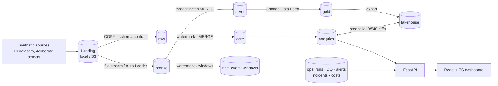
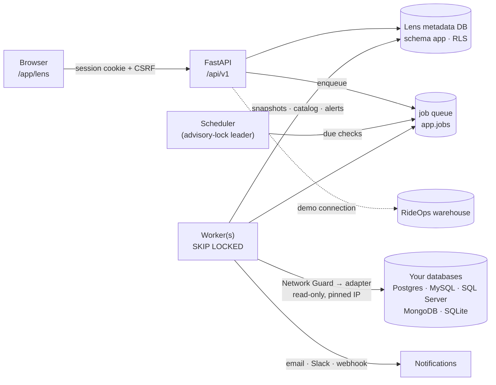
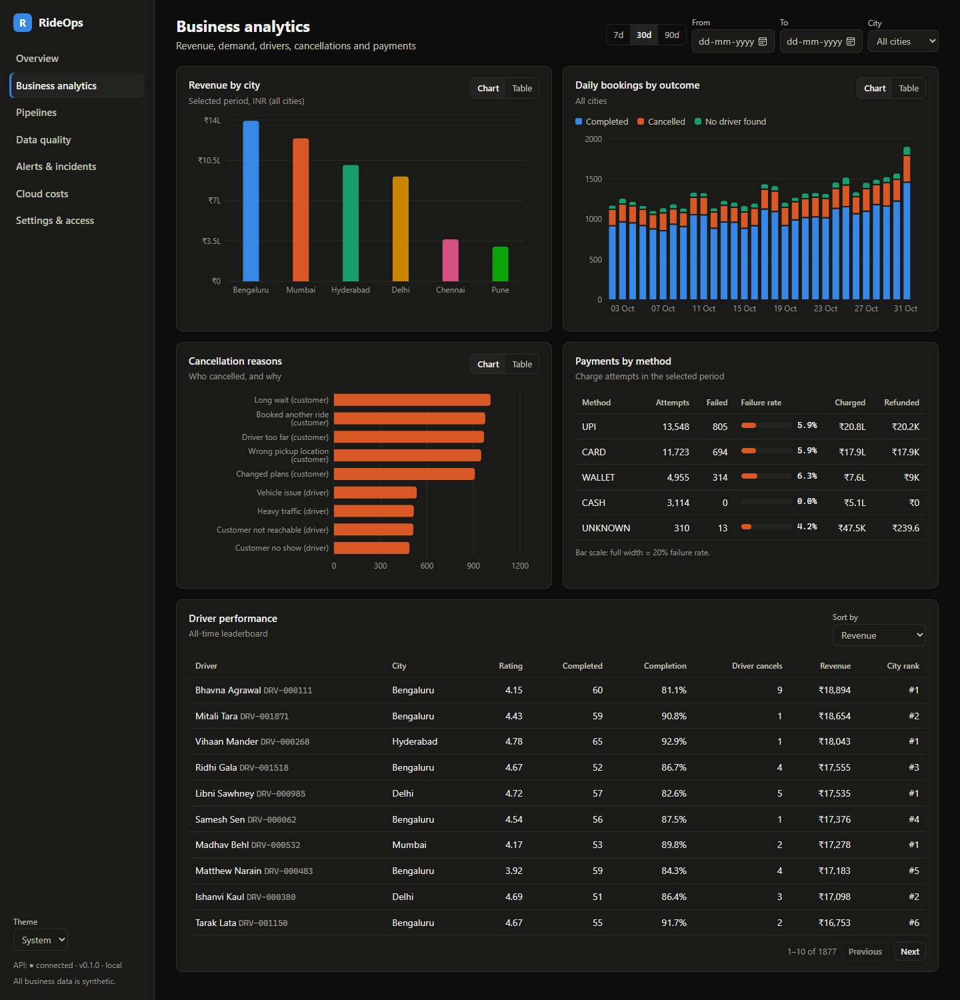
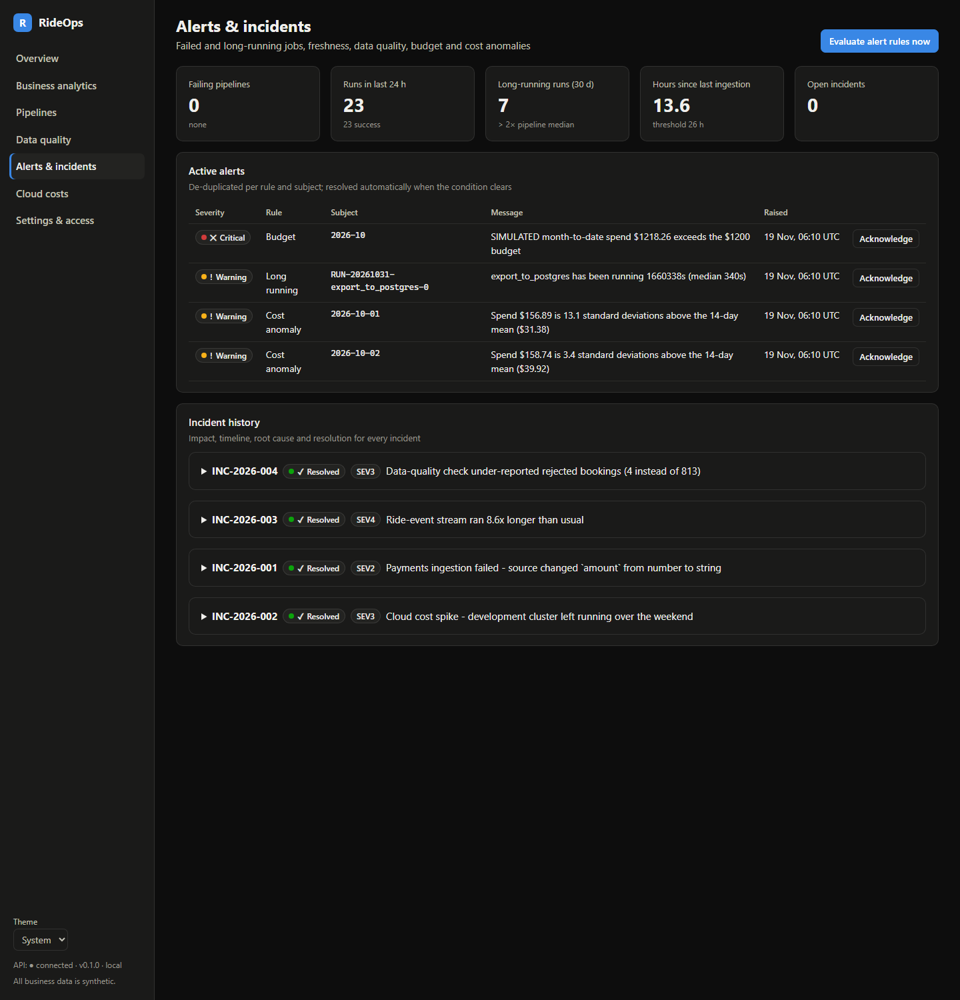
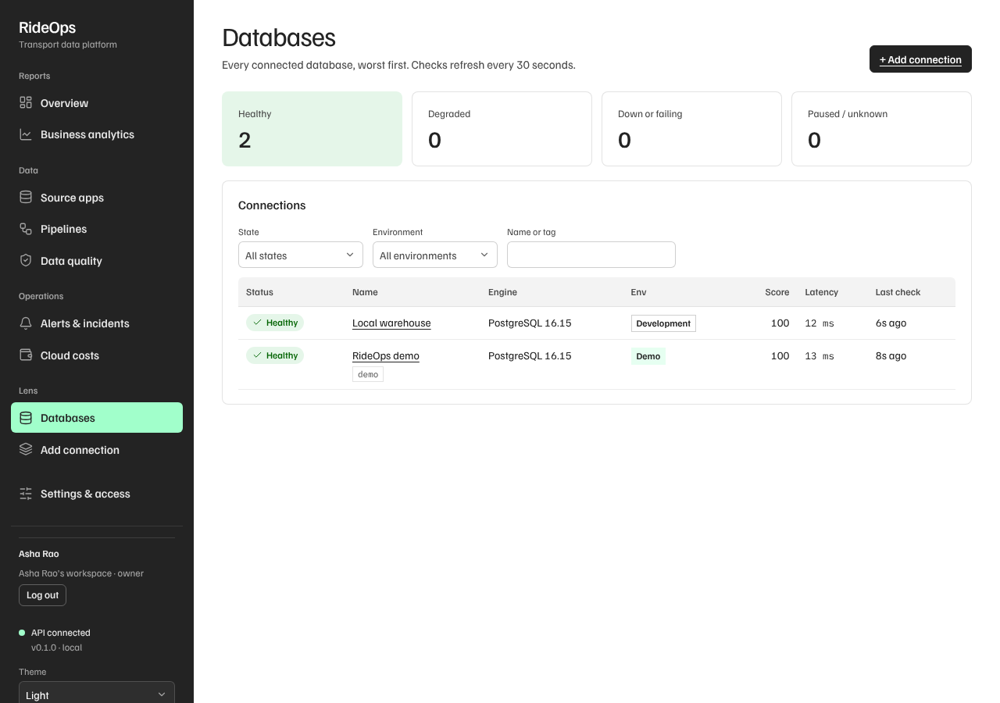
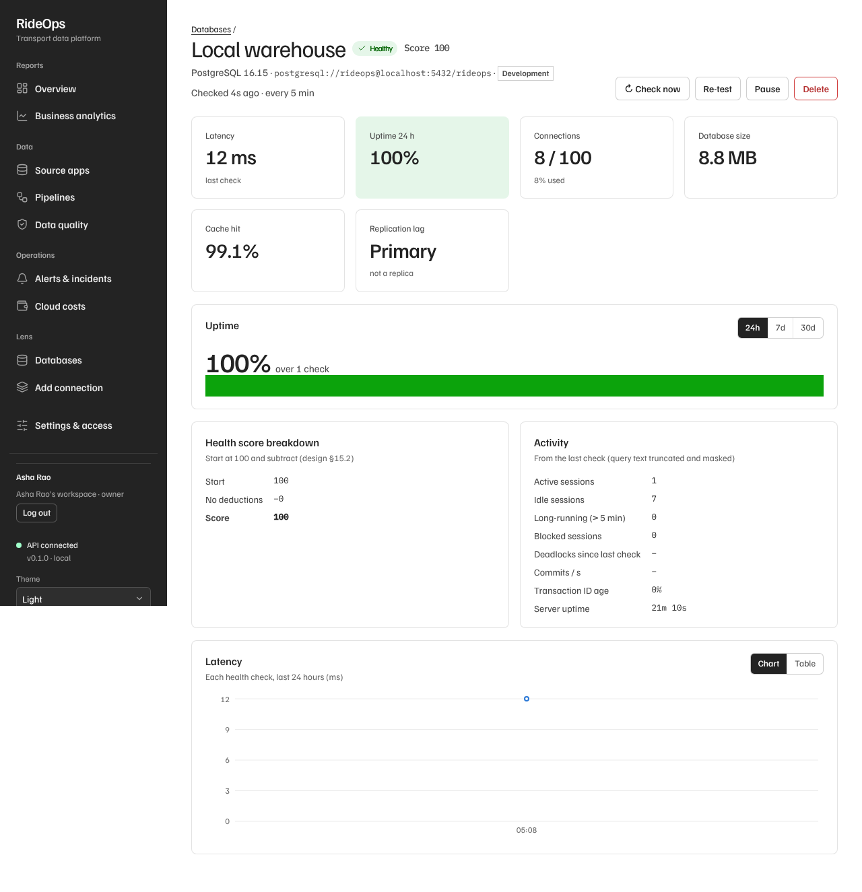
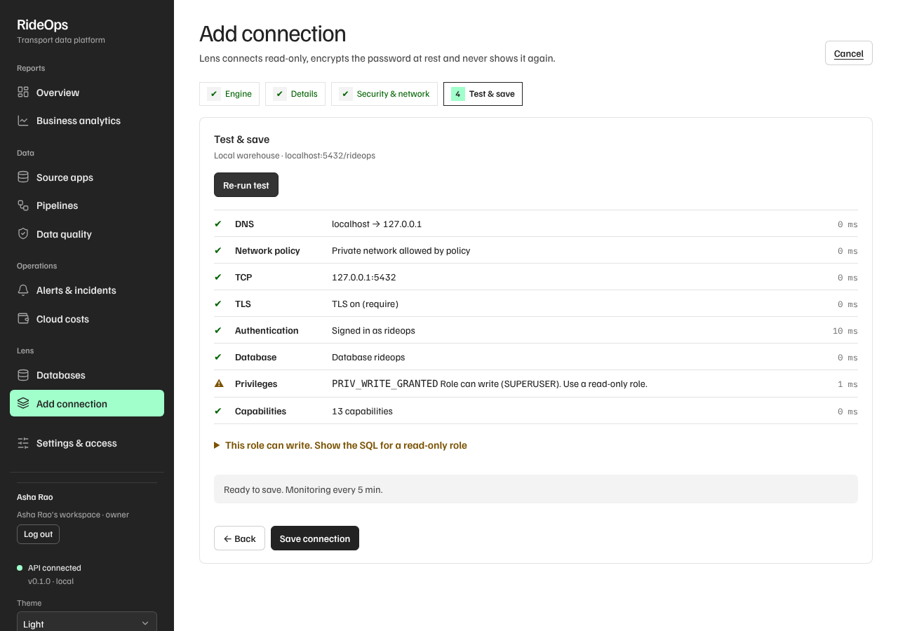
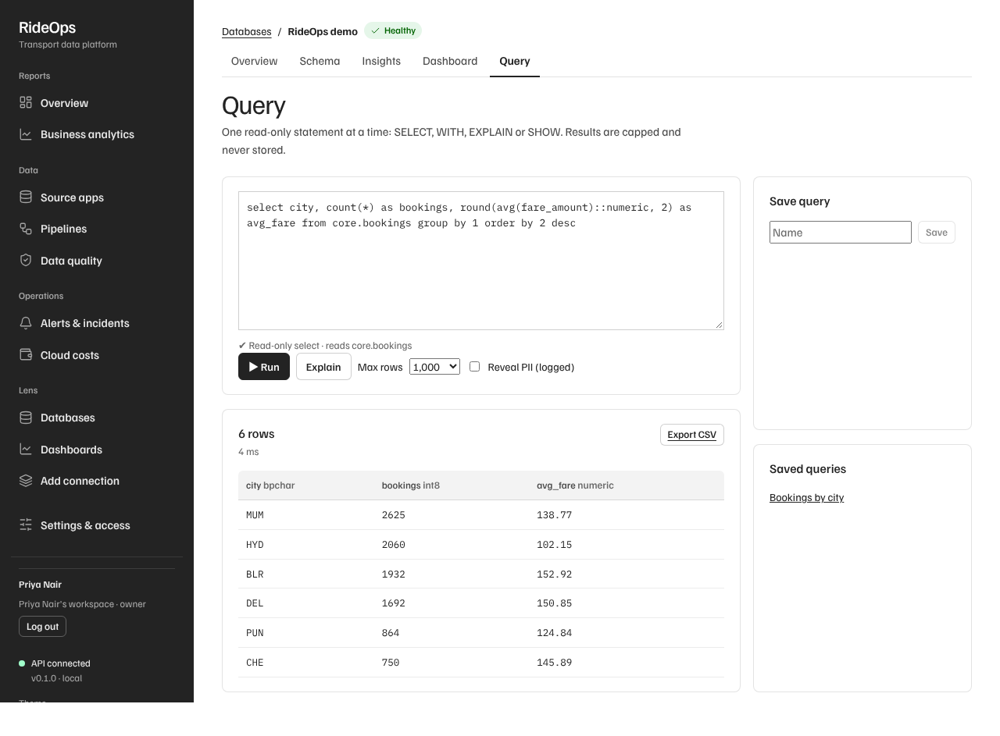
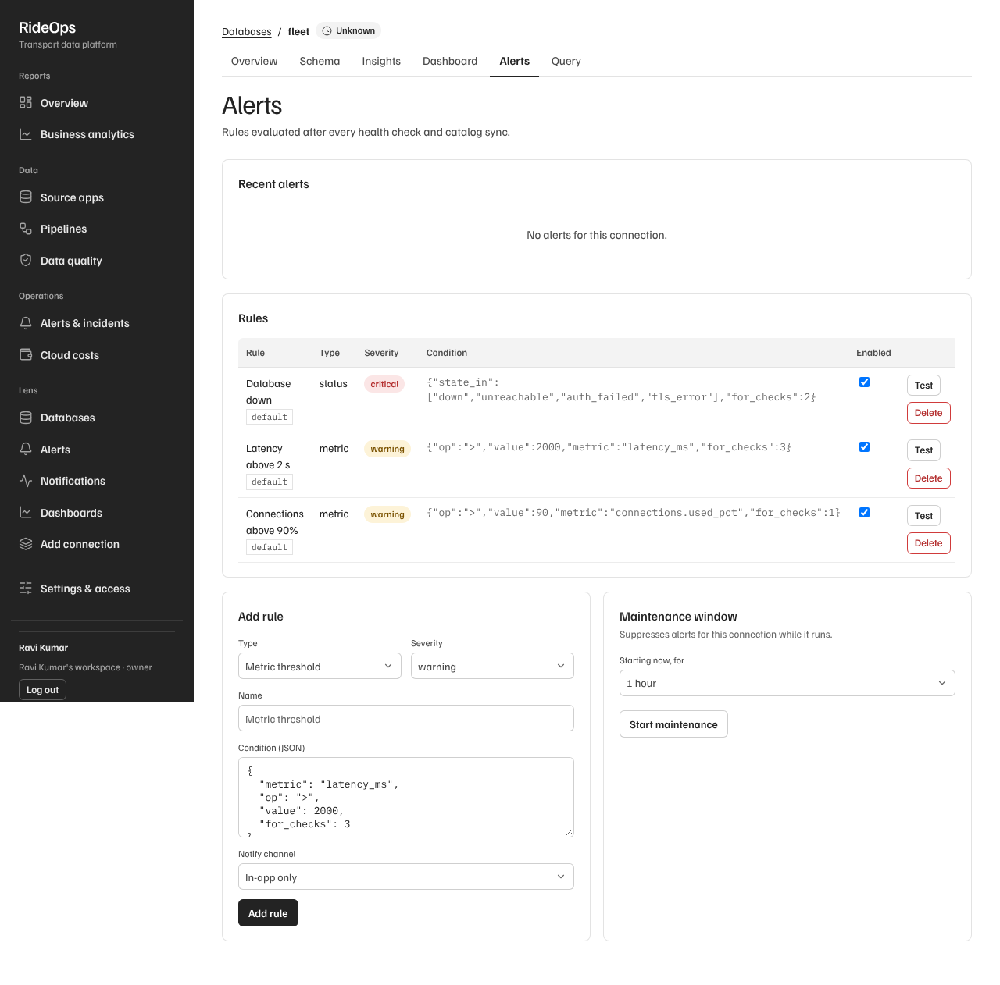

# RideOps — Data Engineering Platform + RideOps Lens

RideOps has two parts that share one API and one web app:

1. **The RideOps data platform.** An end-to-end platform for a **fictional** ride-booking company operating in
   six Indian cities. Synthetic operational data flows through **two independently implemented pipelines**:
   a PostgreSQL SQL warehouse and a PySpark + Delta Lake medallion lakehouse, and the two reconcile exactly.
   A dashboard shows business analytics next to pipeline monitoring, data quality, alerts, incidents and
   cloud costs.
2. **RideOps Lens.** A multi-tenant SaaS layer on top: users sign up, create workspaces and **connect any
   database by URL** (PostgreSQL, MySQL, SQL Server, MongoDB, or an uploaded SQLite file). Lens monitors each
   one's health and uptime, explores its schema, profiles tables, runs read-only queries, builds dashboards
   and sends alerts. The RideOps warehouse is the built-in read-only **demo connection** in every new workspace.

Lens is **opt-in** (`LENS_ENABLED=true`). With it off, the app behaves exactly like the original data platform.

> All business data is **synthetic**. All cost figures are **simulated** and labelled as such, unless loaded
> from a real AWS Cost and Usage Report. Cloud components (AWS, Databricks, hosting) are written and
> validated but **not deployed to real accounts**; see [Known limitations](#known-limitations).
> Progress and verification evidence: [PROJECT_STATUS.md](PROJECT_STATUS.md).


## The business problem

RideOps generates bookings, payments, ride and app events, driver and customer data, pipeline logs and
cloud bills. The data team must:

- ingest it reliably, whether it arrives as batch files, from an API, or as a stream, incrementally and exactly once;
- turn messy raw data (duplicates, nulls, bad formats, orphan keys, late events) into trusted tables;
- answer business questions: revenue by city, demand peaks, driver performance, cancellations, payment failures;
- know when pipelines fail, run long, receive bad data or go stale, and fix it fast;
- know what the platform costs, and get warned before the budget is blown.

## Architecture



How Lens fits in (one FastAPI service; the worker and scheduler can run in the same process or separately):



Details: [architecture](docs/architecture.md) · [data flow](docs/data-flow.md) ·
Lens design: [system design](docs/ReContruction/lens-system-design.md), [wireframes](docs/ReContruction/lens-wireframes.md).

## Repository layout

Each top-level folder is one deployable part of the platform, with its own README:

```
rideops-data-platform/
├── pipelines/              Data engineering: Python package `rideops`              → pipelines/README.md
│   ├── src/rideops/        generators · ingestion · db (SQL pipeline) · spark (lakehouse)
│   │                       quality · monitoring · costs · storage · utils · config
│   ├── sql/                ddl · transform · analytics (45 queries) · quality
│   ├── tests/              unit · integration (PostgreSQL) · spark · fixtures
│   └── Dockerfile          Spark runtime (Python + Java 17 + PySpark + Delta)
├── backend/                REST API: Python package `rideops_api` (FastAPI)          → backend/README.md
│   ├── src/rideops_api/    main · routers/ · schemas · db pool · errors · retry runner
│   │                       Lens: auth/ · workspaces/ · jobs/ · lens/ (connections, adapters,
│   │                       security, status, catalog, profiling, queries, insights, alerts)
│   │                       notifications/ · migrations/ (Alembic, schema `app`) · hardening
│   ├── tests/              API tests against a throwaway PostgreSQL database; tests/lens/ for Lens
│   └── Dockerfile          production image (non-root, health check, migrates when Lens is on)
├── frontend/               Landing page (index.html, design kit in public/assets) and the
│                           dashboard at /app (app/index.html; React + TypeScript + Vite in src/;
│                           Lens screens in src/lens/; functions/ = Cloudflare Pages /api proxy)
├── databricks/             Asset Bundle, Lakeflow Jobs, DLT pipeline, notebooks, Unity Catalog, SQL
├── infra/terraform/        AWS: S3, IAM, Budgets, CUR export
├── monitoring/             runbooks/ (8 pipeline + 5 Lens) and incidents/ (history with resolution notes)
├── scripts/                verify_deployment.py
├── docs/                   architecture, setup, deployment, security, costs, interview guide;
│                           ReContruction/ holds the Lens system design and wireframes
├── .github/                CI workflows, PR template, Dependabot
├── docker-compose.yml      postgres · spark (profile) · api + web (profile "app")
├── render.yaml             hosted API blueprint (incl. Lens variables)
└── ruff.toml               shared Python lint/format rules
```

`backend` depends on `pipelines` as a library (settings, pipeline runner, alert rules). Lens lives inside
`backend` and `frontend`; it does not depend on the pipelines beyond using the warehouse as its demo
database. Run all commands from the repository root, where `.env` and the generated `data/` live.

## Tech stack

| Area | Technologies (pinned versions) |
|---|---|
| Data engineering | Python 3.10–3.12, PySpark 4.2.0, Delta Lake 4.4.1, Structured Streaming |
| SQL | PostgreSQL 17.5: CTEs, window functions, MERGE, generated columns, partial indexes, plpgsql |
| Databricks | Asset Bundles, Lakeflow Jobs, Lakeflow Declarative Pipelines (DLT), Auto Loader, Unity Catalog, Databricks SQL, system tables |
| Backend | FastAPI 0.162, Pydantic 2, psycopg 3 + pool, uvicorn |
| Lens | Alembic 1.20 + SQLAlchemy 2.1 (migrations), argon2-cffi (Argon2id), cryptography (AES-256-GCM), sqlglot (SQL guard), PyMySQL, pymssql, PyMongo |
| Frontend | React 19, TypeScript 6, Vite 8, React Router 7, Recharts 3, Vitest |
| Cloud & IaC | AWS S3, IAM, Budgets, CUR 2.0 (boto3); Terraform 1.17 (AWS provider 6.73) |
| DevOps | Docker / Compose, GitHub Actions, Dependabot, ruff, ESLint, actionlint |

## Features

**Data engineering**
- Reproducible generators: 100k bookings, 86k payments, 373k ride events, 356k app events; exact-count
  defects recorded in a manifest.
- Incremental, exactly-once ingestion: CSV and JSON, schema contracts, checksums, retries, ingestion log.
- SQL ELT: watermark-based, `ROW_NUMBER` versioning, `MERGE` upserts, quarantine table, `dq_flags`.
- Medallion lakehouse: bronze file streams → silver `foreachBatch` MERGE → **CDF-driven incremental gold**.
- Streaming: event-time windows, watermark, `dropDuplicatesWithinWatermark`, checkpoints, a replay tool for live demos.
- Delta Lake tour: ACID, schema enforcement and evolution, MERGE, time travel, history, OPTIMIZE/ZORDER, VACUUM.
- Databricks implementation: bundle, jobs with a data-quality gate, DLT with SCD1 + SCD2, Auto Loader, Unity Catalog with masks and row filters.

**Operations**
- Every run tracked (`ops.pipeline_runs` + logs), simulated history plus real runs, and a **real retry** from the UI.
- 18 SQL + 13 Spark data-quality checks (validity, uniqueness, completeness, referential, volume,
  freshness, schema, reconciliation).
- 6 alert rules (failed, long-running, stale, DQ failed, budget, cost anomaly) with de-duplication,
  auto-resolve and an optional webhook.
- Incident history, 8 runbooks, and a **simulated incident** to practise on.
- Cost reporting: by service, workload and environment; trends; z-score anomalies; budget forecast;
  untagged spend; most expensive jobs.

**Product**
- 25 RideOps REST operations with OpenAPI docs, pagination, validation and uniform errors.
- 8-page responsive dashboard with a CVD-validated chart palette, a table view for every chart,
  light/dark themes, and URL-based filters.

**RideOps Lens** (opt-in, `LENS_ENABLED=true`)
- Accounts and teams: sign-up with email verification, password reset, server-side sessions with CSRF
  protection, workspaces with owner / admin / editor / viewer roles, invitations and an audit log.
- Connect a database by pasting its URL. A staged test (DNS → network policy → TCP → TLS → auth →
  database → privileges → capabilities) explains exactly what failed and shows a least-privilege grant script.
- Health monitoring: scheduled checks, a 0–100 health score with its breakdown, states
  (healthy / degraded / down / …), uptime bars, latency history, hourly and daily roll-ups.
- Analytics: schema explorer with change detection, PII detection, sampled table profiling with
  auto-charts, 12 insight rules, a **read-only query console** (AST-checked; writes are refused twice),
  saved queries, CSV export, and custom or auto-generated dashboards.
- Alerts: 6 rule types with a default rule pack, de-duplication, auto-resolve, maintenance windows,
  incidents with notes, and in-app / email / Slack / HMAC-signed webhook channels.
- Engines: PostgreSQL, MySQL, SQL Server, MongoDB and uploaded SQLite files, behind one adapter contract.
- Safety: connection secrets encrypted with AES-256-GCM (rotatable key ring), SSRF protection
  (Network Guard pins the resolved IP), Row-Level Security per workspace, log redaction, rate limits,
  security headers, Prometheus `/metrics`.

## Quick start

Prerequisites: Python 3.10+, Docker Desktop, Node 22+. Step-by-step: [how to run](docs/how-to-run.md);
more detail: [local development](docs/local-development.md).

```bash
py -3 -m venv .venv && .venv\Scripts\activate          # macOS/Linux: source .venv/bin/activate
pip install -e "./pipelines[dev,aws]" -e "./backend[dev]"
copy .env.example .env                                 # set POSTGRES_PASSWORD
docker compose up -d postgres

python -m rideops.generators --scale full              # ~30 s
python -m rideops.db all                               # load → transform → analytics → DQ
python -m rideops.monitoring seed-incidents
python -m rideops.monitoring alerts

uvicorn rideops_api.main:app --reload                  # http://localhost:8000/docs
cd frontend && npm ci && npm run dev                   # landing http://localhost:5173, dashboard /app/
```

Lakehouse (Spark in Docker):

```bash
docker compose --profile spark build spark
docker compose --profile spark run --rm spark python -m rideops.spark all
docker compose --profile spark run --rm spark python -m rideops.spark delta-demo
```

Full stack as containers: `docker compose --profile app up -d --build` → http://localhost:8080 (landing page)
and http://localhost:8080/app/ (dashboard).

Lens (add to `.env`, restart the API, then open http://localhost:5173/app/signup; for MySQL, SQL Server and
MongoDB connections also `pip install -e "./backend[engines]"`):

```bash
LENS_ENABLED=true
LENS_MASTER_KEYS=1:<output of: python -c "import os,base64;print(base64.b64encode(os.urandom(32)).decode())">
SESSION_COOKIE_SECURE=false        # plain http on localhost
ALLOW_PRIVATE_NETWORKS=true        # lets Lens connect to databases on localhost
```

Create the Lens tables with `python -m rideops_api migrate` (the Docker image does this at start-up);
the API then runs the Lens worker and scheduler in the same process. Verification links are printed in the API log
(`EMAIL_BACKEND=console`). Set `RIDEOPS_DEMO_URL` to give every new workspace the RideOps demo connection;
step-by-step in [how to run](docs/how-to-run.md#lens).

## Screenshots

| | |
|---|---|
|  |  |
|  |  |
|  |  |

Mobile (390 px): [docs/screenshots/mobile-390px.png](docs/screenshots/mobile-390px.png).

RideOps Lens:

| | |
|---|---|
|  |  |
|  |  |
|  |  |

## API documentation

Interactive OpenAPI docs are served at **`/docs`** (Swagger UI) and `/redoc` while the API runs. Main endpoints:

RideOps: `GET /api/v1/health` · `/analytics/{overview,revenue,bookings,drivers,cancellations,payments}` ·
`/sources` · `/pipelines`, `/pipelines/{name}`, `/pipelines/{name}/logs`, `POST /pipelines/{name}/retry`,
`/runs/{id}` · `/monitoring/summary`, `/monitoring/alerts` (+ evaluate, acknowledge), `/incidents` ·
`/costs/{summary,trends}` · `/data-quality` · `/settings/access`

Lens (when enabled; 98 more operations): `/auth/*` (signup, verify-email, login, logout, password forgot/reset, me) ·
`/workspaces/{ws}` (members, invitations, audit) · `/workspaces/{ws}/connections/*` (parse-url, test, status,
uptime, history, catalog, tables, profile, insights, queries, pause/resume, rotate-secret) ·
`/saved-queries`, `/query-runs` (CSV export), `/dashboards` · `/alert-rules`, `/alerts`, `/incidents`,
`/maintenance-windows`, `/notification-channels`, `/notifications` · `/uploads/sqlite` · `/meta/engines`.
Operations endpoints at the root: `/healthz`, `/readyz`, `/metrics`, `POST /internal/tick`.
Mutating Lens requests need the `X-CSRF-Token` header (value of the `lens_csrf` cookie).

## Testing

| Suite | Command | Result (2026-11-24) |
|---|---|---|
| Pipelines: unit + integration (PostgreSQL) | `pytest pipelines -m "not spark"` | 90 passed |
| Backend API incl. Lens | `pytest backend` | 195 passed; 5 SQL Server tests skip unless its container runs (25/25 contract tests when all engines are up) |
| Spark + Delta | `docker compose --profile spark run --rm spark pytest pipelines/tests/spark` | 15 passed |
| Frontend | `cd frontend && npm test` | 43 passed |
| Lint / types | `ruff check pipelines backend scripts`, `ruff format --check ...`, `npm run lint`, `npm run typecheck` | clean |
| Infra / CI | `terraform validate` (Docker), `actionlint` | valid / no findings |
| Deployment | `python scripts/verify_deployment.py --api ... --web ...` (add `--lens` for Lens) | 12/12 on the local Docker stack; 18/18 with `--lens` against the production image |
| Accessibility | axe-core (WCAG 2 A/AA) over the Lens pages | 0 violations on 14 pages |

CI runs all of these on every pull request and push, and **all four workflows are green on GitHub** ([ci-cd](docs/ci-cd.md)).

## Deployment

- Local, production-style: Docker Compose `app` profile (verified).
- Hosted (free tiers): Cloudflare Pages + Render + Neon. Configuration is ready (`render.yaml`,
  `frontend/public/_redirects`, the Pages Function `/api` proxy Lens needs for its cookies, the `lens-tick`
  workflow that keeps checks running while Render sleeps); step-by-step guide in [deployment](docs/deployment.md).
- AWS: [aws-setup](docs/aws-setup.md) · Databricks: [databricks-setup](docs/databricks-setup.md).

## Known limitations

- **Not deployed to real cloud accounts** (the code is on GitHub with green CI). Terraform is validated but not applied; the Databricks bundle is
  statically validated but not deployed; hosting is configured but needs your accounts. Each is labelled
  "verification pending" in the status matrix.
- Cost figures are **simulated** unless you load a CUR export.
- Lens has full authentication and per-workspace authorisation. The original RideOps endpoints stay
  public (read-only synthetic data; retry disabled by default) unless `LENS_PROTECT_RIDEOPS=true`, which
  puts them behind sign-in. See [security](docs/security.md).
- Lens limits on free hosting: no persistent disk (uploaded SQLite files are lost on restart), no static
  egress IPs (firewalled databases can't allowlist Lens), and SQL Server connections are encrypted but
  the certificate is not verified (pymssql). MongoDB SRV hosts are checked by the Network Guard but not IP-pinned.
- Lens queries run synchronously in the request (30 s cap) rather than through the job queue.
- Spark on an 8 GB laptop is slow (the full lakehouse run took about 1h50m, mostly streaming 92 micro-batches).
- In the full replay, the streaming watermark dropped 0 late events (2 files per micro-batch plus
  previous-batch watermark semantics). Late-event dropping is demonstrated in a dedicated test.
- The REST-API source ingestion pattern is shown with the CUR/S3 loaders and the API itself, not an external third-party API.

## Documentation

[Architecture](docs/architecture.md) · [Data flow](docs/data-flow.md) · [Local development](docs/local-development.md) ·
[SQL optimisation](docs/sql-optimization.md) · [AWS setup](docs/aws-setup.md) · [Databricks setup](docs/databricks-setup.md) ·
[Deployment](docs/deployment.md) · [CI/CD](docs/ci-cd.md) · [Security](docs/security.md) ·
[Cost management](docs/cost-management.md) · [Troubleshooting](docs/troubleshooting.md) ·
[Runbooks](monitoring/runbooks/README.md) · [Incidents](monitoring/incidents/) · [**Interview guide**](docs/interview-guide.md) ·
Lens: [system design](docs/ReContruction/lens-system-design.md) · [wireframes](docs/ReContruction/lens-wireframes.md) ·
[backend guide](backend/README.md#lens)

## Skills demonstrated

The full matrix, with an exact location and verification status for each of the 28 skills, is in
[PROJECT_STATUS.md § Skills coverage](PROJECT_STATUS.md#6-skills-coverage-matrix).

## Contributing

Branching and commit conventions: [CONTRIBUTING.md](CONTRIBUTING.md).
