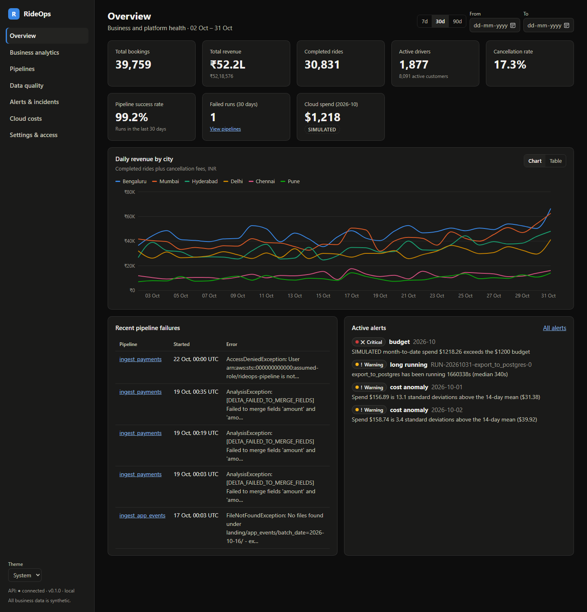
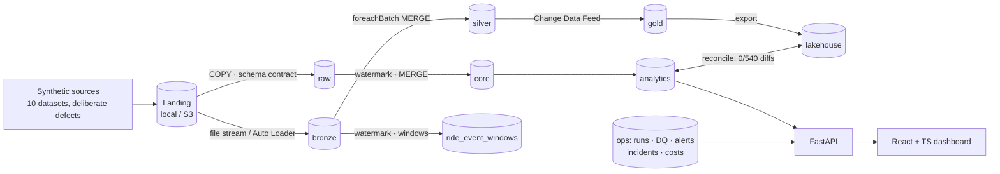
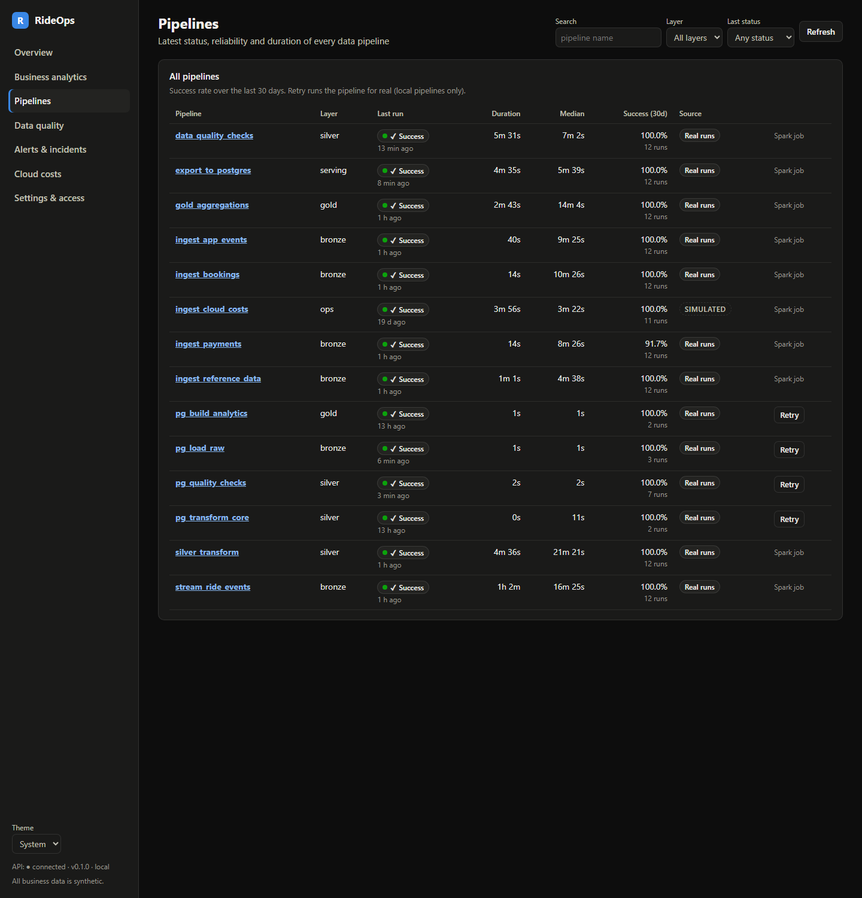
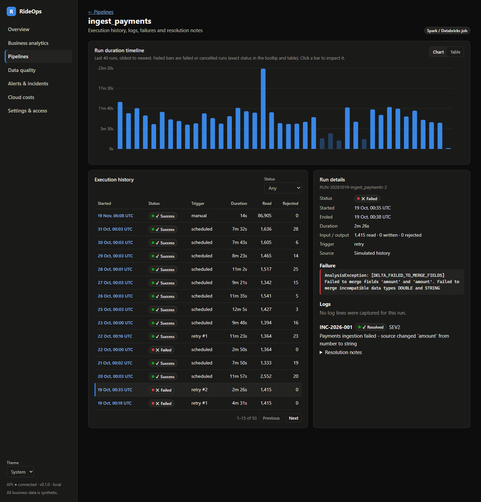
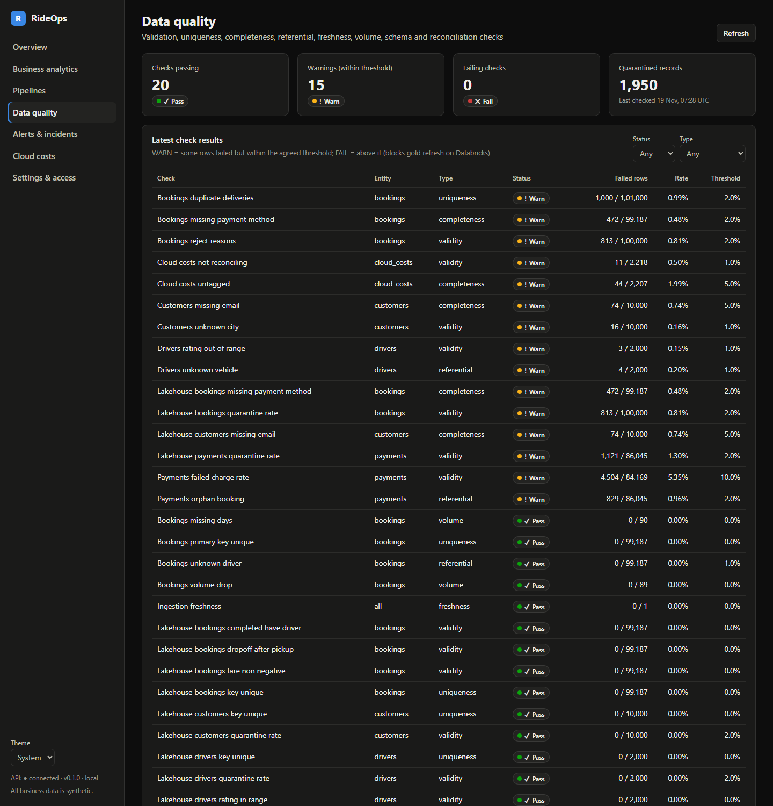
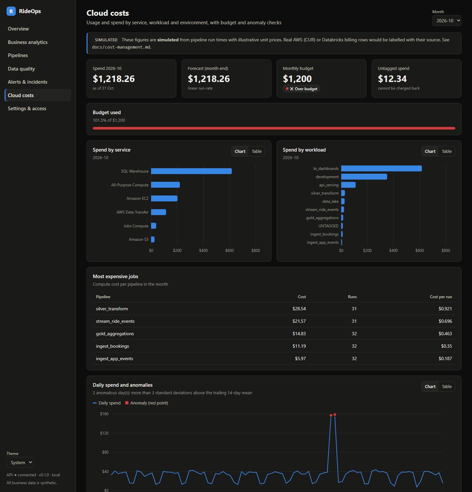

# RideOps — Data Engineering & Platform Operations Platform

An end-to-end data platform for a **fictional** ride-booking company operating in six Indian cities.
Synthetic operational data flows through **two independently implemented pipelines**: a PostgreSQL SQL
warehouse and a PySpark + Delta Lake medallion lakehouse. The two reconcile exactly. The results are
served by a FastAPI backend and a React + TypeScript dashboard, with pipeline monitoring, data-quality
checks, alerting, incident management and cloud cost reporting.

> All business data is **synthetic**. All cost figures are **simulated** and labelled as such, unless loaded
> from a real AWS Cost and Usage Report. Cloud components (AWS, Databricks, hosting) are written and
> validated but **not deployed to real accounts**; see [Known limitations](#known-limitations).
> Progress and verification evidence: [PROJECT_STATUS.md](PROJECT_STATUS.md).



## The business problem

RideOps generates bookings, payments, ride and app events, driver and customer data, pipeline logs and
cloud bills. The data team must:

- ingest it reliably, whether it arrives as batch files, from an API, or as a stream, incrementally and exactly once;
- turn messy raw data (duplicates, nulls, bad formats, orphan keys, late events) into trusted tables;
- answer business questions: revenue by city, demand peaks, driver performance, cancellations, payment failures;
- know when pipelines fail, run long, receive bad data or go stale, and fix it fast;
- know what the platform costs, and get warned before the budget is blown.

## Architecture



Details: [architecture](docs/architecture.md) · [data flow](docs/data-flow.md).

## Tech stack

| Area | Technologies (pinned versions) |
|---|---|
| Data engineering | Python 3.10–3.12, PySpark 4.2.0, Delta Lake 4.4.1, Structured Streaming |
| SQL | PostgreSQL 17.5: CTEs, window functions, MERGE, generated columns, partial indexes, plpgsql |
| Databricks | Asset Bundles, Lakeflow Jobs, Lakeflow Declarative Pipelines (DLT), Auto Loader, Unity Catalog, Databricks SQL, system tables |
| Backend | FastAPI 0.162, Pydantic 2, psycopg 3 + pool, uvicorn |
| Frontend | React 19, TypeScript 6, Vite 8, React Router 7, Recharts 3, Vitest |
| Cloud & IaC | AWS S3, IAM, Budgets, CUR 2.0 (boto3); Terraform 1.17 (AWS provider 6.73) |
| DevOps | Docker / Compose, GitHub Actions, Dependabot, ruff, ESLint, actionlint |

## Features

**Data engineering**
- Reproducible generators: 100k bookings, 86k payments, 373k ride events, 356k app events; exact-count
  defects recorded in a manifest.
- Incremental, exactly-once ingestion: CSV and JSON, schema contracts, checksums, retries, ingestion log.
- SQL ELT: watermark-based, `ROW_NUMBER` versioning, `MERGE` upserts, quarantine table, `dq_flags`.
- Medallion lakehouse: bronze file streams → silver `foreachBatch` MERGE → **CDF-driven incremental gold**.
- Streaming: event-time windows, watermark, `dropDuplicatesWithinWatermark`, checkpoints, a replay tool for live demos.
- Delta Lake tour: ACID, schema enforcement and evolution, MERGE, time travel, history, OPTIMIZE/ZORDER, VACUUM.
- Databricks implementation: bundle, jobs with a data-quality gate, DLT with SCD1 + SCD2, Auto Loader, Unity Catalog with masks and row filters.

**Operations**
- Every run tracked (`ops.pipeline_runs` + logs), simulated history plus real runs, and a **real retry** from the UI.
- 18 SQL + 13 Spark data-quality checks (validity, uniqueness, completeness, referential, volume,
  freshness, schema, reconciliation).
- 6 alert rules (failed, long-running, stale, DQ failed, budget, cost anomaly) with de-duplication,
  auto-resolve and an optional webhook.
- Incident history, 8 runbooks, and a **simulated incident** to practise on.
- Cost reporting: by service, workload and environment; trends; z-score anomalies; budget forecast;
  untagged spend; most expensive jobs.

**Product**
- 22 REST endpoints with OpenAPI docs, pagination, validation and uniform errors.
- 8-page responsive dashboard with a CVD-validated chart palette, a table view for every chart,
  light/dark themes, and URL-based filters.

## Quick start

Prerequisites: Python 3.10+, Docker Desktop, Node 22+. Details: [local development](docs/local-development.md).

```bash
py -3 -m venv .venv && .venv\Scripts\activate          # macOS/Linux: source .venv/bin/activate
pip install -e ".[dev]"
copy .env.example .env                                 # set POSTGRES_PASSWORD
docker compose up -d postgres

python -m rideops.generators --scale full              # ~30 s
python -m rideops.db all                               # load → transform → analytics → DQ
python -m rideops.monitoring seed-incidents
python -m rideops.monitoring alerts

uvicorn rideops.api.main:app --reload                  # http://localhost:8000/docs
cd frontend && npm ci && npm run dev                   # http://localhost:5173
```

Lakehouse (Spark in Docker):

```bash
docker compose --profile spark build spark
docker compose --profile spark run --rm spark python -m rideops.spark all
docker compose --profile spark run --rm spark python -m rideops.spark delta-demo
```

Full stack as containers: `docker compose --profile app up -d --build` → http://localhost:8080.

## Screenshots

| | |
|---|---|
|  |  |
|  |  |
|  |  |

Mobile (390 px): [docs/screenshots/mobile-390px.png](docs/screenshots/mobile-390px.png).

## API documentation

Interactive OpenAPI docs are served at **`/docs`** (Swagger UI) and `/redoc` while the API runs. Main endpoints:

`GET /api/v1/health` · `/analytics/{overview,revenue,bookings,drivers,cancellations,payments}` ·
`/pipelines`, `/pipelines/{name}`, `/pipelines/{name}/logs`, `POST /pipelines/{name}/retry`, `/runs/{id}` ·
`/monitoring/summary`, `/monitoring/alerts` (+ evaluate, acknowledge), `/incidents` ·
`/costs/{summary,trends}` · `/data-quality` · `/settings/access`

## Testing

| Suite | Command | Result (2026-11-19) |
|---|---|---|
| Python unit + integration (PostgreSQL), API | `pytest -m "not spark"` | 107 passed (+ storage, CUR and bundle tests since; see status file) |
| Spark + Delta | `docker compose --profile spark run --rm spark pytest tests/spark` | 15 passed |
| Frontend | `cd frontend && npm test` | 21 passed |
| Lint / types | `ruff check`, `ruff format --check`, `npm run lint`, `npm run typecheck` | clean |
| Infra / CI | `terraform validate` (Docker), `actionlint` | valid / no findings |
| Deployment | `python scripts/verify_deployment.py --api ... --web ...` | 12/12 on the local Docker stack |

CI runs all of these on every pull request ([ci-cd](docs/ci-cd.md)).

## Deployment

- Local, production-style: Docker Compose `app` profile (verified).
- Hosted (free tiers): Cloudflare Pages + Render + Neon. Configuration is ready (`render.yaml`,
  `frontend/public/_redirects`); step-by-step guide in [deployment](docs/deployment.md).
- AWS: [aws-setup](docs/aws-setup.md) · Databricks: [databricks-setup](docs/databricks-setup.md).

## Known limitations

- **Not deployed to real cloud accounts.** Terraform is validated but not applied; the Databricks bundle is
  statically validated but not deployed; hosting is configured but needs your accounts. Each is labelled
  "verification pending" in the status matrix.
- Cost figures are **simulated** unless you load a CUR export.
- The API has no authentication (read-mostly demo; retry disabled by default). See [security](docs/security.md).
- Spark on an 8 GB laptop is slow (the full lakehouse run took about 1h50m, mostly streaming 92 micro-batches).
- In the full replay, the streaming watermark dropped 0 late events (2 files per micro-batch plus
  previous-batch watermark semantics). Late-event dropping is demonstrated in a dedicated test.
- The REST-API source ingestion pattern is shown with the CUR/S3 loaders and the API itself, not an external third-party API.

## Documentation

[Architecture](docs/architecture.md) · [Data flow](docs/data-flow.md) · [Local development](docs/local-development.md) ·
[SQL optimisation](docs/sql-optimization.md) · [AWS setup](docs/aws-setup.md) · [Databricks setup](docs/databricks-setup.md) ·
[Deployment](docs/deployment.md) · [CI/CD](docs/ci-cd.md) · [Security](docs/security.md) ·
[Cost management](docs/cost-management.md) · [Troubleshooting](docs/troubleshooting.md) ·
[Runbooks](monitoring/runbooks/README.md) · [Incidents](monitoring/incidents/) · [**Interview guide**](docs/interview-guide.md)

## Skills demonstrated

The full matrix, with an exact location and verification status for each of the 28 skills, is in
[PROJECT_STATUS.md § Skills coverage](PROJECT_STATUS.md#6-skills-coverage-matrix).

## Contributing

Branching and commit conventions: [CONTRIBUTING.md](CONTRIBUTING.md).
