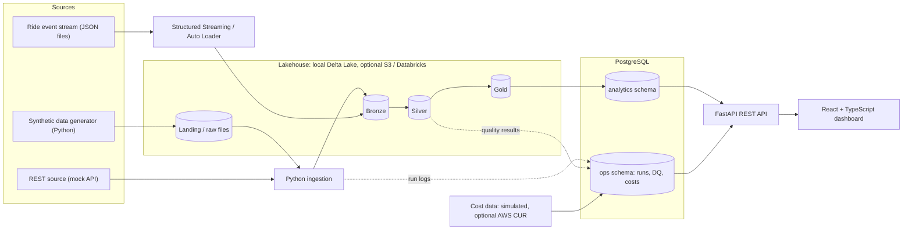

# RideOps — Data Engineering & Platform Operations Platform

> **Status: Phase 1 complete.** Synthetic generators for all 10 source datasets are implemented and tested.
> PostgreSQL and SQL analytics (Phase 2) are next.
> See [PROJECT_STATUS.md](PROJECT_STATUS.md) for what is done, what is in progress, and what has been verified.
> This README only describes features as implemented once they actually are.

RideOps is a portfolio-grade data platform for a **fictional** ride-booking company that operates in several cities.
It takes synthetic operational data through ingestion, a Bronze/Silver/Gold lakehouse, analytics, pipeline monitoring,
data-quality checks and cloud cost reporting, and serves the results through a REST API and a React dashboard.

All data is **synthetic**. All cost figures are **simulated** unless a section is explicitly labeled as real AWS billing data.

---

## Business problem

The company produces bookings, payments, ride events, driver activity, app events, pipeline logs and cloud billing records.
It needs a platform that:

- ingests that data reliably, whether it arrives as batch files, from an API, or as a stream;
- turns raw records into clean, trusted analytical tables;
- answers business questions (revenue by city, driver performance, cancellations, payments);
- tells the platform team when pipelines fail, run long, receive bad data or go stale;
- shows what the platform costs to run and warns before budgets are exceeded.

## Architecture



A fuller explanation, including the design decisions behind it, is in [docs/architecture.md](docs/architecture.md).

## Tech stack (planned)

| Area | Technologies |
|---|---|
| Data engineering | Python, PySpark, Delta Lake, Spark Structured Streaming |
| Databricks | Notebooks, Databricks SQL, Lakeflow Jobs, Lakeflow Declarative Pipelines (DLT), Auto Loader, Unity Catalog, Asset Bundles |
| Storage & database | Local filesystem, AWS S3 (optional), PostgreSQL |
| Backend | FastAPI, Pydantic, REST/JSON |
| Frontend | React, TypeScript, Vite, HTML5/CSS3, charting library |
| Infra & automation | Git, GitHub Actions (YAML), Terraform, Databricks Asset Bundles, Docker |
| Quality | pytest, ruff, frontend test runner, SQL validation |

Exact versions are pinned in each phase as dependencies are added.

## Repository layout

```
rideops-data-platform/
├── src/rideops/          Python package: generators, ingestion, Spark pipelines, quality, monitoring, costs
├── sql/                  PostgreSQL DDL, analytics queries, data-quality and monitoring SQL
├── databricks/           Notebooks, DLT pipelines, Databricks SQL, Unity Catalog, Asset Bundle (databricks.yml)
├── backend/              FastAPI application
├── frontend/             React + TypeScript dashboard
├── infra/terraform/      AWS S3 + IAM infrastructure as code
├── monitoring/           Runbooks and incident history
├── tests/                Unit and integration tests
├── scripts/              Developer helper scripts
├── docs/                 Architecture, setup, deployment, security, cost and interview guides
├── data/                 Local generated data and lakehouse files (git-ignored)
└── .github/              CI workflows and pull request template
```

## Getting started

```bash
# 1. Create and activate a virtual environment (Python 3.10+)
py -3 -m venv .venv
.venv\Scripts\activate            # macOS/Linux: source .venv/bin/activate

# 2. Install the package in editable mode, with dev tools
pip install -e ".[dev]"

# 3. Generate synthetic data into data/landing/ (small: ~3 s, full: ~30 s, ~935k records)
python -m rideops.generators --scale small
python -m rideops.generators --help

# 4. Run tests and linters
pytest                             # all tests
pytest -m "not slow"               # skip full-scale tests
ruff check src tests
ruff format --check src tests
```

Each generation run writes a manifest to `data/landing/_manifests/` that records the seed, row counts
and the exact number of defects injected per entity.

Prerequisites identified in Phase 0:

- Python 3.12 recommended (3.10 is installed but reached end of life in October 2026)
- Java 17 or 21 for Spark
- Node.js 20+ and npm
- Docker Desktop (for PostgreSQL, and for running Spark reliably on Windows)
- Git

Optional, for cloud phases: AWS CLI, Terraform, Databricks CLI.

## Sections to be completed in later phases

- Features — after Phases 1–7
- Screenshots — Phase 7
- API documentation — Phase 5 (FastAPI serves interactive docs at `/docs`)
- Testing — pytest suite started in Phase 1 (see Getting started); CI in Phase 8
- Deployment — Phase 9
- Skills demonstrated (coverage matrix) — maintained in [PROJECT_STATUS.md](PROJECT_STATUS.md)

## Known limitations

- Databricks-specific features (Auto Loader, Unity Catalog, DLT, Jobs) need a Databricks workspace to run.
  Local PySpark equivalents will be provided, and each such feature will be marked with whether it was run in a real workspace.
- Cost data is simulated by default. Real AWS billing integration is optional and off unless configured.

## Contributing

See [CONTRIBUTING.md](CONTRIBUTING.md) for branching and commit conventions.
