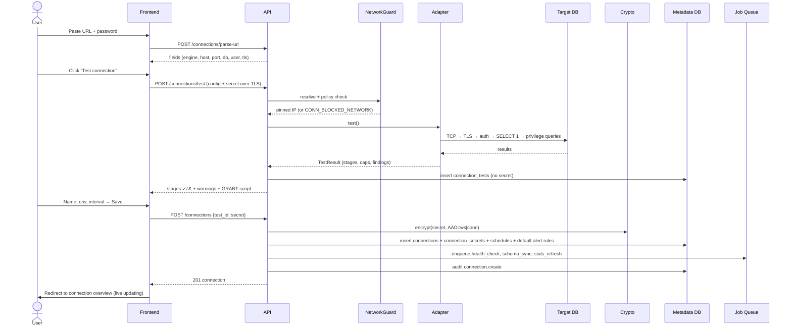
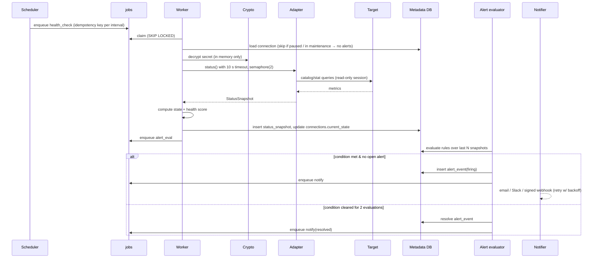

# RideOps Lens — Universal Database Analytics & Status

**System design & architecture specification**

| Field | Value |
|---|---|
| Product | RideOps Data Platform → **Lens** module (connect any database by URL, see its status and analytics) |
| Repo | `rideops-data-platform` (monorepo: `pipelines/`, `backend/`, `frontend/`, `infra/`, `databricks/`) |
| Doc version | 1.0 (2026-11-23) |
| Companion doc | `docs/lens-wireframes.md` (all frontend screens) |
| Status | Design: ready for implementation |

---

## Table of contents

1. Purpose, goals, non-goals
2. Personas & primary use cases
3. Glossary
4. Feature list (complete)
5. Functional requirements (FR)
6. Non-functional requirements (NFR)
7. Supported databases & capability matrix
8. High-level architecture
9. Repository layout changes
10. Backend component design
11. Adapter interface (multi-database abstraction)
12. Metadata data model (DDL)
13. REST API specification
14. Core workflows (sequence diagrams)
15. Status / health model
16. Analytics catalog
17. Alerts & incidents
18. Security design
19. Connectivity options (how the app reaches a database)
20. Performance, limits & quotas
21. Observability of Lens itself
22. Error catalog
23. Configuration (environment variables)
24. Frontend architecture
25. Testing strategy
26. CI/CD changes
27. Deployment (free tier first)
28. Migration from the current RideOps app
29. Delivery phases & acceptance criteria
30. Risks, open decisions, definition of done

---

## 1. Purpose, goals, non-goals

### 1.1 Purpose
Let a signed-in user paste a database connection URL (or fill in a form), have the app connect **securely and read-only**, and show:
- **Status:** is the database reachable and healthy, how fast it responds, and its connections, size and engine-specific health metrics, tracked over time.
- **Analytics:** schema, tables, sizes, growth, data freshness, column profiles, auto-generated charts, custom dashboards and read-only queries.
- **Alerts:** notify the user when status or metrics cross a threshold, then auto-resolve when they recover.

The existing RideOps PostgreSQL warehouse becomes the **first built-in demo connection**, so the current dashboard keeps working.

### 1.2 Goals
| # | Goal |
|---|---|
| G1 | Connect PostgreSQL, MySQL/MariaDB, SQL Server, SQLite, MongoDB in v1; Snowflake, BigQuery, Databricks SQL in v2 through the same adapter interface. |
| G2 | Never store credentials in plaintext. Never send passwords to the browser. TLS by default. |
| G3 | Never modify a user's database. Read-only by design, enforced in three layers. |
| G4 | Never overload a user's database: catalog estimates, sampling, timeouts, concurrency caps. |
| G5 | Runs on free hosting tiers (Neon + Render + Cloudflare Pages) with optional scale-out. |
| G6 | Multi-tenant: users, workspaces, roles; every row is workspace-scoped. |
| G7 | Same quality bar as the rest of the repo: typed, tested, ruff-clean, CI-green, documented, runbooks. |

### 1.3 Non-goals (v1)
- Writing or migrating data in user databases (no INSERT/UPDATE/DDL, ever).
- Full BI tool (pivot tables, semantic layer). Lens gives auto-analytics, simple custom widgets and read-only SQL.
- Query performance tuning that changes the target (no index creation). Lens only **recommends**.
- Replacing vendor monitoring (CloudWatch, Datadog). Lens is a lightweight, unified view.

---

## 2. Personas & primary use cases

| Persona | Needs | Key screens |
|---|---|---|
| **Owner / developer** (you) | Showcase platform; connect own DBs; demo RideOps | All |
| **Data analyst** | Understand an unfamiliar DB fast; profile tables; run safe queries | Schema explorer, table profile, query console |
| **Ops / on-call** | Know when a DB is down/slow; history; alerts | Status overview, alerts, incidents |
| **Viewer / stakeholder** | See dashboards, no credentials | Dashboards, shared snapshot links |
| **Workspace admin** | Manage members, connections, tokens, audit | Settings |

Top use cases:
1. UC-1: "Paste URL → see if my DB is healthy in under 10 s."
2. UC-2: "Show me what's inside this database (tables, sizes, freshness)."
3. UC-3: "Profile this table: nulls, distincts, distributions."
4. UC-4: "Alert me when the DB is down, slow, or a table stops updating."
5. UC-5: "Build a dashboard from a few read-only queries and share a snapshot."
6. UC-6: "Compare health across all my databases on one page."

---

## 3. Glossary

| Term | Meaning |
|---|---|
| **Connection** | Saved config + encrypted secret pointing to one target database |
| **Target DB** | A user's database that Lens connects to (read-only) |
| **Metadata DB** | Lens's own PostgreSQL (Neon) storing users, connections, snapshots, alerts |
| **Adapter** | Engine-specific class implementing the common `DatabaseAdapter` interface |
| **Capability** | Feature flag an adapter supports (e.g. `REPLICATION`, `SLOW_QUERIES`) |
| **Health check** | Short, scheduled probe producing a `status_snapshot` |
| **Schema sync** | Job that reads the catalog and stores tables/columns, diffing for changes |
| **Profile** | Sampled column statistics for one table |
| **Insight** | Rule-generated finding (e.g. "table not updated in 3 days", "unused index") |
| **DEK / KEK** | Data-encryption key (per connection) / key-encryption key (master) |
| **Agent** | Optional small container a user runs inside their own network so Lens can reach private DBs |

---

## 4. Feature list (complete)

Legend: **v1** = first release, **v1.x** = follow-up, **v2** = later.

### 4.1 Accounts & workspaces
| ID | Feature | Release |
|---|---|---|
| F-AUTH-1 | Email + password sign-up, email verification | v1 |
| F-AUTH-2 | Login / logout, secure cookie session, CSRF protection | v1 |
| F-AUTH-3 | Password reset via email link (single-use, 30 min) | v1 |
| F-AUTH-4 | OAuth login (GitHub, Google) | v1.x |
| F-AUTH-5 | TOTP two-factor authentication + recovery codes | v1.x |
| F-AUTH-6 | Personal API tokens (scoped, hashed, expiring) | v1.x |
| F-WS-1 | Workspaces (personal workspace auto-created) | v1 |
| F-WS-2 | Invite members by email; roles Owner/Admin/Editor/Viewer | v1 |
| F-WS-3 | Workspace switcher | v1 |
| F-WS-4 | Audit log (who did what, when, from where) | v1 |
| F-WS-5 | Delete account / workspace (GDPR-style export + erase) | v1.x |

### 4.2 Connections
| ID | Feature | Release |
|---|---|---|
| F-CON-1 | Add connection by **URL** (`postgresql://…`, `mysql://…`, `mssql://…`, `mongodb+srv://…`, `sqlite` upload) | v1 |
| F-CON-2 | Add connection by **form** (engine, host, port, db, user, password, options) | v1 |
| F-CON-3 | URL ⇄ form sync (paste URL fills form; password extracted and moved to secret field) | v1 |
| F-CON-4 | TLS options: `require` / `verify-ca` / `verify-full`, custom CA upload, client cert (mTLS) | v1 |
| F-CON-5 | **Test connection** before saving, with step-by-step diagnostics (DNS → TCP → TLS → auth → privileges) | v1 |
| F-CON-6 | **Privilege check**: warns if the user has write/DDL rights; shows the exact read-only GRANT script | v1 |
| F-CON-7 | Edit, rename, tag, colour, pause/resume, delete connection | v1 |
| F-CON-8 | Rotate credentials (replace secret without losing history) | v1 |
| F-CON-9 | SSH tunnel (bastion host, key auth, host-key pinning) | v1.x |
| F-CON-10 | Connector **agent** for private networks (outbound-only) | v2 |
| F-CON-11 | Built-in **RideOps demo** connection (read-only, seeded) | v1 |
| F-CON-12 | Environment label (prod / staging / dev) with prod safety banner | v1 |
| F-CON-13 | Connection health badge everywhere the connection appears | v1 |

### 4.3 Status & health
| ID | Feature | Release |
|---|---|---|
| F-ST-1 | **Fleet overview**: all connections with status, latency, last check, sparkline | v1 |
| F-ST-2 | Per-connection status page: state, uptime %, latency p50/p95, version, size, connections used, engine metrics | v1 |
| F-ST-3 | Scheduled health checks (interval per connection: 1/5/15/60 min) | v1 |
| F-ST-4 | Manual "Check now" | v1 |
| F-ST-5 | Status history timeline + uptime bars (24 h / 7 d / 30 d) | v1 |
| F-ST-6 | Engine metrics: sessions, active queries, long-running queries, locks/blocking, cache hit, deadlocks, replication lag, transaction wraparound (PG) | v1 (per capability) |
| F-ST-7 | Top slow queries (`pg_stat_statements`, `performance_schema`, Query Store) when available | v1.x |
| F-ST-8 | Health **score** 0–100 with explanation | v1 |
| F-ST-9 | Public **status page** per workspace (opt-in, no secrets) | v2 |

### 4.4 Schema & analytics
| ID | Feature | Release |
|---|---|---|
| F-AN-1 | Schema explorer: databases → schemas → tables/views/collections → columns, types, PK/FK, indexes | v1 |
| F-AN-2 | Search across tables/columns | v1 |
| F-AN-3 | Table overview: row estimate, table size, index size, last modified/vacuum/analyze, scans | v1 |
| F-AN-4 | **Growth trends**: rows & size over time (from stats snapshots) | v1 |
| F-AN-5 | **Data freshness**: detects timestamp columns (`created_at`, `updated_at`, …), shows max value and lag | v1 |
| F-AN-6 | **Column profiling** (sampled): null %, distinct est., min/max, mean/stddev, quantiles, top-k, histogram, length stats, pattern (email/uuid/phone) | v1 |
| F-AN-7 | **Auto-charts** per column type (histogram, top-k bar, time series) | v1 |
| F-AN-8 | **Relationship diagram** (ER) from foreign keys | v1.x |
| F-AN-9 | **Schema change detection** (table/column added/dropped/type changed) with history | v1 |
| F-AN-10 | **Insights / advisor**: largest tables, unused indexes, missing PKs, high dead-tuple ratio, stale tables, nullable FKs | v1 |
| F-AN-11 | Data preview (first 50 rows, PII columns masked by default) | v1 |
| F-AN-12 | PII detection (column name + pattern heuristics) → masked in preview/profiles | v1 |
| F-AN-13 | **Read-only query console** (SQL editor, autocomplete from schema, row/time caps, EXPLAIN) | v1 |
| F-AN-14 | Saved queries (per workspace, with description and tags) | v1 |
| F-AN-15 | **Dashboards**: auto dashboard per connection + custom dashboards from saved queries (KPI, line, bar, table widgets) | v1 |
| F-AN-16 | Dashboard refresh schedule + cached results | v1 |
| F-AN-17 | Export: CSV of query results, PNG of charts, JSON of profile | v1 |
| F-AN-18 | Share **snapshot** link (static results, expiry, no live credentials) | v1.x |
| F-AN-19 | Cross-connection comparison (size, health, freshness side by side) | v1.x |

### 4.5 Alerts & incidents (extends the existing RideOps alerts/incidents module)
| ID | Feature | Release |
|---|---|---|
| F-AL-1 | Rule types: status change, metric threshold, freshness stale, row-count drop %, schema change, privilege drift | v1 |
| F-AL-2 | Severity (info / warning / critical), evaluation window, "for N checks" debounce | v1 |
| F-AL-3 | Channels: in-app, email, generic webhook, Slack incoming webhook | v1 |
| F-AL-4 | Deduplication, auto-resolve, acknowledge, mute until | v1 |
| F-AL-5 | Default rule pack applied to every new connection (down, latency, connections %) | v1 |
| F-AL-6 | Incidents: open → acknowledged → resolved timeline with notes, linked runbook | v1 |
| F-AL-7 | Maintenance windows (suppress alerts) | v1.x |

### 4.6 Platform
| ID | Feature | Release |
|---|---|---|
| F-PL-1 | Job queue + scheduler (Postgres-backed, no extra paid infra) | v1 |
| F-PL-2 | Data retention & roll-ups (raw checks 7 d, hourly 90 d, daily 1 y) | v1 |
| F-PL-3 | Rate limits & per-plan quotas | v1 |
| F-PL-4 | OpenAPI docs + typed TS client generation | v1 |
| F-PL-5 | Dark/light theme, responsive to 360 px, keyboard accessible | v1 |
| F-PL-6 | In-app notifications centre | v1 |
| F-PL-7 | Onboarding checklist & empty states | v1 |

---

## 5. Functional requirements (FR)

Every requirement is testable. "MUST" = v1 blocking.

### Authentication & tenancy
- **FR-01** Users MUST sign up with email + password (min 12 chars, checked against a breached-password list offline set); passwords hashed with **Argon2id**.
- **FR-02** Session MUST be an `HttpOnly; Secure; SameSite=Lax` cookie holding an opaque session id (server-side session table); idle timeout 12 h, absolute 7 d.
- **FR-03** All state-changing requests MUST carry a CSRF token (double-submit header `X-CSRF-Token`).
- **FR-04** Every API query on tenant data MUST filter by `workspace_id` from the session membership (enforced in the repository layer + Postgres Row-Level Security as defence in depth).
- **FR-05** Roles: Owner, Admin, Editor, Viewer with the permission matrix in §18.3.
- **FR-06** Every security-relevant action MUST write an audit event (§12, `audit_log`).

### Connections
- **FR-10** User MUST be able to paste a URL; the parser identifies engine from scheme, extracts host/port/db/user/params, moves the password into the secret field, and **never persists the password inside the URL**.
- **FR-11** Supported schemes: `postgres`, `postgresql`, `postgresql+psycopg`, `mysql`, `mariadb`, `mysql+pymysql`, `mssql`, `sqlserver`, `mssql+pyodbc`, `mongodb`, `mongodb+srv`, `sqlite` (file upload only), and in v2 `snowflake`, `bigquery`, `databricks`.
- **FR-12** "Test connection" MUST run staged diagnostics and return per-stage result + timing: `DNS → NETWORK_POLICY → TCP → TLS → AUTH → DB_SELECT → PRIVILEGES → CAPABILITIES`.
- **FR-13** Save MUST be allowed only after a successful test (Admins may force-save with a reason, logged).
- **FR-14** TLS MUST default to `require`; `disable` is allowed only if workspace setting `allow_insecure_connections=true` (default false) and shows a red banner.
- **FR-15** On save and on every schema sync, the privilege check MUST flag write/DDL privileges with severity **warning** and show an engine-specific read-only GRANT script.
- **FR-16** Credentials MUST be encrypted with envelope encryption (§18.4) and decrypted only inside the worker/API process at connect time, never returned by any endpoint.
- **FR-17** Deleting a connection MUST purge its secret immediately (crypto-shred the DEK) and its snapshots after a 7-day soft-delete window (restorable by Owner/Admin).
- **FR-18** Credential rotation MUST re-test before replacing; old DEK destroyed after success.
- **FR-19** Paused connections MUST not be contacted by any job.

### Status
- **FR-20** Health check MUST complete within `HEALTH_TIMEOUT_S` (default 10 s) or record `TIMEOUT`.
- **FR-21** Health check MUST open at most one connection to the target, run only catalog/statistics queries from the adapter's fixed set, and close it.
- **FR-22** States computed per §15; a state change emits an event consumed by alerts.
- **FR-23** Uptime % = successful checks / total checks in the window (paused time excluded).
- **FR-24** Status page MUST show capability-unavailable metrics as "Not available (needs `pg_monitor` role)" rather than error.

### Analytics
- **FR-30** Schema sync MUST read only catalog views; store tables, columns, indexes, constraints; diff with previous sync; emit `schema_change` events.
- **FR-31** Table stats MUST prefer catalog estimates; exact `COUNT(*)` only on explicit user request **and** only if estimate < `EXACT_COUNT_MAX_ROWS` (default 5 M).
- **FR-32** Profiling MUST use sampling (`TABLESAMPLE SYSTEM`/`BERNOULLI` on PG, `TABLESAMPLE` on SQL Server, bounded `LIMIT` with random offset strategy on MySQL, `$sample` on Mongo); default 10 000 rows, max 100 000.
- **FR-33** PII-flagged columns MUST be masked in previews, top-k values and query console results unless the user has Editor+ **and** toggles "reveal" (logged).
- **FR-34** Query console MUST accept a single statement whose parsed AST root is `SELECT`/`WITH … SELECT`/`EXPLAIN`/`SHOW` (engine-specific allowlist), reject anything else, inject a row `LIMIT` (default 1 000, max 10 000), apply a statement timeout (default 30 s) and cap result payload at 10 MB.
- **FR-35** Dashboards: widgets bound to saved queries or built-in metrics; results cached with TTL; refresh manual or scheduled (min 15 min).
- **FR-36** Exports MUST respect PII masking and row caps.

### Alerts
- **FR-40** Default rule pack on new connection: `status != HEALTHY for 2 checks` (critical), `latency_p95 > 2000 ms for 3 checks` (warning), `connections_used_pct > 90` (warning).
- **FR-41** An alert fires once per open episode (dedup key = rule_id + connection_id), auto-resolves after N healthy evaluations (default 2), and sends a resolve notification.
- **FR-42** Webhook payloads MUST be signed (`X-Lens-Signature: sha256=HMAC(body, webhook_secret)`) and retried with exponential backoff (5 attempts) reusing the existing retry runner.

---

## 6. Non-functional requirements (NFR)

| ID | Category | Requirement |
|---|---|---|
| NFR-01 | Performance | API p95 < 300 ms for metadata reads (cached); Test connection result < 10 s; fleet page loads < 2 s with 50 connections |
| NFR-02 | Target safety | ≤ 2 concurrent sessions per target per Lens instance; every session has statement + lock timeouts; `application_name='rideops-lens'` |
| NFR-03 | Availability | Single-region; API stateless; jobs resumable; health check misses are recorded, not silently skipped |
| NFR-04 | Scalability | 1 worker handles ≈ 500 checks/min; horizontal scale by adding workers (`SKIP LOCKED` queue) |
| NFR-05 | Security | OWASP ASVS L2 targets; no secrets in logs; TLS 1.2+ everywhere; dependency scanning (Dependabot + `pip-audit` + `npm audit`) |
| NFR-06 | Privacy | Lens stores metadata + aggregates + samples only for profiles (top-k values masked if PII); no bulk row copies |
| NFR-07 | Accessibility | WCAG 2.2 AA; full keyboard nav; colour never the only signal (icons + text for status) |
| NFR-08 | Responsiveness | Works 360–1920 px; tables become cards < 640 px |
| NFR-09 | Maintainability | New engine = 1 adapter file + contract tests passing; no engine-specific logic outside `adapters/` |
| NFR-10 | Observability | Structured JSON logs with request_id/job_id; Prometheus-style `/metrics`; Lens monitors itself (§21) |
| NFR-11 | Cost | Runs at $0 on free tiers for demo scale (≤ 10 connections, 5-min checks) |
| NFR-12 | Data retention | Configurable; defaults in F-PL-2; hard delete on workspace deletion within 30 d |

---

## 7. Supported databases & capability matrix

### 7.1 Drivers
| Engine | Python driver | Notes |
|---|---|---|
| PostgreSQL (incl. Neon, Supabase, RDS, Aurora PG, Cloud SQL, Azure PG) | `psycopg[binary]` 3 via SQLAlchemy 2 | Primary engine |
| MySQL / MariaDB (incl. PlanetScale, RDS, Aurora MySQL) | `PyMySQL` via SQLAlchemy | `ssl` dict for TLS |
| SQL Server / Azure SQL | `pyodbc` + MS ODBC Driver 18 (in Docker image) | `Encrypt=yes;TrustServerCertificate=no` |
| SQLite | stdlib `sqlite3` | Upload `.sqlite/.db` file ≤ 200 MB, opened `mode=ro&immutable=1` |
| MongoDB / Atlas | `pymongo` 4 | Non-SQL adapter; collections ≈ tables |
| Snowflake (v2) | `snowflake-connector-python` | key-pair auth recommended |
| BigQuery (v2) | `google-cloud-bigquery` | service-account JSON as secret; dry-run cost estimates |
| Databricks SQL (v2) | `databricks-sql-connector` | PAT or OAuth M2M; ties into your existing `databricks/` work |

Drivers are **optional extras** (`pip install rideops-api[postgres,mysql,mssql,mongo]`); the registry reports `DRIVER_MISSING` if not installed.

### 7.2 Capability matrix (v1)
| Capability | PG | MySQL | MSSQL | SQLite | Mongo |
|---|---|---|---|---|---|
| `STATUS_BASIC` (reachable, latency, version, uptime, size) | ✅ | ✅ | ✅ | ✅ (file) | ✅ |
| `SESSIONS` (total/active/idle, max) | ✅ `pg_stat_activity` | ✅ `SHOW STATUS` / processlist | ✅ `sys.dm_exec_sessions` | – | ✅ `serverStatus.connections` |
| `LONG_QUERIES` | ✅ | ✅ | ✅ `dm_exec_requests` | – | ✅ `currentOp` (if permitted) |
| `LOCKS_BLOCKING` | ✅ `pg_locks`/`pg_blocking_pids` | ✅ `performance_schema.data_lock_waits` | ✅ `blocking_session_id` | – | – |
| `CACHE_HIT` | ✅ | ✅ InnoDB buffer pool | ✅ buffer cache hit ratio | – | ✅ WiredTiger cache |
| `REPLICATION` | ✅ `pg_stat_replication` / `pg_last_xact_replay_timestamp` | ✅ `SHOW REPLICA STATUS` | ✅ AG DMVs (if present) | – | ✅ `replSetGetStatus` |
| `SLOW_QUERIES` | ✅ if `pg_stat_statements` | ✅ if `performance_schema` | ✅ if Query Store | – | ✅ profiler (if on) |
| `SCHEMA` | ✅ | ✅ | ✅ | ✅ | ✅ (inferred from sample) |
| `TABLE_STATS` | ✅ `pg_class`, `pg_stat_user_tables` | ✅ `information_schema.TABLES` | ✅ `sys.dm_db_partition_stats` | ✅ `dbstat` / count | ✅ `collStats` |
| `INDEX_USAGE` | ✅ | ✅ (`sys.schema_unused_indexes`) | ✅ `dm_db_index_usage_stats` | – | ✅ `$indexStats` |
| `COLUMN_PROFILE` | ✅ | ✅ | ✅ | ✅ | ✅ |
| `QUERY_CONSOLE` | ✅ SQL | ✅ SQL | ✅ SQL | ✅ SQL | ✅ `find`/`aggregate` JSON (no `$out`/`$merge`) |
| `EXPLAIN` | ✅ (no ANALYZE) | ✅ | ✅ showplan XML | ✅ | ✅ `explain` |

---

## 8. High-level architecture

```mermaid
flowchart LR
  subgraph Browser
    FE[React + TS SPA<br/>Cloudflare Pages]
  end

  subgraph Lens Backend
    API[FastAPI API<br/>auth, connections, status,<br/>analytics, dashboards, alerts]
    W[Worker(s)<br/>health checks, schema sync,<br/>profiling, query runs, alerts]
    S[Scheduler<br/>enqueues due jobs]
    NG[Network Guard<br/>SSRF + egress policy]
    CR[Crypto Service<br/>envelope encryption]
    AR[Adapter Registry<br/>PG / MySQL / MSSQL / SQLite / Mongo]
  end

  subgraph Lens Storage
    MDB[(Metadata PostgreSQL<br/>Neon: app.* schema)]
    OBJ[(Object storage<br/>SQLite uploads, exports<br/>S3/R2 optional)]
    KMS[[Master key<br/>env var or AWS KMS]]
  end

  subgraph Targets
    T1[(User PostgreSQL)]
    T2[(User MySQL)]
    T3[(User SQL Server)]
    T4[(User MongoDB)]
    AG[Lens Agent<br/>in private network] --> T5[(Private DB)]
  end

  N[Notifications<br/>email, Slack, webhook]

  FE -- HTTPS cookie session --> API
  API --> MDB
  W --> MDB
  S --> MDB
  API --> CR --> KMS
  W --> CR
  W --> AR --> NG
  API --> AR
  NG -- TLS --> T1 & T2 & T3 & T4
  AG -- outbound HTTPS/WSS --> API
  W --> N
  API --> OBJ
```

### 8.1 Key architectural decisions (ADRs)
| ADR | Decision | Why |
|---|---|---|
| ADR-1 | **Adapter pattern** with capability flags | Add engines without touching API/UI; UI renders by capability |
| ADR-2 | **Postgres as job queue** (`app.jobs` + `FOR UPDATE SKIP LOCKED`) | Zero extra infra on free tier; transactional with metadata; Redis optional later |
| ADR-3 | **Envelope encryption** (per-connection DEK, master KEK) | Rotation without re-encrypting everything; crypto-shred on delete |
| ADR-4 | **Read-only enforced in 3 layers** (DB role guidance, session settings, SQL AST guard) | No single point of failure for "never write" |
| ADR-5 | **Snapshots, not live queries, power the UI** | Fast pages, bounded load on targets, history for trends |
| ADR-6 | **API and worker share one codebase**, run as `--role api|worker|all` | `all` = single free-tier process; split when scaling |
| ADR-7 | **Pinned-IP connect** after DNS check | Prevents DNS-rebinding SSRF |
| ADR-8 | Keep existing RideOps routers; Lens lives under `/api/v1/lens/*` → later `/api/v1/*` | No breaking change to current dashboard |

---

## 9. Repository layout changes

```text
backend/
  src/rideops_api/
    main.py                       # mounts existing routers + lens routers
    settings.py                   # pydantic-settings (env vars §23)
    db/                           # metadata DB session, Alembic env
      migrations/versions/*.py
    auth/
      router.py  service.py  passwords.py  sessions.py  csrf.py  deps.py  oauth.py  totp.py
    workspaces/
      router.py  service.py  rbac.py
    lens/
      connections/  router.py  schemas.py  service.py  url_parser.py  diagnostics.py
      status/       router.py  service.py  scoring.py
      catalog/      router.py  service.py  diff.py           # schema sync + changes
      profiling/    router.py  service.py  pii.py  charts.py # auto-chart rules
      insights/     rules.py   service.py
      queries/      router.py  service.py  sqlguard.py
      dashboards/   router.py  service.py
      exports/      router.py  service.py
      adapters/
        base.py  registry.py  capabilities.py  types.py
        postgres.py  mysql.py  mssql.py  sqlite.py  mongodb.py
        snowflake.py  bigquery.py  databricks.py   # v2
        sql/                                         # fixed catalog queries per engine
          postgres/*.sql  mysql/*.sql  mssql/*.sql
      security/
        crypto.py      # envelope encryption
        netguard.py    # SSRF / egress policy, pinned resolve
        readonly.py    # per-engine session hardening
        tls.py         # TLS context builder, CA bundles
        ssh.py         # tunnels (v1.x)
      pools.py         # per-target bounded pool / semaphore
    alerts/            # EXISTING module, extended with lens rule types + channels
    jobs/
      queue.py  scheduler.py  worker.py  registry.py
      tasks/ health_check.py schema_sync.py stats_refresh.py profile.py
             query_run.py alert_eval.py retention.py notify.py
    notifications/  email.py  slack.py  webhook.py  inapp.py
    observability/  logging.py  metrics.py
  tests/
    unit/ ...
    contract/test_adapter_contract.py       # same suite across all engines
    integration/ (docker targets)
    security/ test_ssrf.py test_sqlguard.py test_crypto.py test_tenancy.py
frontend/src/
  app/ router.tsx  providers.tsx  layout/
  api/ client.ts (generated: openapi-typescript)  hooks/
  features/
    auth/ workspaces/ connections/ status/ schema/ table/ profiling/
    query/ dashboards/ alerts/ incidents/ settings/ notifications/ onboarding/
  components/ (StatusBadge, MetricCard, Sparkline, UptimeBar, DataTable, CodeEditor, EmptyState, ...)
agent/                       # v2: connector agent (Python, Dockerfile)
docs/
  lens-system-design.md      # this file
  lens-wireframes.md
  adr/ADR-001..008.md
monitoring/runbooks/
  lens-target-down.md  lens-worker-backlog.md  lens-key-rotation.md  lens-ssrf-block.md
```

---

## 10. Backend component design

### 10.1 Connection Manager (`lens/connections`)
Responsibilities: parse URL, validate, run diagnostics, store config + encrypted secret, rotation, pause/resume, delete.

**URL parser rules**
1. Parse with `sqlalchemy.engine.make_url` (SQL) or `pymongo.uri_parser` (Mongo).
2. Map scheme → `engine` enum; reject unknown.
3. Extract `password` (and `sslkey`, tokens) → `secret`; rebuild URL **without** password → `display_url`.
4. Lowercase host; strip trailing dots; IDNA-encode.
5. Known query params kept in `options` JSON (allowlist per engine, e.g. PG: `sslmode`, `sslrootcert`, `connect_timeout`, `options`, `target_session_attrs`); unknown params rejected (prevents things like `host=/var/run/...` socket injection or `sslkey=/etc/...` local-file reads).
6. Never allow Unix socket hosts or local file paths in cloud mode.

### 10.2 Network Guard (`security/netguard.py`)
```text
resolve(host) -> [ip...]
for ip in ips:
   deny if ip in: 127.0.0.0/8, ::1, 0.0.0.0/8, 10.0.0.0/8, 172.16.0.0/12, 192.168.0.0/16,
                  169.254.0.0/16 (cloud metadata), fe80::/10, fc00::/7, 100.64.0.0/10,
                  224.0.0.0/4, 240.0.0.0/4, ::ffff:<private v4>
   unless settings.ALLOW_PRIVATE_NETWORKS (self-hosted) or host matches workspace allowlist
deny port unless in ALLOWED_PORTS (default 1433, 3306, 5432, 6432, 27017, 443, 1521, plus workspace custom list)
return pinned_ip  -> driver connects to pinned_ip with TLS SNI/hostname verification = original host
```
- Mongo `+srv`: resolve SRV + TXT, validate every resulting host.
- Every denial → audit event `network.blocked` + error `CONN_BLOCKED_NETWORK`.

### 10.3 Crypto Service (`security/crypto.py`)
See §18.4. API: `encrypt_secret(workspace_id, connection_id, plaintext: dict) -> SecretBlob`, `decrypt_secret(blob, aad) -> dict`, `rotate_kek()`, `shred(connection_id)`.

### 10.4 Target Pool Manager (`pools.py`)
- No long-lived pools to targets in v1 (connect-run-close) → avoids holding customer connections.
- Per-target `asyncio.Semaphore(MAX_TARGET_SESSIONS=2)` keyed by `connection_id`.
- Query console sessions: short-lived; optional 60 s keep-alive cache per user+connection.

### 10.5 Job system (`jobs/`)
`app.jobs` table (§12). Worker loop:
```sql
UPDATE app.jobs SET status='running', locked_by=$worker, locked_at=now(), attempts=attempts+1
WHERE id = (
  SELECT id FROM app.jobs
  WHERE status='queued' AND run_at <= now()
  ORDER BY priority DESC, run_at
  FOR UPDATE SKIP LOCKED LIMIT 1)
RETURNING *;
```
- Heartbeat every 15 s; reaper re-queues jobs with stale `locked_at` (> 2× timeout).
- Retries: exponential backoff (reuse existing retry runner), max attempts per job type.
- Idempotency key per job (e.g. `health:{conn}:{minute_bucket}`) → unique index prevents duplicates.
- Scheduler: every 15 s, enqueue due work from `app.schedules` (one row per connection × job type, with `next_run_at`). Leader election via `pg_try_advisory_lock(42)` so only one scheduler runs.
- Free tier: `--role all` runs API + 1 worker + scheduler in one process. External cron (GitHub Actions / Cloudflare Cron Trigger) calls `POST /internal/tick` (token-protected) to wake a sleeping instance.

| Job type | Trigger | Timeout | Max attempts | Priority |
|---|---|---|---|---|
| `health_check` | schedule / manual | 10 s | 1 (next tick retries) | 100 |
| `schema_sync` | on create, daily, manual | 120 s | 3 | 50 |
| `stats_refresh` | every 60 min | 60 s | 3 | 40 |
| `profile_table` | manual / weekly per pinned table | 120 s | 2 | 30 |
| `query_run` | console / dashboard refresh | 30–60 s | 1 | 90 (interactive) |
| `alert_eval` | after every snapshot | 5 s | 3 | 95 |
| `notify` | from alert_eval | 10 s | 5 | 95 |
| `rollup` / `retention` | hourly / daily | 300 s | 3 | 10 |

### 10.6 Snapshot pipeline
`health_check` → `app.status_snapshots` (+ `app.metric_points`) → `alert_eval` → hourly `rollup` into `app.metric_rollups_hourly` → daily roll-up → `retention` purges raw.

### 10.7 Insights engine (`lens/insights/rules.py`)
Pure functions over latest catalog + stats snapshots, each returning `Insight(code, severity, title, detail, object_ref, recommendation)`. Re-evaluated after `stats_refresh`. See §16.4.

---

## 11. Adapter interface (multi-database abstraction)

```python
# backend/src/rideops_api/lens/adapters/base.py
from __future__ import annotations
from dataclasses import dataclass, field
from datetime import datetime
from enum import StrEnum
from typing import Any, ClassVar, Protocol


class Engine(StrEnum):
    POSTGRES = "postgres"; MYSQL = "mysql"; MSSQL = "mssql"
    SQLITE = "sqlite"; MONGODB = "mongodb"
    SNOWFLAKE = "snowflake"; BIGQUERY = "bigquery"; DATABRICKS = "databricks"


class Capability(StrEnum):
    STATUS_BASIC = "status_basic"; SESSIONS = "sessions"; LONG_QUERIES = "long_queries"
    LOCKS = "locks"; CACHE_HIT = "cache_hit"; REPLICATION = "replication"
    SLOW_QUERIES = "slow_queries"; SCHEMA = "schema"; TABLE_STATS = "table_stats"
    INDEX_USAGE = "index_usage"; COLUMN_PROFILE = "column_profile"
    QUERY_CONSOLE = "query_console"; EXPLAIN = "explain"; PRIVILEGE_CHECK = "privilege_check"


@dataclass(frozen=True)
class ConnectionConfig:
    connection_id: str
    engine: Engine
    host: str | None
    port: int | None
    database: str | None
    username: str | None
    options: dict[str, Any]          # allowlisted driver options
    tls_mode: str                    # disable|require|verify-ca|verify-full
    pinned_ip: str | None            # from Network Guard


@dataclass(frozen=True)
class Secret:
    password: str | None = None
    ca_cert_pem: str | None = None
    client_cert_pem: str | None = None
    client_key_pem: str | None = None
    extra: dict[str, str] = field(default_factory=dict)   # tokens, SA JSON, ssh key


@dataclass
class StageResult:
    stage: str; ok: bool; ms: int; message: str = ""; code: str | None = None


@dataclass
class TestResult:
    ok: bool
    stages: list[StageResult]
    server_version: str | None
    capabilities: set[Capability]
    privilege_findings: list[dict[str, Any]]      # e.g. {"privilege":"INSERT","object":"public.*"}


@dataclass
class StatusSnapshot:
    taken_at: datetime
    reachable: bool
    latency_ms: int | None
    server_version: str | None
    uptime_s: int | None
    db_size_bytes: int | None
    metrics: dict[str, float | int | None]        # namespaced keys, see §15.3
    details: dict[str, Any]                       # top long queries, blockers (PII-safe)
    unavailable: dict[str, str]                   # metric -> reason ("needs pg_monitor")


@dataclass
class ColumnInfo:
    name: str; data_type: str; nullable: bool; ordinal: int
    is_pk: bool = False; default: str | None = None; comment: str | None = None


@dataclass
class TableInfo:
    schema: str; name: str; kind: str             # table|view|matview|collection|external
    columns: list[ColumnInfo]
    row_estimate: int | None; total_bytes: int | None; index_bytes: int | None
    indexes: list[dict[str, Any]]; foreign_keys: list[dict[str, Any]]
    last_modified: datetime | None = None; stats: dict[str, Any] = field(default_factory=dict)


@dataclass
class ColumnProfile:
    column: str; data_type: str; sample_size: int
    null_pct: float; distinct_est: int | None
    min: Any = None; max: Any = None; mean: float | None = None; stddev: float | None = None
    quantiles: dict[str, Any] | None = None       # p01,p25,p50,p75,p99
    top_k: list[tuple[Any, int]] | None = None
    histogram: list[tuple[Any, Any, int]] | None = None
    length: dict[str, float] | None = None
    patterns: dict[str, float] | None = None      # {"email":0.98}
    pii: bool = False


@dataclass
class QueryLimits:
    max_rows: int = 1000; timeout_s: int = 30; max_bytes: int = 10_000_000


@dataclass
class QueryResult:
    columns: list[dict[str, str]]; rows: list[list[Any]]
    row_count: int; truncated: bool; elapsed_ms: int


class DatabaseAdapter(Protocol):
    engine: ClassVar[Engine]
    capabilities: ClassVar[frozenset[Capability]]
    default_port: ClassVar[int | None]

    def __init__(self, cfg: ConnectionConfig, secret: Secret) -> None: ...

    async def test(self) -> TestResult: ...
    async def status(self) -> StatusSnapshot: ...
    async def list_schemas(self) -> list[str]: ...
    async def list_tables(self, schema: str | None = None) -> list[TableInfo]: ...
    async def table_stats(self, schema: str, table: str) -> dict[str, Any]: ...
    async def exact_count(self, schema: str, table: str) -> int: ...
    async def profile_table(self, schema: str, table: str,
                            columns: list[str] | None, sample_rows: int) -> list[ColumnProfile]: ...
    async def preview(self, schema: str, table: str, limit: int = 50) -> QueryResult: ...
    async def run_readonly(self, statement: str, limits: QueryLimits) -> QueryResult: ...
    async def explain(self, statement: str) -> dict[str, Any]: ...
    async def privilege_findings(self) -> list[dict[str, Any]]: ...
    async def close(self) -> None: ...

    @staticmethod
    def readonly_grant_script(database: str, username: str) -> str: ...
```

Rules:
- Sync drivers run via `anyio.to_thread.run_sync` with a bounded thread limiter.
- Every adapter opens its session through `security/readonly.py` hardening (§18.5).
- All catalog SQL lives in `adapters/sql/<engine>/*.sql` (reviewable, testable, no string concatenation; identifiers quoted with the dialect's quoting function).
- **Contract test suite** (`tests/contract/`) runs the same assertions against each engine container: test passes, status has `STATUS_BASIC` keys, seeded tables appear, profile of seeded column matches expected stats ±5 %, a write statement is rejected at both the SQL guard and the DB layer.

---

## 12. Metadata data model (DDL)

Lives in schema `app` of Lens's own PostgreSQL (Neon). Managed by **Alembic**. All tenant tables carry `workspace_id` + RLS policy `workspace_id = current_setting('app.workspace_id')::uuid`.

```sql
CREATE SCHEMA IF NOT EXISTS app;
CREATE EXTENSION IF NOT EXISTS pgcrypto;  -- gen_random_uuid()
CREATE EXTENSION IF NOT EXISTS citext;

-- ===== Identity & tenancy ==================================================
CREATE TABLE app.users (
  id              uuid PRIMARY KEY DEFAULT gen_random_uuid(),
  email           citext UNIQUE NOT NULL,
  display_name    text NOT NULL,
  password_hash   text,                         -- null for OAuth-only users
  email_verified  boolean NOT NULL DEFAULT false,
  totp_secret_enc bytea,                        -- encrypted, v1.x
  is_disabled     boolean NOT NULL DEFAULT false,
  created_at      timestamptz NOT NULL DEFAULT now(),
  last_login_at   timestamptz
);

CREATE TABLE app.oauth_identities (
  user_id uuid REFERENCES app.users(id) ON DELETE CASCADE,
  provider text NOT NULL, subject text NOT NULL,
  PRIMARY KEY (provider, subject)
);

CREATE TABLE app.sessions (
  id           text PRIMARY KEY,                -- random 256-bit, stored hashed
  user_id      uuid NOT NULL REFERENCES app.users(id) ON DELETE CASCADE,
  csrf_token   text NOT NULL,
  ip           inet, user_agent text,
  created_at   timestamptz NOT NULL DEFAULT now(),
  last_seen_at timestamptz NOT NULL DEFAULT now(),
  expires_at   timestamptz NOT NULL
);

CREATE TABLE app.workspaces (
  id         uuid PRIMARY KEY DEFAULT gen_random_uuid(),
  name       text NOT NULL,
  slug       citext UNIQUE NOT NULL,
  plan       text NOT NULL DEFAULT 'free',
  settings   jsonb NOT NULL DEFAULT '{"allow_insecure_connections": false,
                                       "allowed_ports": [], "egress_allowlist": []}',
  created_at timestamptz NOT NULL DEFAULT now(),
  deleted_at timestamptz
);

CREATE TYPE app.role AS ENUM ('owner','admin','editor','viewer');

CREATE TABLE app.memberships (
  workspace_id uuid REFERENCES app.workspaces(id) ON DELETE CASCADE,
  user_id      uuid REFERENCES app.users(id) ON DELETE CASCADE,
  role         app.role NOT NULL,
  created_at   timestamptz NOT NULL DEFAULT now(),
  PRIMARY KEY (workspace_id, user_id)
);

CREATE TABLE app.invitations (
  id uuid PRIMARY KEY DEFAULT gen_random_uuid(),
  workspace_id uuid NOT NULL REFERENCES app.workspaces(id) ON DELETE CASCADE,
  email citext NOT NULL, role app.role NOT NULL,
  token_hash text NOT NULL, expires_at timestamptz NOT NULL,
  accepted_at timestamptz, invited_by uuid REFERENCES app.users(id)
);

CREATE TABLE app.api_tokens (
  id uuid PRIMARY KEY DEFAULT gen_random_uuid(),
  workspace_id uuid NOT NULL REFERENCES app.workspaces(id) ON DELETE CASCADE,
  user_id uuid NOT NULL REFERENCES app.users(id) ON DELETE CASCADE,
  name text NOT NULL, prefix text NOT NULL, token_hash text NOT NULL,
  scopes text[] NOT NULL, expires_at timestamptz, last_used_at timestamptz,
  created_at timestamptz NOT NULL DEFAULT now(), revoked_at timestamptz
);

-- ===== Connections =========================================================
CREATE TYPE app.engine AS ENUM ('postgres','mysql','mssql','sqlite','mongodb',
                                'snowflake','bigquery','databricks');
CREATE TYPE app.conn_state AS ENUM ('healthy','degraded','down','auth_failed',
                                    'tls_error','unreachable','unknown','paused');

CREATE TABLE app.connections (
  id              uuid PRIMARY KEY DEFAULT gen_random_uuid(),
  workspace_id    uuid NOT NULL REFERENCES app.workspaces(id) ON DELETE CASCADE,
  name            text NOT NULL,
  engine          app.engine NOT NULL,
  environment     text NOT NULL DEFAULT 'dev' CHECK (environment IN ('prod','staging','dev','demo')),
  host            text, port int, database text, username text,
  display_url     text NOT NULL,                -- password-free
  options         jsonb NOT NULL DEFAULT '{}',  -- allowlisted driver options
  tls_mode        text NOT NULL DEFAULT 'require',
  connectivity    text NOT NULL DEFAULT 'direct' CHECK (connectivity IN ('direct','ssh','agent')),
  ssh_config      jsonb,                        -- host, port, user, known_host_fp (key in secret)
  agent_id        uuid,
  tags            text[] NOT NULL DEFAULT '{}',
  color           text,
  check_interval_s int NOT NULL DEFAULT 300 CHECK (check_interval_s >= 60),
  is_paused       boolean NOT NULL DEFAULT false,
  is_demo         boolean NOT NULL DEFAULT false,
  current_state   app.conn_state NOT NULL DEFAULT 'unknown',
  health_score    smallint,
  server_version  text,
  capabilities    text[] NOT NULL DEFAULT '{}',
  last_checked_at timestamptz,
  last_state_change_at timestamptz,
  created_by      uuid REFERENCES app.users(id),
  created_at      timestamptz NOT NULL DEFAULT now(),
  updated_at      timestamptz NOT NULL DEFAULT now(),
  deleted_at      timestamptz,
  UNIQUE (workspace_id, name)
);

CREATE TABLE app.connection_secrets (
  connection_id uuid PRIMARY KEY REFERENCES app.connections(id) ON DELETE CASCADE,
  kek_version   int NOT NULL,
  wrapped_dek   bytea NOT NULL,                 -- DEK encrypted by KEK
  nonce         bytea NOT NULL,
  ciphertext    bytea NOT NULL,                 -- AES-256-GCM(secret JSON), AAD = ws_id||conn_id
  rotated_at    timestamptz NOT NULL DEFAULT now()
);

CREATE TABLE app.connection_tests (
  id uuid PRIMARY KEY DEFAULT gen_random_uuid(),
  workspace_id uuid NOT NULL, connection_id uuid,          -- null for unsaved test
  ok boolean NOT NULL, stages jsonb NOT NULL, privilege_findings jsonb,
  created_by uuid, created_at timestamptz NOT NULL DEFAULT now()
);

-- ===== Status / metrics ====================================================
CREATE TABLE app.status_snapshots (
  id            bigserial PRIMARY KEY,
  workspace_id  uuid NOT NULL,
  connection_id uuid NOT NULL REFERENCES app.connections(id) ON DELETE CASCADE,
  taken_at      timestamptz NOT NULL DEFAULT now(),
  state         app.conn_state NOT NULL,
  reachable     boolean NOT NULL,
  latency_ms    int,
  error_code    text, error_message text,
  server_version text, uptime_s bigint, db_size_bytes bigint,
  health_score  smallint,
  metrics       jsonb NOT NULL DEFAULT '{}',
  details       jsonb NOT NULL DEFAULT '{}',
  unavailable   jsonb NOT NULL DEFAULT '{}'
);
CREATE INDEX ON app.status_snapshots (connection_id, taken_at DESC);

CREATE TABLE app.metric_rollups (
  connection_id uuid NOT NULL REFERENCES app.connections(id) ON DELETE CASCADE,
  grain   text NOT NULL CHECK (grain IN ('hour','day')),
  bucket  timestamptz NOT NULL,
  metric  text NOT NULL,
  min double precision, max double precision, avg double precision,
  p95 double precision, samples int NOT NULL,
  up_checks int, total_checks int,
  PRIMARY KEY (connection_id, grain, bucket, metric)
);

-- ===== Catalog & analytics =================================================
CREATE TABLE app.catalog_syncs (
  id bigserial PRIMARY KEY,
  connection_id uuid NOT NULL REFERENCES app.connections(id) ON DELETE CASCADE,
  started_at timestamptz NOT NULL DEFAULT now(), finished_at timestamptz,
  ok boolean, table_count int, column_count int, error text
);

CREATE TABLE app.catalog_tables (
  connection_id uuid NOT NULL REFERENCES app.connections(id) ON DELETE CASCADE,
  schema_name text NOT NULL, table_name text NOT NULL,
  kind text NOT NULL, comment text,
  columns jsonb NOT NULL,            -- [ColumnInfo]
  indexes jsonb NOT NULL DEFAULT '[]', foreign_keys jsonb NOT NULL DEFAULT '[]',
  primary_key text[],
  freshness_column text,             -- detected timestamp column
  pii_columns text[] NOT NULL DEFAULT '{}',
  first_seen_at timestamptz NOT NULL DEFAULT now(),
  last_seen_sync bigint REFERENCES app.catalog_syncs(id),
  dropped_at timestamptz,
  is_pinned boolean NOT NULL DEFAULT false,
  PRIMARY KEY (connection_id, schema_name, table_name)
);

CREATE TABLE app.table_stats_snapshots (
  connection_id uuid NOT NULL REFERENCES app.connections(id) ON DELETE CASCADE,
  schema_name text NOT NULL, table_name text NOT NULL,
  taken_at timestamptz NOT NULL DEFAULT now(),
  row_estimate bigint, row_exact bigint,
  total_bytes bigint, table_bytes bigint, index_bytes bigint,
  dead_rows bigint, seq_scans bigint, idx_scans bigint,
  inserts bigint, updates bigint, deletes bigint,
  last_vacuum timestamptz, last_analyze timestamptz,
  freshness_max timestamptz,
  PRIMARY KEY (connection_id, schema_name, table_name, taken_at)
);

CREATE TABLE app.schema_changes (
  id bigserial PRIMARY KEY,
  connection_id uuid NOT NULL REFERENCES app.connections(id) ON DELETE CASCADE,
  detected_at timestamptz NOT NULL DEFAULT now(),
  change_type text NOT NULL,   -- table_added|table_dropped|column_added|column_dropped|type_changed|nullability_changed|index_added|index_dropped
  object_ref text NOT NULL, before jsonb, after jsonb
);

CREATE TABLE app.column_profiles (
  id bigserial PRIMARY KEY,
  connection_id uuid NOT NULL REFERENCES app.connections(id) ON DELETE CASCADE,
  schema_name text NOT NULL, table_name text NOT NULL,
  profiled_at timestamptz NOT NULL DEFAULT now(),
  sample_rows int NOT NULL, method text NOT NULL,
  profiles jsonb NOT NULL,     -- [ColumnProfile], PII values masked
  charts jsonb NOT NULL        -- auto-chart specs
);

CREATE TABLE app.insights (
  id bigserial PRIMARY KEY,
  connection_id uuid NOT NULL REFERENCES app.connections(id) ON DELETE CASCADE,
  code text NOT NULL, severity text NOT NULL, object_ref text,
  title text NOT NULL, detail jsonb NOT NULL, recommendation text,
  first_seen_at timestamptz NOT NULL DEFAULT now(), last_seen_at timestamptz NOT NULL DEFAULT now(),
  dismissed_by uuid, dismissed_at timestamptz,
  UNIQUE (connection_id, code, object_ref)
);

-- ===== Queries & dashboards ================================================
CREATE TABLE app.saved_queries (
  id uuid PRIMARY KEY DEFAULT gen_random_uuid(),
  workspace_id uuid NOT NULL REFERENCES app.workspaces(id) ON DELETE CASCADE,
  connection_id uuid NOT NULL REFERENCES app.connections(id) ON DELETE CASCADE,
  name text NOT NULL, description text, statement text NOT NULL,
  tags text[] NOT NULL DEFAULT '{}',
  created_by uuid, created_at timestamptz NOT NULL DEFAULT now(), updated_at timestamptz NOT NULL DEFAULT now()
);

CREATE TABLE app.query_runs (
  id uuid PRIMARY KEY DEFAULT gen_random_uuid(),
  workspace_id uuid NOT NULL, connection_id uuid NOT NULL,
  saved_query_id uuid REFERENCES app.saved_queries(id) ON DELETE SET NULL,
  statement_hash text NOT NULL, statement text NOT NULL,
  status text NOT NULL,         -- queued|running|ok|error|cancelled|rejected
  row_count int, truncated boolean, elapsed_ms int, error_code text,
  result_cache jsonb,           -- capped; for dashboards
  cache_expires_at timestamptz,
  run_by uuid, created_at timestamptz NOT NULL DEFAULT now()
);

CREATE TABLE app.dashboards (
  id uuid PRIMARY KEY DEFAULT gen_random_uuid(),
  workspace_id uuid NOT NULL REFERENCES app.workspaces(id) ON DELETE CASCADE,
  name text NOT NULL, description text,
  is_auto boolean NOT NULL DEFAULT false, connection_id uuid,
  layout jsonb NOT NULL DEFAULT '[]',     -- grid positions
  refresh_interval_s int CHECK (refresh_interval_s IS NULL OR refresh_interval_s >= 900),
  created_by uuid, created_at timestamptz NOT NULL DEFAULT now(), updated_at timestamptz NOT NULL DEFAULT now()
);

CREATE TABLE app.widgets (
  id uuid PRIMARY KEY DEFAULT gen_random_uuid(),
  dashboard_id uuid NOT NULL REFERENCES app.dashboards(id) ON DELETE CASCADE,
  kind text NOT NULL CHECK (kind IN ('kpi','line','bar','table','status','uptime','text')),
  title text NOT NULL,
  source jsonb NOT NULL,   -- {"type":"saved_query","id":...} | {"type":"metric","connection_id":...,"metric":"latency_ms"}
  options jsonb NOT NULL DEFAULT '{}'      -- x, y, series, format, thresholds
);

CREATE TABLE app.share_links (
  id uuid PRIMARY KEY DEFAULT gen_random_uuid(),
  workspace_id uuid NOT NULL, dashboard_id uuid NOT NULL REFERENCES app.dashboards(id) ON DELETE CASCADE,
  token_hash text NOT NULL, snapshot jsonb NOT NULL,
  expires_at timestamptz NOT NULL, revoked_at timestamptz, created_by uuid,
  created_at timestamptz NOT NULL DEFAULT now()
);

-- ===== Alerts (extends existing module) ====================================
CREATE TABLE app.alert_rules (
  id uuid PRIMARY KEY DEFAULT gen_random_uuid(),
  workspace_id uuid NOT NULL REFERENCES app.workspaces(id) ON DELETE CASCADE,
  connection_id uuid REFERENCES app.connections(id) ON DELETE CASCADE,  -- null = all connections
  name text NOT NULL,
  rule_type text NOT NULL,  -- status|metric|freshness|row_drop|schema_change|privilege
  condition jsonb NOT NULL, -- {"metric":"latency_ms","op":">","value":2000,"for_checks":3}
  severity text NOT NULL CHECK (severity IN ('info','warning','critical')),
  channels uuid[] NOT NULL DEFAULT '{}',
  runbook_url text,
  is_enabled boolean NOT NULL DEFAULT true, is_default boolean NOT NULL DEFAULT false,
  created_at timestamptz NOT NULL DEFAULT now()
);

CREATE TABLE app.notification_channels (
  id uuid PRIMARY KEY DEFAULT gen_random_uuid(),
  workspace_id uuid NOT NULL REFERENCES app.workspaces(id) ON DELETE CASCADE,
  kind text NOT NULL CHECK (kind IN ('email','webhook','slack','inapp')),
  name text NOT NULL,
  config_enc bytea NOT NULL,   -- encrypted (webhook URL + signing secret, email list)
  is_verified boolean NOT NULL DEFAULT false
);

CREATE TABLE app.alert_events (
  id bigserial PRIMARY KEY,
  workspace_id uuid NOT NULL,
  rule_id uuid NOT NULL REFERENCES app.alert_rules(id) ON DELETE CASCADE,
  connection_id uuid,
  dedup_key text NOT NULL,
  status text NOT NULL CHECK (status IN ('firing','acknowledged','resolved','muted')),
  severity text NOT NULL,
  opened_at timestamptz NOT NULL DEFAULT now(),
  acknowledged_at timestamptz, acknowledged_by uuid,
  resolved_at timestamptz, muted_until timestamptz,
  last_value jsonb, summary text NOT NULL,
  incident_id uuid
);
CREATE UNIQUE INDEX alert_open_dedup ON app.alert_events (dedup_key) WHERE status IN ('firing','acknowledged');

CREATE TABLE app.notifications (
  id bigserial PRIMARY KEY,
  workspace_id uuid NOT NULL, user_id uuid,
  kind text NOT NULL, title text NOT NULL, body text, link text,
  read_at timestamptz, created_at timestamptz NOT NULL DEFAULT now()
);

CREATE TABLE app.maintenance_windows (
  id uuid PRIMARY KEY DEFAULT gen_random_uuid(),
  workspace_id uuid NOT NULL, connection_id uuid,
  starts_at timestamptz NOT NULL, ends_at timestamptz NOT NULL, reason text
);

-- ===== Jobs ================================================================
CREATE TABLE app.jobs (
  id bigserial PRIMARY KEY,
  workspace_id uuid, connection_id uuid,
  job_type text NOT NULL, payload jsonb NOT NULL DEFAULT '{}',
  idempotency_key text UNIQUE,
  status text NOT NULL DEFAULT 'queued' CHECK (status IN ('queued','running','done','failed','cancelled')),
  priority int NOT NULL DEFAULT 50,
  run_at timestamptz NOT NULL DEFAULT now(),
  attempts int NOT NULL DEFAULT 0, max_attempts int NOT NULL DEFAULT 3,
  locked_by text, locked_at timestamptz, heartbeat_at timestamptz,
  last_error text, created_at timestamptz NOT NULL DEFAULT now(), finished_at timestamptz
);
CREATE INDEX jobs_ready ON app.jobs (priority DESC, run_at) WHERE status = 'queued';

CREATE TABLE app.schedules (
  connection_id uuid REFERENCES app.connections(id) ON DELETE CASCADE,
  job_type text NOT NULL, interval_s int NOT NULL, next_run_at timestamptz NOT NULL,
  PRIMARY KEY (connection_id, job_type)
);

-- ===== Audit ===============================================================
CREATE TABLE app.audit_log (
  id bigserial PRIMARY KEY,
  workspace_id uuid, actor_user_id uuid, actor_token_id uuid,
  action text NOT NULL,        -- e.g. connection.create, secret.rotate, query.run, pii.reveal
  target_type text, target_id text,
  ip inet, user_agent text, request_id text,
  metadata jsonb NOT NULL DEFAULT '{}',   -- never secrets
  created_at timestamptz NOT NULL DEFAULT now()
);
CREATE INDEX ON app.audit_log (workspace_id, created_at DESC);
```

**Retention job** deletes `status_snapshots` > 7 d, hourly rollups > 90 d, daily > 365 d, `query_runs.result_cache` past expiry, `connection_tests` > 30 d, `audit_log` > 1 y (configurable).

---

## 13. REST API specification

Base: `/api/v1`. JSON. Auth: session cookie + `X-CSRF-Token` for mutations, or `Authorization: Bearer <api_token>`. Uniform error body (reuses current RideOps error format):

```json
{ "error": { "code": "CONN_AUTH_FAILED", "message": "Authentication failed for user 'readonly'.",
             "details": {"stage": "AUTH"}, "request_id": "req_01J..." } }
```

Pagination: `?limit=50&cursor=...` → `{ "items": [...], "next_cursor": "..." }`.

### 13.1 Auth & account
| Method | Path | Role | Purpose |
|---|---|---|---|
| POST | `/auth/signup` | public | Create user + personal workspace, send verification |
| POST | `/auth/verify-email` | public | Verify token |
| POST | `/auth/login` | public | Create session (rate-limited, lockout after 10 fails/15 min) |
| POST | `/auth/logout` | user | Destroy session |
| POST | `/auth/password/forgot` | public | Send reset email (always 202) |
| POST | `/auth/password/reset` | public | Reset with token |
| GET | `/auth/me` | user | User, memberships, current workspace, csrf token |
| GET | `/auth/oauth/{provider}/start` · `/callback` | public | OAuth (v1.x) |
| POST | `/auth/totp/enroll` · `/verify` · `/disable` | user | 2FA (v1.x) |
| GET/POST/DELETE | `/tokens` | user | API tokens |

### 13.2 Workspaces
| Method | Path | Role |
|---|---|---|
| GET/POST | `/workspaces` | user |
| GET/PATCH/DELETE | `/workspaces/{ws}` | viewer / admin / owner |
| GET | `/workspaces/{ws}/members` | viewer |
| POST | `/workspaces/{ws}/invitations` | admin |
| POST | `/invitations/{token}/accept` | user |
| PATCH/DELETE | `/workspaces/{ws}/members/{user}` | admin |
| GET | `/workspaces/{ws}/audit?action=&actor=&from=&to=` | admin |

### 13.3 Connections (all under `/workspaces/{ws}`)
| Method | Path | Role | Purpose |
|---|---|---|---|
| POST | `/connections/parse-url` | editor | Parse URL → form fields (password returned only as `has_password: true`) |
| POST | `/connections/test` | editor | Test an unsaved config (body includes secret) → `TestResult` |
| POST | `/connections` | editor | Create (requires `test_id` of a passing test ≤ 10 min old) |
| GET | `/connections?state=&engine=&tag=&env=` | viewer | List with current state, score, sparkline data |
| GET | `/connections/{id}` | viewer | Detail (no secret) |
| PATCH | `/connections/{id}` | editor | Name, tags, interval, env, options (re-test if host/port/db/tls changed) |
| POST | `/connections/{id}/test` | editor | Re-test saved connection |
| POST | `/connections/{id}/rotate-secret` | admin | Replace secret after test |
| POST | `/connections/{id}/pause` · `/resume` | editor | |
| DELETE | `/connections/{id}` | admin | Soft delete + crypto-shred |
| POST | `/connections/{id}/restore` | admin | Within 7 d (requires new secret) |
| GET | `/connections/{id}/grant-script` | editor | Read-only role SQL for this engine |
| POST | `/uploads/sqlite` | editor | Upload SQLite file (multipart) → `upload_id` |

Example — test request/response:
```json
POST /api/v1/workspaces/ws_1/connections/test
{ "url": "postgresql://lens_ro@db.example.com:5432/shop?sslmode=verify-full",
  "secret": {"password": "•••"}, "tls_mode": "verify-full" }

200 OK
{ "test_id": "tst_9f2", "ok": true, "server_version": "PostgreSQL 17.5",
  "stages": [
    {"stage":"DNS","ok":true,"ms":12,"message":"db.example.com → 203.0.113.10"},
    {"stage":"NETWORK_POLICY","ok":true,"ms":0},
    {"stage":"TCP","ok":true,"ms":41},
    {"stage":"TLS","ok":true,"ms":63,"message":"TLSv1.3, cert valid for db.example.com until 2027-03-01"},
    {"stage":"AUTH","ok":true,"ms":88},
    {"stage":"DB_SELECT","ok":true,"ms":9},
    {"stage":"PRIVILEGES","ok":false,"ms":31,"code":"PRIV_WRITE_GRANTED",
     "message":"Role has INSERT/UPDATE on 12 tables. Use a read-only role."},
    {"stage":"CAPABILITIES","ok":true,"ms":20}],
  "capabilities": ["status_basic","sessions","table_stats","column_profile","query_console"],
  "privilege_findings": [{"privilege":"INSERT","object":"public.*"}] }
```

### 13.4 Status
| Method | Path | Role |
|---|---|---|
| GET | `/status/overview` | viewer — fleet summary (counts by state, worst offenders) |
| GET | `/connections/{id}/status` | viewer — latest snapshot + score breakdown |
| POST | `/connections/{id}/status/check` | editor — enqueue check now (rate-limit 1/10 s) → `job_id` |
| GET | `/connections/{id}/status/history?from=&to=&grain=raw|hour|day` | viewer |
| GET | `/connections/{id}/metrics/{metric}?from=&to=&grain=` | viewer |
| GET | `/connections/{id}/uptime?window=24h|7d|30d` | viewer |
| GET | `/connections/{id}/activity` | editor — current sessions/long queries/blockers (live, PII-masked query text) |
| GET | `/connections/{id}/slow-queries` | editor (v1.x) |

### 13.5 Catalog, analytics, insights
| Method | Path | Role |
|---|---|---|
| POST | `/connections/{id}/catalog/sync` | editor |
| GET | `/connections/{id}/catalog?search=&schema=&kind=` | viewer |
| GET | `/connections/{id}/tables/{schema}/{table}` | viewer — structure + latest stats |
| GET | `/connections/{id}/tables/{schema}/{table}/stats/history` | viewer |
| POST | `/connections/{id}/tables/{schema}/{table}/count` | editor — exact count (guarded) |
| POST | `/connections/{id}/tables/{schema}/{table}/profile` | editor — enqueue profile |
| GET | `/connections/{id}/tables/{schema}/{table}/profile` | viewer — latest profile + charts |
| GET | `/connections/{id}/tables/{schema}/{table}/preview` | editor — 50 rows, masked |
| POST | `/connections/{id}/tables/{schema}/{table}/pin` | editor |
| GET | `/connections/{id}/erd` | viewer (v1.x) |
| GET | `/connections/{id}/schema-changes?from=` | viewer |
| GET | `/connections/{id}/insights` | viewer |
| POST | `/insights/{insight_id}/dismiss` | editor |
| GET | `/compare?ids=a,b,c` | viewer (v1.x) |

### 13.6 Queries, dashboards, exports, sharing
| Method | Path | Role |
|---|---|---|
| POST | `/connections/{id}/queries/validate` | editor — SQL guard verdict + parsed tables |
| POST | `/connections/{id}/queries/run` | editor → `{run_id}`; poll or SSE |
| GET | `/query-runs/{run_id}` | editor |
| GET | `/query-runs/{run_id}/events` (SSE) | editor |
| POST | `/query-runs/{run_id}/cancel` | editor |
| POST | `/connections/{id}/queries/explain` | editor |
| CRUD | `/saved-queries` | editor (viewer read) |
| CRUD | `/dashboards`, `/dashboards/{id}/widgets` | editor (viewer read) |
| POST | `/dashboards/{id}/refresh` | editor |
| POST | `/dashboards/{id}/share` · DELETE `/share-links/{id}` | editor |
| GET | `/public/share/{token}` | public (static snapshot only) |
| GET | `/query-runs/{run_id}/export.csv` | editor |
| GET | `/connections/{id}/tables/{s}/{t}/profile/export.json` | viewer |

### 13.7 Alerts, incidents, notifications
| Method | Path | Role |
|---|---|---|
| CRUD | `/alert-rules` | editor (viewer read) |
| POST | `/alert-rules/{id}/test` | editor — sends test notification |
| CRUD | `/notification-channels` | admin |
| POST | `/notification-channels/{id}/verify` | admin |
| GET | `/alerts?status=&severity=&connection=` | viewer |
| POST | `/alerts/{id}/ack` · `/resolve` · `/mute` | editor |
| CRUD | `/incidents`, POST `/incidents/{id}/notes` | editor (viewer read) |
| CRUD | `/maintenance-windows` | editor |
| GET | `/notifications` · POST `/notifications/read-all` | user |

### 13.8 System
| Method | Path | Purpose |
|---|---|---|
| GET | `/healthz` | liveness |
| GET | `/readyz` | metadata DB + migrations + key loaded |
| GET | `/metrics` | Prometheus (internal token) |
| POST | `/internal/tick` | wake scheduler (internal token) |
| GET | `/meta/engines` | supported engines, capabilities, URL examples, default ports |

### 13.9 Rate limits (per workspace unless noted)
| Endpoint group | Limit |
|---|---|
| `/auth/login` | 10/min per IP + per email |
| `/connections/test` | 10/min |
| `/status/check` | 1 per 10 s per connection |
| `/queries/run` | 30/min, max 3 concurrent |
| `/profile` | 10/hour per connection |
| Everything else | 600/min per user |

---

## 14. Core workflows (sequence diagrams)

### 14.1 Add a connection (URL → test → save → first sync)


### 14.2 Scheduled health check → alert


### 14.3 Schema sync & change detection
1. Claim job → decrypt → adapter `list_tables()` (catalog only).
2. Compare with `catalog_tables` → produce diff list.
3. Upsert tables; set `dropped_at` for missing ones; write `schema_changes`.
4. Detect freshness column per table (priority: `updated_at`, `modified_at`, `last_updated`, `created_at`, `inserted_at`, `event_time`, `ts`, any `timestamp/timestamptz/datetime` column indexed).
5. PII detection on column names (`email`, `phone`, `ssn`, `aadhaar`, `pan`, `dob`, `address`, `name`, `card`, `iban`, `ip`, `password`, `token`, …) → `pii_columns`.
6. Enqueue `alert_eval` (schema_change rules) + `insights` recompute.

### 14.4 Profiling a table
1. User clicks **Profile** → API checks rate limit & role → enqueue `profile_table` (priority interactive).
2. Worker: choose method by engine & row estimate:
   - estimate ≤ sample size → full scan with `LIMIT`.
   - PG: `TABLESAMPLE SYSTEM (p)` (p computed from estimate), fall back to `BERNOULLI` for small tables.
   - MSSQL: `TABLESAMPLE (n ROWS)`.
   - MySQL: primary-key range sampling (`WHERE pk >= random_start LIMIT n`) – avoids `ORDER BY RAND()`.
   - Mongo: `$sample: {size: n}`.
3. Compute stats in Python (Polars/pandas optional; plain Python acceptable for v1) over the sample, apply PII masking to top-k/min/max.
4. Generate chart specs (§16.3), store `column_profiles`, notify UI (SSE/notification).

### 14.5 Read-only query console
1. Editor types SQL → debounce `POST /queries/validate` (sqlglot parse with engine dialect).
2. Reject if: >1 statement; root not SELECT/WITH/EXPLAIN/SHOW; contains `INTO`, `FOR UPDATE`, DML/DDL nodes in CTEs, `COPY`, `pg_sleep`, `dblink`, `lo_*`, `xp_cmdshell`, `OPENROWSET`, `LOAD_FILE`, `INTO OUTFILE`, `SET`, `CALL`/`EXEC`; or for Mongo, any `$out`/`$merge`/`$function`/`$where`.
3. Run: worker opens hardened session (read-only txn + timeouts) → wraps query `SELECT * FROM (<q>) AS lens_q LIMIT n` (dialect-aware: `TOP` for MSSQL) → stream rows up to caps → store run (result cached only if for dashboard) → audit `query.run` with statement hash.
4. UI shows rows, types, elapsed, truncated flag; export CSV.

### 14.6 Credential rotation
Editor/Admin submits new secret → test with new secret → on success: new DEK, encrypt, swap row in one transaction, destroy old DEK, audit `secret.rotate`; on failure: keep old secret, return stage errors.

### 14.7 Delete connection
Admin confirms by typing the name → `deleted_at=now()`, `connection_secrets` row deleted (crypto-shred), schedules removed, open alerts resolved with reason "connection deleted", audit → retention job hard-deletes snapshots after 7 d.

### 14.8 Agent connectivity (v2)
1. Admin creates agent → gets one-time `agent_token`.
2. User runs `docker run rideops/lens-agent -e LENS_URL=... -e AGENT_TOKEN=...` inside their network; **DB credentials are entered into the agent locally** (stay in their network).
3. Agent opens outbound WSS to `/agents/connect`, mutual auth by token + pinned server cert.
4. Worker sends typed jobs (`status`, `list_tables`, `profile`, `run_readonly`) — never raw drivers; agent runs the same adapters + SQL guard locally and returns results.
5. Agent heartbeat → agent status shown in UI.

---

## 15. Status / health model

### 15.1 States
| State | Rule |
|---|---|
| `healthy` | reachable, auth ok, score ≥ 80 |
| `degraded` | reachable but score 50–79, or any warning threshold breached |
| `down` | reachable at TCP but DB returns errors (e.g. "database is starting up", too many connections), or score < 50 |
| `unreachable` | DNS/TCP failure or timeout |
| `auth_failed` | authentication/authorization error |
| `tls_error` | handshake or certificate verification failed |
| `paused` | user paused |
| `unknown` | never checked / job errors not attributable to target |

### 15.2 Health score (0–100)
Start at 100, subtract (capped per component), show the breakdown in UI:

| Component | Deduction |
|---|---|
| Latency p95 (last 5 checks) | >500 ms: −10; >2000 ms: −25 |
| Connections used % | >80 %: −10; >95 %: −25 |
| Cache hit ratio (PG/MySQL/MSSQL) | <95 %: −5; <90 %: −15 |
| Replication lag | >30 s: −10; >300 s: −30 |
| Long-running queries (>5 min) | each −5 (max −15) |
| Blocked sessions | >0: −10 |
| Deadlocks since last check | >0: −5 |
| Failed checks in last 10 | each −5 (max −30) |
| PG transaction ID age | >50 % of wraparound: −10; >80 %: −40 |
| Storage free (when known) | <20 %: −10; <10 %: −30 |

Thresholds are configurable per connection.

### 15.3 Metric keys (namespaced, stored in `metrics` JSON)
Common: `latency_ms`, `connections.total`, `connections.active`, `connections.idle`, `connections.max`, `connections.used_pct`, `db.size_bytes`, `uptime_s`, `queries.long_running`, `locks.blocked`, `cache.hit_ratio`, `replication.lag_s`, `deadlocks.delta`, `tx.commits_per_s`, `tx.rollbacks_per_s`.
PG extras: `pg.xid_age_pct`, `pg.dead_tuple_ratio`, `pg.temp_bytes_delta`, `pg.checkpoints_req_delta`.
MySQL extras: `mysql.threads_running`, `mysql.slow_queries_delta`, `mysql.aborted_connects_delta`, `mysql.innodb_row_lock_waits_delta`.
MSSQL extras: `mssql.batch_req_per_s`, `mssql.page_life_expectancy`, `mssql.top_wait_type`.
Mongo extras: `mongo.opcounters.*`, `mongo.wt_cache_used_pct`, `mongo.repl_lag_s`.
(`*_delta` and `*_per_s` computed from previous snapshot's cumulative counters.)

### 15.4 Example PG status queries (fixed set, read-only)
```sql
-- version / uptime / size
SELECT version(), extract(epoch FROM now() - pg_postmaster_start_time())::bigint,
       pg_database_size(current_database());
-- sessions
SELECT count(*) total,
       count(*) FILTER (WHERE state = 'active') active,
       count(*) FILTER (WHERE state = 'idle') idle,
       current_setting('max_connections')::int max
FROM pg_stat_activity WHERE datname = current_database();
-- long-running (text truncated + masked in app)
SELECT pid, usename, now() - query_start AS runtime, left(query, 300) AS query
FROM pg_stat_activity
WHERE state = 'active' AND now() - query_start > interval '5 minutes' AND pid <> pg_backend_pid();
-- blocked
SELECT count(*) FROM pg_stat_activity WHERE cardinality(pg_blocking_pids(pid)) > 0;
-- cache hit / deadlocks / tx
SELECT blks_hit::float / nullif(blks_hit + blks_read, 0), deadlocks, xact_commit, xact_rollback
FROM pg_stat_database WHERE datname = current_database();
-- xid age
SELECT max(age(datfrozenxid))::float / 2000000000 FROM pg_database;
```
Without `pg_monitor`, other users' `query` text shows as `<insufficient privilege>`. Lens records the reason under `unavailable` and suggests `GRANT pg_monitor TO lens_ro;`.

---

## 16. Analytics catalog

### 16.1 Connection-level analytics
- Total size, table count, largest 10 tables (bytes and rows), growth per day (rows and bytes) from stats history.
- Freshness board: every table with a freshness column, `max(ts)`, lag, status (fresh / stale / unknown).
- Schema change feed.
- Index health: unused indexes (0 scans since stats reset), duplicate indexes, tables without a PK.
- Activity heat map: commits/s by hour of day (from rollups).

### 16.2 Table-level analytics
Row estimate, exact count (on request), table/index/toast bytes, dead tuples %, seq vs index scans, insert/update/delete rates, last vacuum/analyze, freshness, columns + profiles, FK relationships, 50-row preview (masked).

### 16.3 Auto-chart rules
| Column type | Condition | Chart |
|---|---|---|
| numeric | distinct > 20 | Histogram (20 bins) + box stats |
| numeric / text / bool | distinct ≤ 20 | Bar of top-k values |
| text | high cardinality | Length histogram + pattern breakdown (email, uuid, url, phone, numeric-string) |
| date / timestamp | – | Daily count time series (from sample, labelled "sampled") + min/max range |
| boolean | – | True/false/null bar |
| JSON / array | – | Key presence top-k (sampled) |
| PII flagged | – | Stats only (null %, distinct, length); no values |

Table level: "rows per day" chart for the freshness column, using an **aggregate query** (`SELECT date_trunc('day', col), count(*) … WHERE col > now() - interval '90 days' GROUP BY 1`). It runs only when the column is indexed or the estimate is < 10 M rows. Otherwise Lens uses the sample.

### 16.4 Insight rules (v1)
| Code | Severity | Rule |
|---|---|---|
| `TABLE_STALE` | warning | freshness lag > 3× median update interval or > 7 d |
| `NO_PRIMARY_KEY` | info | table without PK |
| `UNUSED_INDEX` | info | idx_scan = 0 and index > 10 MB |
| `DUPLICATE_INDEX` | info | identical column list |
| `HIGH_DEAD_TUPLES` | warning | dead/(live+dead) > 20 % (PG) |
| `SEQ_SCAN_HEAVY` | info | seq_scan > 10× idx_scan on table > 100k rows |
| `TABLE_GROWING_FAST` | info | growth > 50 % in 7 d |
| `FK_WITHOUT_INDEX` | info | FK column not indexed |
| `OVER_PRIVILEGED_ROLE` | warning | Lens role has write/DDL |
| `TLS_WEAK` | warning | TLS mode `require` without verification on prod env |
| `XID_WRAPAROUND_RISK` | critical | xid age > 80 % |
| `CONNECTIONS_NEAR_MAX` | warning | used_pct > 80 % in 3 consecutive checks |

---

## 17. Alerts & incidents

- **Rule condition schema**
  ```json
  {"metric": "latency_ms", "op": ">", "value": 2000, "for_checks": 3, "aggregation": "p95"}
  {"state_in": ["down","unreachable","auth_failed","tls_error"], "for_checks": 2}
  {"freshness_table": "public.orders", "max_lag_minutes": 120}
  {"row_drop_table": "public.orders", "drop_pct": 30, "window": "1d"}
  {"schema_change_types": ["table_dropped","column_dropped","type_changed"]}
  ```
- **Lifecycle:** `firing → acknowledged → resolved` (or `muted` until a time). Critical alerts open an **incident** automatically (reusing the RideOps `monitoring/incidents` model) and link the runbook.
- **Notification payload** (webhook):
  ```json
  {"event":"alert.firing","alert_id":123,"severity":"critical","rule":"DB down",
   "connection":{"id":"…","name":"shop-prod","engine":"postgres","environment":"prod"},
   "summary":"shop-prod unreachable for 2 checks (TCP timeout)","opened_at":"…",
   "link":"https://lens.example.com/c/…/status"}
  ```
- **Suppression:** paused connections, maintenance windows and the dedup unique index. A flapping guard requires 2 healthy evaluations to resolve.

---

## 18. Security design

### 18.1 Threat model (STRIDE summary)
| Threat | Example | Mitigation |
|---|---|---|
| Spoofing | Stolen session | HttpOnly Secure cookies, session rotation on login, 2FA, IP/UA shown in sessions list, revoke-all |
| Tampering | Writes to target DB via console | 3-layer read-only (§18.5) |
| Repudiation | "I didn't run that query" | Audit log with actor, IP, request id, statement hash |
| Information disclosure | Credential leak from metadata DB | Envelope encryption, KEK outside DB, secrets never in API responses/logs |
| Information disclosure | Cross-tenant access | workspace scoping in repository layer + Postgres RLS + tenancy tests |
| Information disclosure | PII exposure | PII detection + masking + reveal audit |
| SSRF | URL to `169.254.169.254` or internal services | Network Guard, pinned IP, port allowlist, option allowlist |
| Local file read | `sslrootcert=/etc/passwd`, SQLite path | Only uploaded certs (stored as secrets, written to temp files 0600, deleted after use); no paths accepted |
| DoS on target | Heavy profiling | Sampling, timeouts, semaphores, rate limits |
| DoS on Lens | Many connections/queries | Quotas, rate limits, job priorities |
| Elevation | Viewer edits connections | RBAC checks in deps + tests per endpoint |
| Injection | Identifier injection in catalog SQL | Bind params; identifiers from catalog only, quoted via dialect `quote_identifier` |
| Webhook abuse | Webhook URL to internal network | Network Guard also applied to webhook URLs; HTTPS only |

### 18.2 Authentication
- Argon2id (`argon2-cffi`, memory 64 MB, t=3, p=1); login error is generic.
- Session id: 32 random bytes, stored as SHA-256 hash; rotated on login/privilege change.
- CSRF: per-session token, sent in `X-CSRF-Token`, compared constant-time.
- Email verification required before creating non-demo connections.
- Lockout: progressive delay after 5 failures; captcha hook optional.
- API tokens: `lens_<prefix>_<secret>`, shown once, SHA-256 stored, scoped (`read`, `query`, `admin`).

### 18.3 Authorization (RBAC)
| Action | Owner | Admin | Editor | Viewer |
|---|---|---|---|---|
| View connections, status, dashboards, insights | ✅ | ✅ | ✅ | ✅ |
| Create/test/edit/pause connection | ✅ | ✅ | ✅ | – |
| Rotate secret, delete/restore connection | ✅ | ✅ | – | – |
| Run queries, preview data, profile | ✅ | ✅ | ✅ | – |
| Reveal PII | ✅ | ✅ | ✅ (audited) | – |
| Manage dashboards, saved queries, alert rules | ✅ | ✅ | ✅ | – |
| Manage notification channels, members, settings, audit view | ✅ | ✅ | – | – |
| Allow insecure connections / private networks | ✅ | – | – | – |
| Delete workspace, transfer ownership | ✅ | – | – | – |

### 18.4 Credential encryption (envelope)
```
KEK (32 bytes) ← LENS_MASTER_KEYS env (versioned: "1:<b64>,2:<b64>") or AWS KMS key
per connection:
  DEK = random 32 bytes
  ciphertext = AES-256-GCM(DEK, nonce=random 12B, plaintext=json(secret), AAD=workspace_id||connection_id)
  wrapped_dek = AES-256-GCM(KEK_vN, DEK)   (or KMS Encrypt)
store: kek_version, wrapped_dek, nonce, ciphertext
```
- AAD binding prevents copying a ciphertext to another connection/workspace.
- Decrypted secret lives only in the stack frame of a job; zeroed references after use; never logged (log filter redacts keys matching `password|secret|token|key|pwd`, and SQLAlchemy URLs rendered with `hide_password=True`).
- KEK rotation: add new version → background job re-wraps DEKs → retire old version (runbook `lens-key-rotation.md`).
- Crypto-shred: deleting the `connection_secrets` row makes the ciphertext unrecoverable.

### 18.5 Read-only enforcement (3 layers)
1. **DB role (user-side).** The wizard shows a grant script, and the privilege check warns about any write rights.
   ```sql
   -- PostgreSQL
   CREATE ROLE lens_ro LOGIN PASSWORD '…' CONNECTION LIMIT 5;
   GRANT CONNECT ON DATABASE shop TO lens_ro;
   GRANT USAGE ON SCHEMA public TO lens_ro;
   GRANT SELECT ON ALL TABLES IN SCHEMA public TO lens_ro;
   ALTER DEFAULT PRIVILEGES IN SCHEMA public GRANT SELECT ON TABLES TO lens_ro;
   GRANT pg_monitor TO lens_ro;            -- optional: full status metrics
   ALTER ROLE lens_ro SET default_transaction_read_only = on;
   ALTER ROLE lens_ro SET statement_timeout = '30s';

   -- MySQL / MariaDB
   CREATE USER 'lens_ro'@'%' IDENTIFIED BY '…' REQUIRE SSL WITH MAX_USER_CONNECTIONS 5;
   GRANT SELECT, SHOW VIEW, PROCESS ON shop.* TO 'lens_ro'@'%';
   GRANT SELECT ON performance_schema.* TO 'lens_ro'@'%';   -- optional
   -- PROCESS is global: GRANT PROCESS ON *.* TO 'lens_ro'@'%';

   -- SQL Server
   CREATE LOGIN lens_ro WITH PASSWORD = '…';
   USE shop; CREATE USER lens_ro FOR LOGIN lens_ro;
   ALTER ROLE db_datareader ADD MEMBER lens_ro;
   GRANT VIEW DATABASE STATE TO lens_ro;                    -- DMVs
   -- GRANT VIEW SERVER STATE TO lens_ro;  (server-level metrics, optional)

   -- MongoDB
   db.createUser({user:"lens_ro", pwd:"…", roles:[{role:"read", db:"shop"}, {role:"clusterMonitor", db:"admin"}]})
   ```
2. **Session hardening (Lens-side, every session):**
   | Engine | Settings |
   |---|---|
   | PG | `SET SESSION CHARACTERISTICS AS TRANSACTION READ ONLY; SET statement_timeout='30s'; SET lock_timeout='2s'; SET idle_in_transaction_session_timeout='60s'; SET application_name='rideops-lens'` |
   | MySQL | `SET SESSION TRANSACTION READ ONLY; SET SESSION max_execution_time=30000; SET SESSION innodb_lock_wait_timeout=2` |
   | MSSQL | `SET LOCK_TIMEOUT 2000; SET TRANSACTION ISOLATION LEVEL READ COMMITTED;` + `ApplicationIntent=ReadOnly` + driver query timeout; queries wrapped in `BEGIN TRAN … ROLLBACK` |
   | SQLite | `file:…?mode=ro&immutable=1`, `PRAGMA query_only=ON` |
   | Mongo | `readPreference=secondaryPreferred`, `maxTimeMS=30000`, only `find`/`aggregate`/`count`/`distinct`/`listCollections`/stats commands callable |
3. **SQL guard (sqlglot AST allowlist)** for every user-supplied statement (§14.5). Even if layers 1 and 2 fail, DML/DDL never reaches the driver.

### 18.6 Transport security
- Browser ↔ API: HTTPS only, HSTS, `Secure` cookies, strict CSP (`default-src 'self'`), `X-Frame-Options: DENY`, `Referrer-Policy: same-origin`.
- API ↔ Target: TLS default `require`. Lens recommends `verify-full` for prod, with a CA bundle from `certifi` plus an optional uploaded CA. The certificate expiry date is shown, with a warning when it's under 14 days away.
- API ↔ Metadata DB: `sslmode=require` (Neon default).

### 18.7 Data minimisation & privacy
- Store only metadata, stats, sampled **aggregates**. Previews/query results are not persisted except dashboard caches (TTL, capped, masked).
- Query text from `pg_stat_activity` etc. is truncated to 300 chars and literals are masked (`'…'`, numbers → `?`) before storage.
- Workspace export (JSON) + hard delete on request.

### 18.8 Secure SDLC
`ruff` + `bandit` + `pip-audit` + `npm audit` + Dependabot + `gitleaks` in CI; security tests mandatory (§25.4); `SECURITY.md` with disclosure contact.

---

## 19. Connectivity options (how Lens reaches a database)

| Option | When | How | Release |
|---|---|---|---|
| **Direct (public endpoint)** | Managed DBs with public endpoints (Neon, Supabase, Atlas, RDS public) | TLS + user allowlists Lens egress IPs | v1 |
| **IP allowlist guidance** | Firewalled DB | UI shows Lens's static egress IPs (from settings `EGRESS_IPS`) — free hosts may not have static IPs: document limitation | v1 |
| **SSH tunnel** | DB in private subnet with bastion | `asyncssh`/`paramiko` local forward; host-key fingerprint pinned on first test (TOFU with explicit confirm); key encrypted as secret | v1.x |
| **Agent** | Strict private networks, on-prem | Outbound-only agent (§14.8) | v2 |
| **Self-hosted Lens** | Everything stays internal | `docker compose up` with `ALLOW_PRIVATE_NETWORKS=true` | v1 |

---

## 20. Performance, limits & quotas

| Setting | Default | Max |
|---|---|---|
| Check interval | 300 s | min 60 s (free plan 300 s) |
| Health timeout | 10 s | 30 s |
| Concurrent sessions per target | 2 | 5 |
| Profile sample | 10 000 rows | 100 000 |
| Profile columns per run | 50 | 200 |
| Exact COUNT allowed if estimate < | 5 M | 50 M |
| Query rows | 1 000 | 10 000 |
| Query timeout | 30 s | 120 s |
| Result payload | 10 MB | 25 MB |
| SQLite upload | 200 MB | – |
| Connections per workspace (free) | 10 | configurable |
| Dashboard min refresh | 15 min | – |
| Catalog tables listed in UI | virtualised, unlimited; sync capped at 20 000 tables (warn) | – |

Caching: catalog and stats served from the metadata DB (snapshots). Status overview cached for 15 s in-process. ETags on GET responses. Frontend polls status every 30 s, or uses SSE `/events` (v1.x).

---

## 21. Observability of Lens itself

- **Logs:** JSON (`structlog`) with `request_id`, `workspace_id`, `connection_id`, `job_id`, `duration_ms`, and secrets redacted.
- **Metrics (`/metrics`):** `lens_jobs_queued{type}`, `lens_job_duration_seconds{type,outcome}`, `lens_target_check_latency_ms`, `lens_ssrf_blocks_total`, `lens_query_rejections_total{reason}`, `lens_api_requests_total{route,status}`.
- **Self-monitoring:** the existing RideOps monitoring router gains a "Lens platform" panel showing queue depth, oldest queued job age, worker heartbeats and failed jobs per hour. Built-in alerts: backlog > 5 min, no worker heartbeat for 2 min.
- **Runbooks:** `lens-target-down.md`, `lens-worker-backlog.md`, `lens-key-rotation.md`, `lens-ssrf-block.md`, `lens-metadata-db-full.md`.

---

## 22. Error catalog

| Code | HTTP | Stage | User message / hint |
|---|---|---|---|
| `URL_INVALID` | 422 | parse | Can't parse URL. Check the format, e.g. `postgresql://user@host:5432/db`. |
| `ENGINE_UNSUPPORTED` | 422 | parse | This database type isn't supported yet. |
| `OPTION_NOT_ALLOWED` | 422 | parse | Option `X` is not allowed for security reasons. |
| `DRIVER_MISSING` | 500 | any | Server is missing the driver for this engine (ops issue). |
| `CONN_DNS_FAILED` | 400 | DNS | Host name not found. |
| `CONN_BLOCKED_NETWORK` | 403 | NETWORK_POLICY | Private/internal addresses aren't allowed. Use SSH tunnel or agent. |
| `CONN_PORT_NOT_ALLOWED` | 403 | NETWORK_POLICY | Port not allowed; ask an admin to add it. |
| `CONN_TIMEOUT` | 504 | TCP | Timed out. Is the DB public and is our IP allowlisted? |
| `CONN_REFUSED` | 502 | TCP | Connection refused on that port. |
| `CONN_TLS_REQUIRED` | 400 | TLS | Server doesn't support TLS; insecure connections are disabled. |
| `CONN_TLS_VERIFY_FAILED` | 400 | TLS | Certificate not trusted / hostname mismatch. Upload the CA or use verify-ca. |
| `CONN_AUTH_FAILED` | 401 | AUTH | Wrong username/password or auth method. |
| `CONN_DB_NOT_FOUND` | 404 | DB_SELECT | Database doesn't exist or no CONNECT privilege. |
| `CONN_TOO_MANY` | 503 | AUTH | Server has no free connections. |
| `PRIV_WRITE_GRANTED` | 200 (warning) | PRIVILEGES | Role can write. Use a read-only role (script provided). |
| `PRIV_INSUFFICIENT` | 200 (warning) | PRIVILEGES | Some metrics need extra grants (e.g. `pg_monitor`). |
| `QUERY_NOT_READONLY` | 422 | guard | Only SELECT/WITH/EXPLAIN/SHOW allowed. |
| `QUERY_MULTI_STATEMENT` | 422 | guard | Run one statement at a time. |
| `QUERY_FORBIDDEN_FUNCTION` | 422 | guard | Function `X` is blocked. |
| `QUERY_TIMEOUT` | 504 | run | Query exceeded 30 s. |
| `QUERY_TOO_LARGE` | 413 | run | Result too large; add filters. |
| `PROFILE_TOO_EXPENSIVE` | 409 | profile | Table too large for exact operation; using sample. |
| `RATE_LIMITED` | 429 | any | Too many requests; retry after N s. |
| `QUOTA_EXCEEDED` | 402/403 | any | Plan limit reached. |
| `FORBIDDEN` | 403 | any | Your role can't do this. |
| `NOT_FOUND` | 404 | any | – |
| `CSRF_FAILED` | 403 | any | Refresh the page and retry. |

---

## 23. Configuration (environment variables)

| Variable | Example | Purpose |
|---|---|---|
| `LENS_ROLE` | `all` / `api` / `worker` / `scheduler` | Process role |
| `DATABASE_URL` | `postgresql+psycopg://…neon.tech/lens?sslmode=require` | Metadata DB |
| `LENS_MASTER_KEYS` | `1:base64key` | KEK ring (or use `AWS_KMS_KEY_ID`) |
| `LENS_ACTIVE_KEY_VERSION` | `1` | KEK used for new secrets |
| `AWS_KMS_KEY_ID` | `arn:aws:kms:…` | Optional KMS |
| `SESSION_SECRET` | random | Cookie signing |
| `PUBLIC_APP_URL` | `https://lens.pages.dev` | Links in emails |
| `CORS_ORIGINS` | `https://lens.pages.dev` | |
| `ALLOW_PRIVATE_NETWORKS` | `false` | true only self-hosted |
| `ALLOWED_PORTS` | `1433,3306,5432,6432,27017` | |
| `EGRESS_IPS` | `203.0.113.5,203.0.113.6` | Shown in UI for allowlisting |
| `HEALTH_TIMEOUT_S` | `10` | |
| `MAX_TARGET_SESSIONS` | `2` | |
| `QUERY_MAX_ROWS` / `QUERY_TIMEOUT_S` | `1000` / `30` | |
| `PROFILE_SAMPLE_ROWS` | `10000` | |
| `EXACT_COUNT_MAX_ROWS` | `5000000` | |
| `RETENTION_RAW_DAYS` / `_HOURLY_DAYS` / `_DAILY_DAYS` | `7/90/365` | |
| `SMTP_URL` or `RESEND_API_KEY` | – | Email |
| `INTERNAL_TOKEN` | random | `/internal/tick`, `/metrics` |
| `OAUTH_GITHUB_ID/SECRET`, `OAUTH_GOOGLE_ID/SECRET` | – | v1.x |
| `UPLOADS_BUCKET` | `s3://rideops-lens-uploads` | SQLite uploads/exports (reuse your Terraform S3) |
| `RIDEOPS_DEMO_URL` | read-only URL to RideOps DB | Seeds demo connection |
| `RIDEOPS_SQL_DIR` | existing | unchanged |
| `LOG_LEVEL` | `INFO` | |

---

## 24. Frontend architecture

- **Stack:** React + TypeScript (strict, existing), React Router, **TanStack Query** (server state, polling), `react-hook-form` + `zod` (forms; zod schemas mirror the API), a CodeMirror 6 SQL editor (autocomplete from catalog), your existing chart components (or Recharts), CSS variables from `tokens.css`.
- **API client:** generated from OpenAPI (`openapi-typescript` + `openapi-fetch`), plus a CSRF header interceptor, 401 → redirect to login, and uniform error toast from `error.code`.
- **Routing:**
  ```
  /login  /signup  /verify  /forgot  /reset  /invite/:token
  /w/:ws                       → Fleet overview (home)
  /w/:ws/connections/new       → Add connection wizard
  /w/:ws/c/:id                 → Connection overview (status)  [tabs below]
  /w/:ws/c/:id/status          → Status & metrics
  /w/:ws/c/:id/activity        → Live sessions/queries
  /w/:ws/c/:id/schema          → Schema explorer
  /w/:ws/c/:id/t/:schema/:tbl  → Table detail (overview | columns | profile | preview | stats | changes)
  /w/:ws/c/:id/insights        → Insights
  /w/:ws/c/:id/query           → Query console
  /w/:ws/c/:id/settings        → Connection settings (edit, rotate, thresholds, delete)
  /w/:ws/dashboards  /w/:ws/dashboards/:id
  /w/:ws/alerts  /w/:ws/alerts/rules  /w/:ws/incidents/:id
  /w/:ws/settings/{general,members,channels,tokens,audit,security}
  /share/:token                → public snapshot
  ```
- **Shared components:** `StatusBadge` (icon + text + colour), `HealthScore` (ring + breakdown popover), `MetricCard`, `Sparkline`, `UptimeBar`, `TimeRangePicker`, `DataTable` (virtualised, sortable, card mode < 640 px), `StageChecklist` (diagnostics), `SecretInput` (never prefilled), `CodeBlock` (copy grant script), `EmptyState`, `ErrorState`, `Skeleton`, `ConfirmDangerDialog` (type-to-confirm), `EnvBanner` (prod warning), `CapabilityGate` ("not available" placeholder).
- **State rules:** passwords are never stored in React Query cache or localStorage. The secret field is cleared after submit. Workspace id comes from the URL.
- **Accessibility:** focus rings, `aria-live` for test progress and status changes, table semantics, and status always shown as icon + text.
- Full screen designs are in **`docs/lens-wireframes.md`**.

---

## 25. Testing strategy

### 25.1 Unit (fast, no network)
URL parser (every scheme, password extraction, option allowlist), Network Guard (all CIDRs, IPv6-mapped, SRV), crypto (round trip, AAD mismatch fails, rotation), SQL guard (allowed or denied corpus, more than 150 cases across dialects), health score, state machine, alert evaluator (debounce, dedup, resolve), insight rules, auto-chart rules, PII detector, RBAC matrix.

### 25.2 Adapter contract tests (Docker targets)
`docker-compose.test.yml` runs these targets: `postgres:17`, `mysql:8.4`, `mariadb:11`, `mcr.microsoft.com/mssql/server:2022-latest`, `mongo:8`, plus a SQLite fixture. Each is seeded with the same small "shop" dataset, a read-only user and an over-privileged user.

The same parameterised suite runs against every engine. It checks that:
- the test stages pass, and fail with the right code for a bad password, a bad database or a TLS mismatch
- status has the required keys
- the catalog lists the seeded tables, columns, PK and FK
- profile statistics are within tolerance
- a write statement is rejected by the guard, and the DB also rejects a write forced through the session layer
- the over-privileged user triggers `PRIV_WRITE_GRANTED`

### 25.3 API tests (extend existing 27)
Auth flows, CSRF, tenancy isolation (user A cannot read workspace B on **every** endpoint: generated test from the OpenAPI route list), rate limits, and error format.

### 25.4 Security tests
- SSRF corpus: `localhost`, `127.1`, `0x7f000001`, `[::1]`, `169.254.169.254`, DNS rebinding simulation, SRV to private.
- Option injection (`host=/tmp`, `sslrootcert=/etc/passwd`).
- Secrets never appear in logs (capture logs during the full suite and grep for the seeded password).
- Webhook SSRF.
- `bandit`, `gitleaks`.

### 25.5 Frontend
Vitest + Testing Library for components (wizard steps, StatusBadge states, CapabilityGate, masking), MSW for API mocks, Playwright e2e: sign up → add RideOps demo → see healthy → profile table → run query → create alert → simulate down (stop container) → alert fires → resolve. Visual checks at 390 px and 1440 px.

### 25.6 Load / safety
Locust: 200 connections × 60 s checks against a pool of containers. Assert no more than 2 concurrent sessions per target (verified via `pg_stat_activity` with `application_name='rideops-lens'`).

---

## 26. CI/CD changes

| Workflow | Change |
|---|---|
| `python.yml` | add unit + API + security tests for `backend/` lens modules; `pip-audit`, `bandit` |
| **`adapters.yml` (new)** | matrix `engine: [postgres, mysql, mariadb, mssql, mongodb, sqlite]` with GitHub service containers; runs `tests/contract` |
| `frontend.yml` | add generated-client drift check (`openapi.json` vs `src/api/schema.d.ts`), Playwright e2e on `docker compose` stack (nightly + on label) |
| `infra.yml` | Terraform for uploads bucket + optional KMS key |
| **`security.yml` (new)** | gitleaks, CodeQL (Python + JS), weekly |
| Release | build `api` image (with ODBC driver), `worker` uses same image; tag on `main`; Render deploy hook |
| Branch protection | require all workflows green on `main` (your next-step #1) |

---

## 27. Deployment (free tier first)

| Piece | Free option | Notes |
|---|---|---|
| Frontend | Cloudflare Pages | already planned |
| API + worker + scheduler | Render web service, `LENS_ROLE=all` | Free instances sleep when idle. Use a Cloudflare Cron Trigger or GitHub Actions cron to call `/internal/tick` every 5 min so scheduled checks run. Upgrade to a separate worker when needed. |
| Metadata DB | Neon free | `app` schema; RideOps demo data in a separate schema/branch with a read-only role |
| Email | Resend / SMTP free tier | |
| Uploads/exports | S3 (your Terraform) or Cloudflare R2 | optional in v1 (SQLite uploads can be disabled) |
| Secrets | Render env vars (KEK) | KMS optional when AWS is applied |

Check each provider's current free-tier limits before launch; they change. Self-hosting is `docker compose up` (existing `app` stack plus `lens-worker`).

**Deployment verification:** extend `scripts/verify_deployment.py` with signup → demo connection healthy → status history non-empty → query console rejects `DELETE` → SSRF to `169.254.169.254` blocked → alert test notification delivered. Target: 12/12 → about 20/20.

---

## 28. Migration from the current RideOps app

1. Add Alembic and the `app` schema. Existing `raw/core/analytics/ops` schemas are untouched.
2. Add auth. Existing RideOps routers become **authenticated** (Viewer+) and are kept at their current paths so the dashboard keeps working. Add a feature flag `LENS_ENABLED`.
3. Seed a **"RideOps demo"** connection (`is_demo=true`, environment `demo`) for each new workspace, using a dedicated read-only role on the RideOps DB (`RIDEOPS_DEMO_URL`).
4. Existing alerts/incidents tables are migrated into or linked with `app.alert_*`. The existing incident drill becomes a Lens e2e test.
5. Frontend: the current pages move under a "RideOps (demo)" section. The new home is the Fleet overview, with the RideOps dashboard reachable from the demo connection's Dashboards tab.
6. Update `STATUS.md` (new milestones Phase 11–14), the skills matrix (security, multi-DB adapters, job queue) and the interview guide (system design talking points from this doc).

---

## 29. Delivery phases & acceptance criteria

| Phase | Scope | Acceptance criteria (all must be verified, not just written) |
|---|---|---|
| **11 — Foundations** | Alembic, `app` schema, auth (signup/login/reset/verify), workspaces, RBAC, audit, CSRF, settings, job queue + scheduler (`--role all`) | Auth e2e passes; tenancy test passes on all routes; job claimed exactly once with 4 concurrent workers; existing 27 API tests still green |
| **12 — Connections + PG** | URL parser, Network Guard, crypto, staged test, privilege check, grant scripts, Postgres adapter (status, catalog, stats), health checks, fleet + connection overview UI, RideOps demo connection | Add Neon/Supabase PG by URL in < 10 s; SSRF corpus 100 % blocked; secret never in logs/API; health history + uptime render; contract suite green for PG |
| **13 — Analytics** | Schema explorer, table detail, freshness, profiling + auto-charts, PII masking, insights, schema change detection, query console + SQL guard, saved queries, auto dashboard, CSV export | SQL guard corpus 100 %; profiling a 10 M-row table finishes < 30 s with ≤ 2 sessions; PII masked by default; e2e "profile + query" passes |
| **14 — Alerts & multi-engine** | Alert rules + default pack + channels (email/webhook/Slack) + incidents integration; MySQL/MariaDB, SQL Server, SQLite, Mongo adapters | Contract suite green for all v1 engines in CI; stop-container drill fires and auto-resolves alert with notifications |
| **15 — Hardening & deploy** | Rate limits, quotas, retention/rollups, observability, runbooks, Render/Neon/Pages deploy, verify script | `verify_deployment.py` all checks pass against hosted URLs; Lighthouse a11y ≥ 95; 390 px screenshots reviewed |
| **16 (v1.x)** | OAuth, TOTP, API tokens, SSH tunnel, slow queries, ERD, comparisons, share links, maintenance windows | per feature tests |
| **17 (v2)** | Agent, Snowflake/BigQuery/Databricks SQL, public status page | per feature tests |

---

## 30. Risks, open decisions, definition of done

### 30.1 Risks
| Risk | Impact | Mitigation |
|---|---|---|
| Users connect with admin credentials | Accidental writes, liability | 3-layer read-only + loud warnings + grant script |
| Free host sleeps → missed checks | Gaps in status history | External cron tick; show "monitoring paused (host asleep)" gap marker; paid worker later |
| No static egress IPs on free hosting | Firewalled DBs unreachable | Document; SSH tunnel; agent; self-host |
| Heavy catalogs (10k+ tables) | Slow sync | Paginated catalog queries, capped sync, virtualised UI |
| Driver install size (ODBC) | Bigger image / slower deploys | Separate optional image tag `api-full` |
| Legal/privacy for third-party data | Compliance | Data minimisation, masking, retention, deletion, ToS/Privacy page |

### 30.2 Open decisions (owner)
1. Public multi-tenant SaaS vs. self-hosted-first? (affects `ALLOW_PRIVATE_NETWORKS`, signup openness)
2. Engines after PostgreSQL: which order? (default: MySQL → SQL Server → Mongo → SQLite)
3. KMS now (AWS, after Terraform apply) or env KEK first? (default: env KEK, KMS in phase 15)
4. Email provider (Resend vs SMTP).
5. Keep current dashboard at `/` or move home to Fleet overview? (default: Fleet overview)

### 30.3 Definition of done (per feature)
- [ ] Code typed, `ruff` clean, no TODOs without issue links
- [ ] Unit + integration/contract tests; security tests where relevant
- [ ] RBAC + tenancy enforced and tested
- [ ] Audit events emitted
- [ ] Errors use catalog codes; UI shows hint
- [ ] Empty/loading/error/mobile states implemented (see wireframes)
- [ ] Docs + runbook updated; `STATUS.md` row with evidence
- [ ] CI green on GitHub
