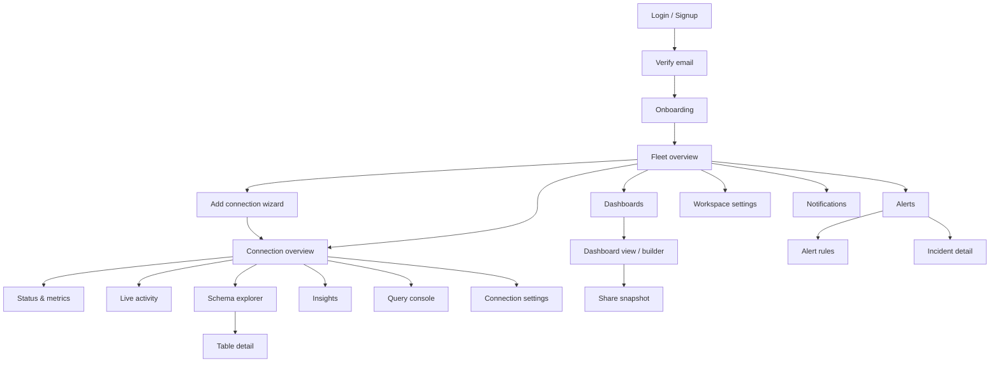

# RideOps Lens — Frontend Wireframes & UX Flows

Companion to `docs/lens-system-design.md`. Low-fidelity ASCII wireframes: layout, content, states and interactions. Visual styling comes from the existing `tokens.css` / `app.css`.

**Legend**

```
[Button]   (•) radio   [x] checkbox   [▾ Select]   [_____] input   [••••] secret input
●  healthy (green)   ◐ degraded (amber)   ○ down/unreachable (red)   ◌ unknown/paused (grey)
▁▂▃▅▇ sparkline     ████░░ bar      ⓘ tooltip      ⋯ overflow menu      ↻ refresh
```
Status is **always icon + text + colour** (never colour alone).

---

## Contents
1. Site map & navigation flow
2. App shell (desktop / tablet / mobile)
3. Auth screens
4. Onboarding (first run)
5. Fleet overview (home)
6. Add connection wizard (4 steps)
7. Connection overview (status)
8. Status & metrics detail
9. Live activity
10. Schema explorer
11. Table detail (overview, columns, profile, preview, stats, changes)
12. Insights
13. Query console
14. Dashboards (list, view, builder, share)
15. Alerts, rules, incidents
16. Connection settings (edit, rotate, thresholds, danger zone)
17. Workspace settings (general, members, channels, tokens, audit, security)
18. Notifications centre
19. Public share snapshot
20. System states (empty, loading, error, permission, capability, offline)
21. Mobile layouts (390 px)
22. Component inventory & interaction rules
23. User journeys (end-to-end flows)

---

## 1. Site map & navigation flow



Primary nav (left sidebar): **Overview · Connections · Dashboards · Alerts · Settings**.
Per-connection tabs: **Overview · Status · Activity · Schema · Insights · Query · Settings**.

---

## 2. App shell

### 2.1 Desktop (≥ 1024 px)
```
┌──────────────────────────────────────────────────────────────────────────────────────┐
│ ◆ RideOps Lens   [▾ Workspace: Chandra's]      🔍 Search tables, connections…  ⌘K   🔔3  (CK)▾ │
├──────────────┬───────────────────────────────────────────────────────────────────────┤
│ ▣ Overview   │  Breadcrumb: Overview / Connections / shop-prod                       │
│ ⛁ Connections│ ┌───────────────────────────────────────────────────────────────────┐ │
│   ● shop-prod│ │                                                                   │ │
│   ◐ crm-mysql│ │                        PAGE CONTENT                               │ │
│   ● rideops  │ │                                                                   │ │
│   + Add      │ │                                                                   │ │
│ ▦ Dashboards │ │                                                                   │ │
│ ⚠ Alerts  (2)│ │                                                                   │ │
│ ⚙ Settings   │ └───────────────────────────────────────────────────────────────────┘ │
│              │                                                                       │
│ ─────────    │                                                                       │
│ ☾ Theme      │                                                                       │
│ ? Docs       │                                                                       │
└──────────────┴───────────────────────────────────────────────────────────────────────┘
```
- The `⌘K` command palette jumps to connections, tables, dashboards and actions ("Add connection", "Run query on…").
- The sidebar lists connections with live status dots (polled every 30 s).
- User menu: Profile, Security (2FA), API tokens, Sign out.

### 2.2 Tablet (640–1023 px)
Sidebar collapses to icons only. Search becomes an icon that opens a full-width overlay.

### 2.3 Mobile (< 640 px)
```
┌──────────────────────────────┐
│ ☰  RideOps Lens     🔍  🔔3  │
├──────────────────────────────┤
│                              │
│        PAGE CONTENT          │
│   (single column, cards)     │
│                              │
├──────────────────────────────┤
│ ▣Home ⛁Conns ▦Dash ⚠Alerts ⚙ │  ← bottom tab bar
└──────────────────────────────┘
```

---

## 3. Auth screens

### 3.1 Sign up
```
┌───────────────────────────────────────────┐
│               ◆ RideOps Lens              │
│   See the health & analytics of any DB.   │
│                                           │
│  Name      [_____________________________]│
│  Email     [_____________________________]│
│  Password  [••••••••••••••••]  👁         │
│            ████████░░ Strong (≥12 chars)  │
│  [x] I agree to Terms & Privacy           │
│                                           │
│  [        Create account        ]         │
│  ─────────────── or ───────────────       │
│  [ Continue with GitHub ] [ Google ]  v1.x│
│                                           │
│  Already have an account? Log in          │
└───────────────────────────────────────────┘
```
Validation is inline. A breached password gives "This password appeared in a breach, choose another."

### 3.2 Log in
```
┌───────────────────────────────────────────┐
│  Email     [_____________________________]│
│  Password  [••••••••••]   Forgot password?│
│  [            Log in             ]        │
│  ⚠ Email or password is incorrect.  (generic)
└───────────────────────────────────────────┘
```
With 2FA enabled (v1.x), the next step shows `Enter 6-digit code [______]  Use recovery code`.

### 3.3 Verify email / Forgot / Reset / Accept invite
```
┌───────────────────────────────┐   ┌───────────────────────────────┐
│ ✉ Check your inbox            │   │ Reset password                │
│ We sent a link to a@b.com     │   │ New password [••••••••]       │
│ [Resend email] (60 s cooldown)│   │ Confirm      [••••••••]       │
└───────────────────────────────┘   │ [Set new password]            │
                                    └───────────────────────────────┘
┌──────────────────────────────────────────────┐
│ You're invited to "Acme Data" as Editor      │
│ by priya@acme.com                            │
│ [Accept & continue]   [Decline]              │
└──────────────────────────────────────────────┘
```

---

## 4. Onboarding (first run)

```
┌───────────────────────────────────────────────────────────────────────────┐
│ Welcome, Chandra 👋  Let's get your first database connected.              │
│                                                                           │
│  Getting started                                    2 / 5 complete         │
│  ✔ Create account                                                         │
│  ✔ Explore the RideOps demo database            [Open demo →]             │
│  ○ Connect your own database                    [Add connection]          │
│  ○ Set up an alert channel (email / Slack)      [Add channel]             │
│  ○ Invite a teammate                            [Invite]                  │
│                                                                           │
│  ┌ Tip ────────────────────────────────────────────────────────────────┐  │
│  │ Use a READ-ONLY database user. We'll give you the exact SQL to       │  │
│  │ create one in the next step.                                         │  │
│  └──────────────────────────────────────────────────────────────────────┘  │
│                                                         [Dismiss checklist]│
└───────────────────────────────────────────────────────────────────────────┘
```
Shown on the Fleet overview until dismissed or complete.

---

## 5. Fleet overview (home)

```
┌───────────────────────────────────────────────────────────────────────────────────────┐
│ Overview                                         [Last 24h ▾]  ↻ 12s ago   [+ Add connection] │
├───────────────────────────────────────────────────────────────────────────────────────┤
│ ┌───────────┐ ┌───────────┐ ┌───────────┐ ┌───────────┐ ┌──────────────┐             │
│ │ ● Healthy │ │ ◐ Degraded│ │ ○ Down    │ │ ⚠ Alerts  │ │ Avg uptime   │             │
│ │    5      │ │    1      │ │    1      │ │ 2 firing  │ │   99.62 %    │             │
│ └───────────┘ └───────────┘ └───────────┘ └───────────┘ └──────────────┘             │
│                                                                                       │
│ Filter: [All states ▾] [All engines ▾] [All envs ▾] [Tags ▾]   🔍[filter by name___]   │
│ View: (•) Table  ( ) Cards                                                            │
│ ┌────────────────────────────────────────────────────────────────────────────────────┐│
│ │ Status      Name           Engine     Env    Score Latency p95  Uptime 24h  Last chk ││
│ │────────────────────────────────────────────────────────────────────────────────────││
│ │ ○ Down      orders-legacy  MySQL 8.0  PROD    —    timeout  ██████████░ 91.2%  1m  ⋯││
│ │             └ CONN_TIMEOUT since 10:42 · Alert firing · [View]                      ││
│ │ ◐ Degraded  crm-mysql      MySQL 8.4  STAGE   68   820 ms ▁▂▅▇▅ ███████████ 99.1% 2m ⋯││
│ │ ● Healthy   shop-prod      PG 17.5    PROD    94    42 ms ▁▁▂▁▁ ████████████ 100% 1m ⋯││
│ │ ● Healthy   rideops (demo) PG 17.5    DEMO    97    18 ms ▁▁▁▁▁ ████████████ 100% 4m ⋯││
│ │ ● Healthy   events-mongo   Mongo 8.0  PROD    90    65 ms ▁▂▁▂▁ ████████████ 100% 3m ⋯││
│ │ ◌ Paused    analytics-mssql SQL 2022  DEV     —      —          —            —    ⋯││
│ └────────────────────────────────────────────────────────────────────────────────────┘│
│  ⋯ menu: Check now · Open query console · Pause · Settings                            │
│                                                                                       │
│ ┌ Recent alerts ───────────────────────────┐ ┌ Insights to review ───────────────────┐│
│ │ ○ CRIT orders-legacy unreachable  10:42  │ │ ⚠ shop-prod: public.orders is stale   ││
│ │ ◐ WARN crm-mysql latency p95 > 500ms 9:10│ │   (last row 3 d ago)                  ││
│ │ [View all alerts]                        │ │ ⓘ crm-mysql: 4 unused indexes (1.2 GB)││
│ └──────────────────────────────────────────┘ │ [View all insights]                   ││
│                                              └───────────────────────────────────────┘│
│ ┌ Recent schema changes ────────────────────────────────────────────────────────────┐ │
│ │ shop-prod  + column public.orders.coupon_code (text)              today 08:02     │ │
│ │ crm-mysql  − table crm.tmp_import                                  yesterday       │ │
│ └───────────────────────────────────────────────────────────────────────────────────┘ │
└───────────────────────────────────────────────────────────────────────────────────────┘
```
- The table is sorted by worst status first. Clicking a row opens Connection overview.
- Card view (also used on mobile) shows one card per connection: status, name, engine logo/text, score ring, sparkline.

---

## 6. Add connection wizard

Stepper: **1 Engine → 2 Details → 3 Security & network → 4 Test & save**. "Paste URL" is available on step 1 and jumps straight to step 2 with fields filled in.

### 6.1 Step 1 — Choose engine or paste URL
```
┌───────────────────────────────────────────────────────────────────────────┐
│ Add connection            ① Engine ─ ② Details ─ ③ Security ─ ④ Test     │
├───────────────────────────────────────────────────────────────────────────┤
│ Paste a connection URL (fastest)                                          │
│ [postgresql://lens_ro@db.example.com:5432/shop?sslmode=verify-full______] │
│ ⓘ Your password will be moved to a secure field and never stored in the URL│
│                                                    [Continue with URL →]  │
│ ─────────────────────────── or choose an engine ───────────────────────── │
│ ┌──────────┐ ┌──────────┐ ┌──────────┐ ┌──────────┐ ┌──────────┐          │
│ │PostgreSQL│ │  MySQL   │ │ MariaDB  │ │SQL Server│ │ MongoDB  │          │
│ │ Neon,RDS │ │PlanetScale│ │          │ │ Azure SQL│ │  Atlas   │          │
│ └──────────┘ └──────────┘ └──────────┘ └──────────┘ └──────────┘          │
│ ┌──────────┐ ┌──────────┐ ┌──────────┐ ┌──────────┐                       │
│ │ SQLite   │ │Snowflake │ │ BigQuery │ │Databricks│   (v2: "Coming soon") │
│ │ upload   │ │  soon    │ │  soon    │ │  soon    │                       │
│ └──────────┘ └──────────┘ └──────────┘ └──────────┘                       │
│                                                              [Cancel]     │
└───────────────────────────────────────────────────────────────────────────┘
```
Parse error (inline): `✗ Can't parse URL. Expected e.g. mysql://user@host:3306/db` with a [See examples] link.

### 6.2 Step 2 — Connection details
```
┌───────────────────────────────────────────────────────────────────────────┐
│ ① Engine ✔ ─ ② Details ─ ③ Security ─ ④ Test          Engine: PostgreSQL │
├───────────────────────────────────────────────────────────────────────────┤
│ Display name *   [shop-prod______________________]                        │
│ Environment      (•) Production  ( ) Staging  ( ) Development             │
│ Host *           [db.example.com_________________]  Port [5432]           │
│ Database *       [shop___________________________]                        │
│ Username *       [lens_ro________________________]                        │
│ Password *       [••••••••••••]  👁   ⓘ Encrypted at rest, never shown again│
│ Tags             [ecommerce ×] [critical ×] [+ add]                        │
│ Check every      [5 minutes ▾]   (1, 5, 15, 60 min)                       │
│                                                                           │
│ ▸ Advanced options (allowlisted)                                          │
│   connect_timeout [10]   target_session_attrs [any ▾]   schema filter [*] │
│                                                                           │
│ Read-only user recommended  ▸ Show SQL to create one                      │
│ ┌─────────────────────────────────────────────────────────── [Copy] ───┐  │
│ │ CREATE ROLE lens_ro LOGIN PASSWORD '<choose>' CONNECTION LIMIT 5;    │  │
│ │ GRANT CONNECT ON DATABASE shop TO lens_ro;                           │  │
│ │ GRANT USAGE ON SCHEMA public TO lens_ro;                             │  │
│ │ GRANT SELECT ON ALL TABLES IN SCHEMA public TO lens_ro;              │  │
│ │ GRANT pg_monitor TO lens_ro;  -- optional, full status metrics       │  │
│ │ ALTER ROLE lens_ro SET default_transaction_read_only = on;           │  │
│ └──────────────────────────────────────────────────────────────────────┘  │
│                                               [← Back]   [Next →]         │
└───────────────────────────────────────────────────────────────────────────┘
```
- **MongoDB:** fields change to `URI / hosts`, `replica set`, `auth source`, `SRV [x]`.
- **SQLite:** a drop zone `⇪ Drop .sqlite / .db (≤ 200 MB)` with an upload progress bar replaces host/user.

### 6.3 Step 3 — Security & network
```
┌───────────────────────────────────────────────────────────────────────────┐
│ ① ✔ ─ ② ✔ ─ ③ Security & network ─ ④ Test                                │
├───────────────────────────────────────────────────────────────────────────┤
│ Encryption (TLS)                                                          │
│  ( ) Require — encrypt, don't verify certificate                          │
│  ( ) Verify CA — encrypt + trusted CA                                     │
│  (•) Verify full — encrypt + CA + hostname   ← recommended for Production │
│  ( ) Disabled  🔒 (blocked by workspace policy)                           │
│  CA certificate (optional)   [⇪ Upload .pem]   rds-ca-2024.pem ✔ ×        │
│  Client certificate (mTLS)   [⇪ cert.pem] [⇪ key.pem]                      │
│                                                                           │
│ How should Lens reach this database?                                      │
│  (•) Directly over the internet                                           │
│      ⓘ Allowlist our IPs in your firewall:  203.0.113.5, 203.0.113.6 [Copy]│
│  ( ) Through an SSH tunnel (bastion)                          v1.x        │
│      SSH host [_________] port [22] user [_____] key [⇪ id_ed25519]        │
│  ( ) Through a Lens Agent in my network                        v2         │
│      [Select agent ▾]  or  [Set up an agent]                              │
│                                               [← Back]   [Next →]         │
└───────────────────────────────────────────────────────────────────────────┘
```

### 6.4 Step 4 — Test & save
```
┌───────────────────────────────────────────────────────────────────────────┐
│ ① ✔ ─ ② ✔ ─ ③ ✔ ─ ④ Test & save                                          │
├───────────────────────────────────────────────────────────────────────────┤
│  [▶ Test connection]                                                      │
│                                                                           │
│  ✔ DNS            db.example.com → 203.0.113.10                   12 ms   │
│  ✔ Network policy public address, port 5432 allowed                0 ms   │
│  ✔ TCP            connected                                      41 ms   │
│  ✔ TLS            TLS 1.3 · cert valid until 01 Mar 2027          63 ms   │
│  ✔ Authentication lens_ro                                        88 ms   │
│  ✔ Database       shop · PostgreSQL 17.5                           9 ms   │
│  ⚠ Privileges     Role can INSERT/UPDATE on 12 tables              31 ms   │
│                   Use a read-only role. [Show fix SQL]                    │
│  ✔ Capabilities   status ✔ sessions ✔ table stats ✔ profiling ✔           │
│                   slow queries ✗ (pg_stat_statements not installed)       │
│                                                                           │
│  ┌ Summary ─────────────────────────────────────────────────────────────┐ │
│  │ Ready to save. 1 warning. Monitoring every 5 min · Production         │ │
│  │ Default alerts: Down (critical) · Latency > 2 s (warning) ·           │ │
│  │ Connections > 90 % (warning)        [x] Apply default alert rules     │ │
│  └──────────────────────────────────────────────────────────────────────┘ │
│                                         [← Back]   [Save connection ✔]   │
└───────────────────────────────────────────────────────────────────────────┘
```
**Failure example** (the stage list stops at the failure and later stages are greyed out):
```
│  ✔ DNS  ✔ Network policy                                                  │
│  ✗ TCP   CONN_TIMEOUT · No response from 203.0.113.10:5432 after 10 s     │
│          Likely causes: firewall not allowlisting 203.0.113.5/.6;         │
│          database not publicly accessible.  [Copy our IPs] [Use SSH tunnel]│
│  ◌ TLS  ◌ Authentication  ◌ Database  ◌ Privileges                        │
│                                        [Edit details]  [Retry test]      │
```
Blocked network: `✗ Network policy · 10.0.3.7 is a private address. Use SSH tunnel or Agent.`
While the test runs, each stage shows a spinner. `aria-live="polite"` announces each stage result.

---

## 7. Connection overview (status)

```
┌───────────────────────────────────────────────────────────────────────────────────────┐
│ ⚠ PRODUCTION database — read-only access                                     (banner) │
│ shop-prod  ● Healthy · Score 94 ⓘ        PostgreSQL 17.5 · db.example.com · shop      │
│ Tags: ecommerce critical      Checked 48 s ago   [↻ Check now] [▶ Query] [⋯]           │
├───────────────────────────────────────────────────────────────────────────────────────┤
│ Overview │ Status │ Activity │ Schema │ Insights (3) │ Query │ Settings               │
├───────────────────────────────────────────────────────────────────────────────────────┤
│ ┌──────────┐ ┌──────────┐ ┌───────────┐ ┌───────────┐ ┌───────────┐ ┌──────────┐      │
│ │Latency p95│ │Uptime 30d│ │Connections│ │ DB size   │ │Cache hit  │ │Repl. lag │      │
│ │  42 ms    │ │ 99.98 %  │ │ 23 / 100  │ │ 48.2 GB   │ │ 99.4 %    │ │  0.8 s   │      │
│ │ ▁▁▂▁▁▂▁  │ │          │ │ ██░░░░ 23%│ │ +1.2%/7d  │ │ ●         │ │ ●        │      │
│ └──────────┘ └──────────┘ └───────────┘ └───────────┘ └───────────┘ └──────────┘      │
│                                                                                       │
│ Uptime (last 30 days)                                                                 │
│ ██████████████████████████▌███   ← each bar = 1 day; hover: % + incidents           │
│                                                                                       │
│ ┌ Health score breakdown ───────────────┐ ┌ Open alerts ──────────────────────────┐  │
│ │ 100 start                             │ │ none ✔                                 │  │
│ │  −5  1 long-running query (> 5 min)   │ └────────────────────────────────────────┘  │
│ │  −1  cache hit 99.4 % (ok)            │ ┌ Data freshness ───────────────────────┐  │
│ │ = 94                                  │ │ ● public.events      2 min ago        │  │
│ └───────────────────────────────────────┘ │ ● public.payments    11 min ago       │  │
│                                           │ ◐ public.orders      3 days ago  ⚠    │  │
│ ┌ Largest tables ───────────────────────┐ │ [All tables →]                         │  │
│ │ public.events     18.1 GB  412 M rows │ └────────────────────────────────────────┘  │
│ │ public.orders      9.4 GB   38 M rows │ ┌ Top insights ─────────────────────────┐  │
│ │ public.payments    6.0 GB   36 M rows │ │ ⚠ orders is stale                     │  │
│ │ [Schema explorer →]                   │ │ ⓘ 3 unused indexes (1.1 GB)           │  │
│ └───────────────────────────────────────┘ │ ⓘ FK payments.order_id not indexed    │  │
│                                           └────────────────────────────────────────┘  │
│ ┌ Recent events ─────────────────────────────────────────────────────────────────────┐│
│ │ 10:05  Schema: + column public.orders.coupon_code                                  ││
│ │ 09:12  State ◐ Degraded → ● Healthy (latency recovered)                            ││
│ │ 08:59  Alert WARN latency p95 > 500 ms fired → auto-resolved 09:12                 ││
│ └────────────────────────────────────────────────────────────────────────────────────┘│
└───────────────────────────────────────────────────────────────────────────────────────┘
```
- Metric cards the connection's capabilities don't support show the **Capability gate** (§20.5).
- ⋯ menu: Pause monitoring, Re-sync schema, Rotate credentials, Copy display URL, Delete.

---

## 8. Status & metrics detail

```
┌───────────────────────────────────────────────────────────────────────────────────────┐
│ Status                       Range: [1h] [24h] [7d] [30d] [Custom…]   Grain: [auto ▾] │
├───────────────────────────────────────────────────────────────────────────────────────┤
│ State timeline                                                                         │
│ ●●●●●●●●●●●◐◐◐●●●●●●●●●●●●●●●●○○●●●●●●●●●●●●●●●  (hover: state, error, duration)      │
│                                                                                       │
│ ┌ Latency (ms) p50 / p95 ──────────────────────────────┐ ┌ Connections ─────────────┐ │
│ │ 900┤          ╭╮                                      │ │100┤- - - - max - - - - -│ │
│ │ 500┤- - - - - ││- - - warn - - - - - - - - - - - -   │ │ 50┤      ╭─╮            │ │
│ │   0┤▁▁▁▁▁▁▁▁▁▁╯╰▁▁▁▁▁▁▁▁▁▁▁▁▁▁▁▁▁▁▁▁▁▁▁▁▁▁▁▁▁▁      │ │  0┤▁▁▁▁▁▁╯ ╰▁▁▁ active/idle│ │
│ └──────────────────────────────────────────────────────┘ └──────────────────────────┘ │
│ ┌ Cache hit ratio ───────────┐ ┌ Commits / rollbacks per s ┐ ┌ Replication lag (s) ──┐ │
│ │ chart                      │ │ chart                      │ │ chart                 │ │
│ └────────────────────────────┘ └────────────────────────────┘ └───────────────────────┘ │
│ ┌ Deadlocks ─────────────────┐ ┌ DB size growth ───────────┐ ┌ XID age % (PG only) ──┐ │
│ │ chart                      │ │ chart                      │ │ chart                 │ │
│ └────────────────────────────┘ └────────────────────────────┘ └───────────────────────┘ │
│                                                                                       │
│ Check history                                                     [Export CSV]        │
│ Time       State       Latency  Score  Error                                          │
│ 10:41:02   ● Healthy    41 ms    94     —                                              │
│ 10:36:01   ● Healthy    44 ms    94     —                                              │
│ 09:02:00   ○ Unreach.   —        —      CONN_TIMEOUT (10 s)                [details]   │
│ [Load more]                                                                           │
└───────────────────────────────────────────────────────────────────────────────────────┘
```
Threshold lines come from the connection thresholds. Clicking a point on a chart opens that snapshot's details in a side drawer.

---

## 9. Live activity

Requires the `SESSIONS` capability and the Editor role or higher.
```
┌───────────────────────────────────────────────────────────────────────────────────────┐
│ Activity (live)            Auto-refresh [10 s ▾]  ⏸     Sessions: 23 (active 4, idle 19)│
├───────────────────────────────────────────────────────────────────────────────────────┤
│ Long-running queries (> 5 min)                                                         │
│ PID    User      App        Runtime  State    Query (truncated, literals masked)       │
│ 48211  etl_user  airflow    07:42    active   UPDATE orders SET status = ? WHERE …     │
│                                                                                       │
│ Blocking chains                                                                       │
│ 48211 (etl_user) ──blocks──▶ 48390 (api_user) waiting 00:41 on relation orders        │
│                                                                                       │
│ All sessions                            [Filter state ▾] [Filter user ▾]              │
│ PID   User     Client IP     App         State   Since    Wait event                  │
│ …                                                                                     │
│ ⓘ Lens is read-only: it cannot cancel or kill sessions. Copy the PID to act yourself.  │
└───────────────────────────────────────────────────────────────────────────────────────┘
```

---

## 10. Schema explorer

```
┌───────────────────────────────────────────────────────────────────────────────────────┐
│ Schema      Last synced 2 h ago [↻ Sync now]   142 tables · 1,903 columns  [ER diagram]│
├─────────────────────────────┬─────────────────────────────────────────────────────────┤
│ 🔍 [search tables/columns_] │ public  ·  48 tables                [Sort: Size ▾]       │
│ ▾ shop (database)           │ ┌─────────────────────────────────────────────────────┐ │
│   ▾ public (48)             │ │ Name        Kind   Rows (est)  Size    Fresh   Pin  │ │
│     ▤ events                │ │ events      table  412 M       18.1 GB ● 2m    ☆    │ │
│     ▤ orders          ★     │ │ orders      table   38 M        9.4 GB ◐ 3d    ★    │ │
│     ▤ payments              │ │ payments    table   36 M        6.0 GB ● 11m   ☆    │ │
│     ◫ v_daily_sales  (view) │ │ customers   table  1.2 M        0.9 GB ● 1h    ☆    │ │
│   ▸ analytics (31)          │ │ v_daily_sales view    —            —     —     ☆    │ │
│   ▸ staging (63)            │ │ …                                                   │ │
│                             │ └─────────────────────────────────────────────────────┘ │
│ Legend: ▤ table ◫ view      │ Search hits for "email": customers.email 🔒PII,          │
│ ◩ mat. view ⧉ collection    │                           leads.contact_email 🔒PII      │
└─────────────────────────────┴─────────────────────────────────────────────────────────┘
```
Mongo shows **collections** with "inferred fields (from 1,000 sampled docs)".
ER diagram (v1.x) is a zoomable canvas of tables connected by FK lines, filterable by schema.

---

## 11. Table detail

Header shared by all tabs:
```
┌───────────────────────────────────────────────────────────────────────────────────────┐
│ shop-prod / public / orders   ★ pinned       ◐ Stale (last row 3 days ago)            │
│ Overview │ Columns │ Profile │ Preview │ Stats history │ Changes                       │
└───────────────────────────────────────────────────────────────────────────────────────┘
```

### 11.1 Overview tab
```
│ ┌──────────┐┌──────────┐┌──────────┐┌──────────┐┌──────────┐┌──────────────┐          │
│ │Rows (est)││Exact rows││Table size││Index size││Dead rows ││Last analyze  │          │
│ │ 38.2 M   ││[Count ▶] ││ 7.1 GB   ││ 2.3 GB   ││ 4.2 %    ││ 2 h ago      │          │
│ └──────────┘└──────────┘└──────────┘└──────────┘└──────────┘└──────────────┘          │
│ Rows per day (created_at, last 90 d)          Freshness column: [created_at ▾]        │
│ 600k┤      ▃▅▇▇▆▅▇▇▆▅▆▇▇▆▅▇▇▆▅▆▇▇▆▅▆▇▇▆▅▆▇▇▆▅▆▇▇▆▅▆▇▇▆▅▁▁▁  ← drop = stale            │
│ Scans: seq 1,204 · index 3.4 M     Writes/day: ins 410k · upd 120k · del 2k           │
│ Primary key: id     Foreign keys: customer_id → customers.id, …                       │
│ Indexes: orders_pkey (1.1 GB, 3.4M scans) · idx_orders_status (0.4 GB, 0 scans ⚠)     │
│ [Create alert for this table ▾]  (freshness · row drop · schema change)               │
```
The exact count needs a confirmation: "Runs COUNT(*) on ~38 M rows (est. 6–20 s). Continue?" It's disabled when the estimate is over the limit.

### 11.2 Columns tab
```
│ #  Column        Type          Null  Default        PK/FK      Flags         Null % │
│ 1  id            bigint        no    nextval(…)     PK                        0.0 % │
│ 2  customer_id   bigint        no                   FK→cust.                  0.0 % │
│ 3  email         text          yes                             🔒 PII         2.1 % │
│ 4  status        text          no    'new'                     low-card       0.0 % │
│ 5  total_amount  numeric(10,2) no                                             0.0 % │
│ 6  created_at    timestamptz   no    now()                     ⏱ freshness    0.0 % │
│ 7  coupon_code   text          yes                             NEW today     98.7 % │
│ PII flags: [Edit] (Editor+) — mark/unmark columns as sensitive                       │
```

### 11.3 Profile tab
```
│ Profile · sampled 10,000 of ~38.2 M rows (TABLESAMPLE SYSTEM) · 2 h ago  [↻ Re-profile ▾ sample 10k] │
│ ┌ status (text) ─────────────────────┐ ┌ total_amount (numeric) ─────────────────────┐ │
│ │ null 0 % · distinct 5              │ │ null 0 % · min 0.50 · max 9,980 · mean 64.2 │ │
│ │ delivered ██████████████ 61 %      │ │ p50 38 · p95 210 · stddev 88                │ │
│ │ shipped   ██████ 22 %              │ │     ▇▇▅▃▂▁▁▁▁▁  histogram (20 bins)         │ │
│ │ new       ███ 10 %                 │ │                                             │ │
│ │ cancelled ██ 6 %  returned ▏1 %    │ └─────────────────────────────────────────────┘ │
│ └────────────────────────────────────┘ ┌ created_at (timestamptz) ───────────────────┐ │
│ ┌ email (text) 🔒 PII ───────────────┐ │ min 2019-02-01 · max 2026-11-20 (3 d ago ⚠)  │ │
│ │ null 2.1 % · distinct ≈ 9,800      │ │ ▁▂▃▅▆▇▇▇▇▇▆▁  daily (sampled)               │ │
│ │ pattern: email 99.2 %              │ └─────────────────────────────────────────────┘ │
│ │ length avg 22 · max 64             │                                                │
│ │ values hidden (PII)  [Reveal] Ed+  │   [Export profile JSON]                        │
│ └────────────────────────────────────┘                                                │
```
While profiling, cards show skeletons with "Profiling… sampling rows (step 2/3)" and a [Cancel] button.

### 11.4 Preview tab
```
│ First 50 rows · PII masked  [Reveal PII] (audited)   [Open in Query console]         │
│ id      customer_id  email              status     total_amount  created_at        │
│ 991203  55120        j•••@•••.com       delivered  42.10         2026-11-20 08:01  │
│ …                                                                                    │
```

### 11.5 Stats history tab
Charts of rows (est), total size, index size and dead rows % over 90 d, plus a growth table (7 d / 30 d %).

### 11.6 Changes tab
```
│ When           Change            Object                         Before → After      │
│ today 08:02    column_added      orders.coupon_code             — → text NULL       │
│ 12 Nov 14:20   index_added       idx_orders_status              — → btree(status)   │
│ 02 Nov 03:00   type_changed      orders.total_amount            numeric → numeric(10,2) │
```

---

## 12. Insights

```
┌───────────────────────────────────────────────────────────────────────────────────────┐
│ Insights (7)          [All severities ▾] [All types ▾]  [ ] Show dismissed             │
├───────────────────────────────────────────────────────────────────────────────────────┤
│ ⚠ WARNING  Table is stale — public.orders                                             │
│   Newest created_at is 3 days old; typical gap is 2 min.                              │
│   → Check the ETL job that loads orders.   [Create freshness alert] [Dismiss]          │
│ ⚠ WARNING  Lens user has write privileges                                             │
│   lens_ro can INSERT/UPDATE 12 tables. → [Show read-only SQL]                         │
│ ⓘ INFO     3 unused indexes (1.1 GB)                                                  │
│   idx_orders_status, idx_events_tmp, idx_pay_legacy  (0 scans since stats reset)      │
│   → Consider dropping after confirming with the team.            [Copy names] [Dismiss]│
│ ⓘ INFO     Foreign key without index — payments.order_id                              │
│ ⓘ INFO     Table without primary key — staging.raw_clicks                             │
└───────────────────────────────────────────────────────────────────────────────────────┘
```
Lens never executes recommendations; it only advises.

---

## 13. Query console

```
┌───────────────────────────────────────────────────────────────────────────────────────┐
│ Query · shop-prod (PostgreSQL)   🔒 Read-only · limit [1000 ▾] · timeout 30 s          │
├──────────────────────────┬────────────────────────────────────────────────────────────┤
│ Saved queries  [+ New]   │ ┌───────────────────────────────────────────────────────┐  │
│ 🔍[filter_____]          │ │ 1  SELECT status, count(*) AS orders,                 │  │
│ ▤ Daily orders     ★     │ │ 2         sum(total_amount) AS revenue                │  │
│ ▤ Top customers          │ │ 3  FROM public.orders                                 │  │
│ ▤ Refund rate            │ │ 4  WHERE created_at > now() - interval '7 days'       │  │
│                          │ │ 5  GROUP BY status ORDER BY orders DESC;              │  │
│ Schema  🔍[_______]      │ │    ↳ autocomplete: tables/columns from catalog        │  │
│ ▸ public                 │ └───────────────────────────────────────────────────────┘  │
│   ▸ orders               │ ✔ Valid read-only SELECT · touches: public.orders          │
│     id, status, …        │ [▶ Run ⌘↵] [Explain] [Save] [Format]   History ▾          │
│ (click to insert)        ├────────────────────────────────────────────────────────────┤
│                          │ Results · 5 rows · 412 ms     [Table] [Chart]  [Export CSV]│
│                          │ status     orders   revenue                                 │
│                          │ delivered  281,033  18,402,110.20                           │
│                          │ shipped     98,120   6,210,880.00                           │
│                          │ …                                                           │
│                          │ [Add to dashboard ▾]                                        │
└──────────────────────────┴────────────────────────────────────────────────────────────┘
```
**Rejected query:**
```
│ ✗ QUERY_NOT_READONLY — Only SELECT, WITH, EXPLAIN and SHOW are allowed.               │
│   Found: DELETE at line 1. Lens never modifies your database.                         │
```
**Truncated:** `⚠ Showing first 1,000 rows (more available). Add filters or raise limit (max 10,000).`
**Running:** progress bar with elapsed time and [Cancel]. **Timeout:** `✗ QUERY_TIMEOUT after 30 s.`
**Chart toggle:** pick X / Y / series columns, then line or bar.
**Mongo console:** the editor switches to JSON with `collection [orders ▾]`, `operation (•) find ( ) aggregate`.

---

## 14. Dashboards

### 14.1 List
```
┌───────────────────────────────────────────────────────────────────────────┐
│ Dashboards                                            [+ New dashboard]   │
│ ┌────────────────────┐ ┌────────────────────┐ ┌────────────────────┐      │
│ │ ⚡ shop-prod (auto) │ │ Sales overview      │ │ RideOps demo        │      │
│ │ 8 widgets          │ │ 6 widgets · 15 min ↻│ │ 12 widgets          │      │
│ │ updated 2 m ago    │ │ by Priya            │ │ built-in            │      │
│ └────────────────────┘ └────────────────────┘ └────────────────────┘      │
└───────────────────────────────────────────────────────────────────────────┘
```

### 14.2 View
```
┌───────────────────────────────────────────────────────────────────────────────────────┐
│ Sales overview      Refreshed 4 min ago [↻]  Auto: [15 min ▾]  [Edit] [Share] [⋯]      │
├───────────────────────────────────────────────────────────────────────────────────────┤
│ ┌ Revenue 7d (KPI) ┐ ┌ Orders 7d (KPI) ┐ ┌ shop-prod status ┐ ┌ Uptime 30d ─────────┐ │
│ │ ₹ 2.48 Cr ▲ 6 %  │ │ 391,204 ▲ 3 %   │ │ ● Healthy 94     │ │ ███████████▌███     │ │
│ └──────────────────┘ └─────────────────┘ └──────────────────┘ └─────────────────────┘ │
│ ┌ Daily orders (line) ───────────────────────────┐ ┌ Orders by status (bar) ─────────┐ │
│ │ chart                                          │ │ chart                           │ │
│ └────────────────────────────────────────────────┘ └─────────────────────────────────┘ │
│ ┌ Top customers (table) ────────────────────────────────────────────────────────────┐ │
│ │ table                                                                             │ │
│ └───────────────────────────────────────────────────────────────────────────────────┘ │
└───────────────────────────────────────────────────────────────────────────────────────┘
```
Each widget shows a small "as of 10:32" stamp and a ⚠ icon if its last refresh failed (hover shows the error code).

### 14.3 Builder (edit mode)
```
┌───────────────────────────────────────────────────────────────────────────────────────┐
│ Editing: Sales overview                                    [Cancel] [Save dashboard]   │
├────────────────────────────┬──────────────────────────────────────────────────────────┤
│ Add widget                 │  (12-column grid; drag to move, drag corner to resize)   │
│ [KPI] [Line] [Bar] [Table] │  ┌──────────┐┌──────────┐                                 │
│ [Status] [Uptime] [Text]   │  │ KPI  ⠿ ✎×││ KPI  ⠿ ✎×│                                 │
│                            │  └──────────┘└──────────┘                                 │
│ Widget settings (selected) │  ┌──────────────────────┐                                 │
│ Title  [Daily orders____]  │  │ Line        ⠿ ✎ ×    │                                 │
│ Source (•) Saved query     │  └──────────────────────┘                                 │
│        [Daily orders ▾]    │                                                          │
│        ( ) Connection metric│                                                         │
│        [shop-prod ▾][latency ▾]                                                       │
│ X [day ▾]  Y [orders ▾]    │                                                          │
│ Series [— none ▾]          │                                                          │
│ Format [number ▾] Thresholds [>__ warn] [>__ crit]                                    │
└────────────────────────────┴──────────────────────────────────────────────────────────┘
```
On mobile the builder is read-only, with the message "Edit dashboards on a larger screen."

### 14.4 Share dialog
```
┌──────────────────────────────────────────────┐
│ Share a snapshot                             │
│ Creates a static, read-only copy of current  │
│ results. No live DB access, no credentials.  │
│ Expires in  [7 days ▾]                       │
│ [x] Mask PII  (forced on)                    │
│ [Create link]                                │
│ https://lens…/share/8fK…   [Copy]  [Revoke]  │
└──────────────────────────────────────────────┘
```

---

## 15. Alerts, rules, incidents

### 15.1 Alerts list
```
┌───────────────────────────────────────────────────────────────────────────────────────┐
│ Alerts     [Firing (2)] [Acknowledged (1)] [Resolved] [Muted]      [Rules] [Channels]  │
├───────────────────────────────────────────────────────────────────────────────────────┤
│ Sev   Connection      Rule                         Opened     Duration  Actions        │
│ ○CRIT orders-legacy   DB down (2 checks)           10:42      18 m      [Ack][Mute▾][⋯]│
│       CONN_TIMEOUT · incident INC-2026-005 · runbook: lens-target-down                 │
│ ◐WARN crm-mysql       Latency p95 > 500 ms (3 chk) 10:51      9 m       [Ack][Mute▾]   │
└───────────────────────────────────────────────────────────────────────────────────────┘
```

### 15.2 Rule editor (drawer)
```
┌ New alert rule ──────────────────────────────────────────────┐
│ Name        [Orders freshness________________]               │
│ Applies to  (•) One connection [shop-prod ▾]  ( ) All        │
│ Type        [Freshness ▾]                                    │
│             Status · Metric · Freshness · Row drop ·          │
│             Schema change · Privilege drift                   │
│ ── Condition ──────────────────────────────────────────────  │
│ Table [public.orders ▾]   Column [created_at ▾]              │
│ Alert if newest row is older than [120] [minutes ▾]          │
│ For [2] consecutive checks                                   │
│ Severity  ( ) Info  (•) Warning  ( ) Critical                │
│ Notify    [x] In-app [x] Email: team@… [ ] Slack #data-ops   │
│ Runbook URL [https://…_____________]                         │
│ Preview: "Would have fired 3 times in the last 7 days"       │
│ [Send test notification]          [Cancel] [Save rule]       │
└──────────────────────────────────────────────────────────────┘
```
The **Metric** type shows `Metric [latency_ms ▾] [p95 ▾] [> ▾] [2000]`. The **Status** type shows state checkboxes.

### 15.3 Rules list
Table of rule, type, scope, severity, channels and enabled toggle. Default rules are marked "default".

### 15.4 Notification channels
```
│ Channel          Type     Target                       Verified   ⋯  │
│ Team email       Email    team@acme.com                ✔          ⋯  │
│ #data-ops        Slack    hooks.slack.com/…/•••        ✔          ⋯  │
│ PagerDuty proxy  Webhook  https://hooks.acme.com/…     ✗ [Verify] ⋯  │
│ [+ Add channel]  (webhook secret shown once for HMAC verification)  │
```

### 15.5 Incident detail
```
┌───────────────────────────────────────────────────────────────────────────────────────┐
│ INC-2026-005 · orders-legacy unreachable           ○ Open · CRIT   [Acknowledge][Resolve]│
├───────────────────────────────────────────────────────────────────────────────────────┤
│ Timeline                                   │ Details                                  │
│ 10:42 Alert fired (CONN_TIMEOUT)           │ Connection: orders-legacy (MySQL 8.0)    │
│ 10:43 Email + Slack sent                   │ Rule: DB down (2 checks)                 │
│ 10:50 Acked by Chandra                     │ Runbook: lens-target-down.md  [Open]     │
│ 10:52 Note: "RDS maintenance window"       │ Related checks: [View status 10:30–now]  │
│ [Add note______________________] [Post]    │                                          │
└───────────────────────────────────────────────────────────────────────────────────────┘
```

---

## 16. Connection settings

```
┌───────────────────────────────────────────────────────────────────────────────────────┐
│ Settings · shop-prod                                                                   │
├───────────────────────────────────────────────────────────────────────────────────────┤
│ General                                                                               │
│  Name [shop-prod]  Environment [Production ▾]  Tags [...]  Colour [● ▾]               │
│  Check interval [5 min ▾]   Monitoring  [● On / Pause]                                │
│                                                                                       │
│ Connection                                                                            │
│  postgresql://lens_ro@db.example.com:5432/shop?sslmode=verify-full  (no password)     │
│  [Edit host/port/db/TLS]  → requires re-test before save                              │
│                                                                                       │
│ Credentials                                                                           │
│  Password ••••••••  last rotated 12 Sep 2026        [Rotate credentials] (Admin)       │
│  CA certificate: rds-ca-2024.pem (expires 2027-03-01) [Replace]                        │
│                                                                                       │
│ Thresholds (health score & default alerts)                                            │
│  Latency warn [500] ms  crit [2000] ms   Connections warn [80] % crit [95] %          │
│  Replication lag warn [30] s crit [300] s  Freshness default [7] days                 │
│                                                                                       │
│ Data & privacy                                                                        │
│  Schemas to include [public, analytics ×] (empty = all)   PII auto-detect [On]        │
│  Profile sample size [10,000 ▾]                                                       │
│                                                                                       │
│ ┌ Danger zone ───────────────────────────────────────────────────────────────────────┐│
│ │ Delete connection — removes credentials immediately; history kept 7 days.          ││
│ │ [Delete connection…] → dialog: type "shop-prod" to confirm                         ││
│ └────────────────────────────────────────────────────────────────────────────────────┘│
└───────────────────────────────────────────────────────────────────────────────────────┘
```
**Rotate credentials dialog:** new password (plus an optional new username) → [Test & rotate], which shows the stage list. The old secret is kept if the test fails.

---

## 17. Workspace settings

Tabs: **General · Members · Channels · API tokens · Audit log · Security**

### 17.1 Members
```
│ Members (4)                                               [Invite member]           │
│ Name            Email               Role          Joined      ⋯                     │
│ Chandra K       chandra@…           Owner         Nov 2026                          │
│ Priya S         priya@acme.com      [Admin ▾]     Nov 2026    Remove                │
│ Rahul M         rahul@acme.com      [Viewer ▾]    Nov 2026    Remove                │
│ (pending)       sam@acme.com        Editor        invited 2d  Resend · Revoke       │
```

### 17.2 API tokens (v1.x)
```
│ Name          Scopes         Prefix        Last used   Expires    ⋯                 │
│ CI pipeline   read           lens_ab12…    1 h ago     2027-01-01 Revoke            │
│ [+ New token]  → token shown ONCE: lens_ab12_•••••••• [Copy]                         │
```

### 17.3 Audit log
```
│ Filters: [Action ▾] [User ▾] [From/To]                               [Export CSV]   │
│ Time        User     Action             Target              IP            Details   │
│ 10:50:12    Chandra  alert.ack          INC-2026-005        49.36.x.x     …         │
│ 10:31:40    Priya    query.run          shop-prod           103.21.x.x    hash 9f3… │
│ 09:02:11    Priya    pii.reveal         shop-prod.orders    103.21.x.x    email     │
│ 08:00:01    Chandra  secret.rotate      shop-prod           49.36.x.x     —         │
```

### 17.4 Security (Owner)
```
│ [ ] Allow unencrypted (TLS disabled) connections      ⚠ not recommended            │
│ [ ] Allow private network addresses (self-hosted only)                             │
│ Extra allowed ports [_____]                                                        │
│ Egress IPs to allowlist: 203.0.113.5, 203.0.113.6 [Copy]                           │
│ Require 2FA for all members (v1.x) [ ]                                             │
│ Session length [7 days ▾]   [Sign out all sessions]                                │
│ Data retention: raw checks [7 d ▾] hourly [90 d ▾] daily [365 d ▾]                 │
│ [Export workspace data]  [Delete workspace…]                                       │
```

---

## 18. Notifications centre

```
┌ 🔔 Notifications ────────────── [Mark all read] ┐
│ ● ○ orders-legacy is unreachable        2 m     │
│ ● ⚠ public.orders is stale              1 h     │
│   ✔ Profile ready: public.orders        2 h     │
│   👤 Priya joined Acme Data              1 d     │
│ [View all]                                      │
└─────────────────────────────────────────────────┘
```

---

## 19. Public share snapshot

```
┌───────────────────────────────────────────────────────────────────────────┐
│ ◆ RideOps Lens · Shared snapshot of "Sales overview"                      │
│ Captured 23 Nov 2026 10:32 IST · expires 30 Nov · read-only, static data  │
├───────────────────────────────────────────────────────────────────────────┤
│   (widgets rendered from stored results, no refresh, no navigation)       │
└───────────────────────────────────────────────────────────────────────────┘
```
Expired or revoked links show "This snapshot is no longer available."

---

## 20. System states

### 20.1 Empty states
```
┌──────────────────────────────────────────────┐   ┌───────────────────────────────────┐
│            ⛁                                 │   │  No alerts firing ✔               │
│   No connections yet                         │   │  You'll be notified on: email,    │
│   Connect a database to see its health and   │   │  Slack #data-ops   [Edit channels]│
│   analytics, or explore the demo first.      │   └───────────────────────────────────┘
│   [+ Add connection]  [Open RideOps demo]    │
└──────────────────────────────────────────────┘
```
Other empty states: no tables ("This database has no tables in the selected schemas"), no profile yet ([Profile table]), no saved queries, no dashboards, no insights ("Looking good ✔").

### 20.2 Loading
Skeleton cards and rows that match the final layout. Charts show a shimmer. Waits over 3 s show context text ("Waiting for first health check… usually < 10 s").

### 20.3 Error
```
┌──────────────────────────────────────────────┐
│ ✗ Couldn't load status                       │
│ CONN_TIMEOUT · The database didn't respond.  │
│ Request ID req_01J8… [Copy]                  │
│ [Retry]   [View troubleshooting]             │
└──────────────────────────────────────────────┘
```
API outage (Lens itself): top banner `⚠ Lens is having trouble reaching its server. Retrying…`.

### 20.4 Permission
`🔒 You need Editor access to run queries. Ask a workspace admin.` (buttons disabled with a tooltip, not hidden, so users understand why).

### 20.5 Capability gate
```
┌ Replication lag ─────────────────────┐
│  Not available                       │
│  Needs the pg_monitor role.          │
│  [Show GRANT SQL]                    │
└──────────────────────────────────────┘
```

### 20.6 Stale / offline data
The header shows `Data as of 10:32 (monitoring paused: host was asleep 10:33–10:51)`. Charts show the gap as a hatched region.

### 20.7 Paused connection
A grey banner reads `◌ Monitoring paused by Priya on 20 Nov. [Resume]`. Charts show history only.

### 20.8 Toasts
Success: "Connection saved". Info: "Schema sync started". Error: code + message. Each toast lasts 5 s and has an action where relevant (Undo for dismissals).

---

## 21. Mobile layouts (390 px)

### 21.1 Fleet overview
```
┌──────────────────────────────┐
│ ☰ Overview          🔍  🔔3  │
├──────────────────────────────┤
│ ●5  ◐1  ○1   ⚠2 alerts       │
│ [All states ▾] [Engines ▾]   │
│ ┌──────────────────────────┐ │
│ │ ○ Down · orders-legacy   │ │
│ │ MySQL · PROD             │ │
│ │ CONN_TIMEOUT · 18 m      │ │
│ │ [View] [Ack alert]       │ │
│ └──────────────────────────┘ │
│ ┌──────────────────────────┐ │
│ │ ● shop-prod      94  ◔   │ │
│ │ PG 17.5 · PROD           │ │
│ │ 42 ms ▁▁▂▁▁  100 %       │ │
│ └──────────────────────────┘ │
│ [+ Add connection]           │
├──────────────────────────────┤
│ ▣  ⛁  ▦  ⚠  ⚙               │
└──────────────────────────────┘
```

### 21.2 Connection overview
```
┌──────────────────────────────┐
│ ← shop-prod        ↻   ⋯     │
│ ● Healthy · 94 · PG 17.5     │
│ ‹Overview Status Schema Q…›  │ ← horizontally scrollable tabs
├──────────────────────────────┤
│ ┌───────────┐┌───────────┐   │
│ │Latency 42 ││Uptime 99.9│   │ ← 2-column metric grid
│ └───────────┘└───────────┘   │
│ ┌───────────┐┌───────────┐   │
│ │Conns 23%  ││Size 48 GB │   │
│ └───────────┘└───────────┘   │
│ Uptime 30d ███████████▌██    │
│ Freshness                    │
│ ● events 2m  ◐ orders 3d     │
│ Insights (3) ›               │
└──────────────────────────────┘
```

### 21.3 Add connection (mobile)
One wizard step per screen, with a sticky bottom bar `[Back] [Next]`. The stage checklist is full-width. Pasting a URL is the primary action.

### 21.4 Tables → cards
Wide `DataTable`s turn into stacked cards: key fields at the top, the rest in a "More" expander.

### 21.5 Query console (mobile)
The editor sits on top with results below (Table and Chart tabs). The schema browser opens as a bottom sheet, and a "Run" FAB is shown.

---

## 22. Component inventory & interaction rules

| Component | Props / behaviour | States |
|---|---|---|
| `StatusBadge` | `state`, `size`; icon+label+colour; tooltip with last error | healthy/degraded/down/unreachable/auth_failed/tls_error/paused/unknown |
| `HealthScore` | ring 0–100; click → breakdown popover | ≥80 green, 50–79 amber, <50 red, null grey |
| `MetricCard` | title, value, unit, delta, sparkline, threshold | normal, warn, crit, unavailable (CapabilityGate), loading |
| `UptimeBar` | buckets with % + incidents tooltip | full/partial/down/no-data (hatched) |
| `TimeRangePicker` | presets + custom; syncs URL query | — |
| `StageChecklist` | ordered stages, live updates, aria-live | pending/running/ok/warn/fail/skipped |
| `SecretInput` | never prefilled; show/hide; clears on unmount | — |
| `CodeBlock` | syntax highlight, copy button | — |
| `DataTable` | virtualised, sort, filter, column resize, card mode < 640 px, CSV export | empty/loading/error |
| `SqlEditor` | CodeMirror; dialect; catalog autocomplete; ⌘↵ run; live validation | valid/invalid/running |
| `ChartWidget` | line/bar/histogram/KPI; "sampled" badge; as-of stamp | loading/error/stale |
| `ConfirmDangerDialog` | type-to-confirm name | — |
| `EnvBanner` | PROD warning bar | prod/staging/dev/demo |
| `PiiMask` | masks values; reveal (Editor+) logs audit | masked/revealed |
| `CapabilityGate` | renders child only if capability present; else reason + fix | — |
| `EmptyState`, `ErrorState`, `Skeleton`, `Toast` | standardised | — |

**Interaction rules**
1. Polling: the fleet list and connection overview refresh every 30 s, but only while the tab is visible. Activity refreshes every 10 s. Polling pauses in background tabs.
2. Destructive actions always use a confirmation dialog. Delete connection needs type-to-confirm.
3. Secrets are never displayed after save. The UI shows `••••••••` plus the last-rotated date.
4. Every server error shows its `code`, a readable message and a request id (copyable).
5. Long operations (sync, profile, query) are async jobs with progress, cancellation and a notification when done.
6. Keyboard: `⌘K` palette, `g o` overview, `g c` connections, `/` focuses search, `⌘↵` runs a query, `Esc` closes drawers.
7. Time is shown in the user's timezone (IST), with UTC in the tooltip. Relative times ("2 m ago") are used under 24 h.
8. Numbers use locale formatting (Indian grouping optional: `1,20,000`), byte sizes in KB/MB/GB, and large counts as 38.2 M.
9. Colour contrast is at least 4.5:1, and every chart has a data-table fallback ("View as table").
10. Deep links: every tab, filter and time range is encoded in the URL for sharing inside the workspace.

---

## 23. User journeys (end-to-end flows)

### J1 — First connection (target: under 2 minutes)
Sign up → verify email → onboarding → **Add connection** → paste URL → enter password → Next → TLS stays "Verify full" → **Test**: all ✔ except ⚠ privileges → copy the read-only SQL and create `lens_ro` in their own SQL client → edit the username and password → re-test: all ✔ → Save → land on Connection overview, where metrics fill in after the first check (under 10 s) and the schema syncs in the background (toast "142 tables found").

### J2 — "Is my DB okay?" (daily check)
Open app → Fleet overview, sorted worst-first → one ◐ degraded → click → health breakdown shows "−25 latency p95 820 ms" → Status tab latency chart shows a spike at 09:00 → Activity tab shows a long-running ETL query blocking others → copy the PID and act in their own tool.

### J3 — Understand an unfamiliar table
Schema → search "orders" → Table detail Overview (size, rows, freshness ◐ stale) → Profile → [Profile table] → charts appear in about 15 s → Preview (masked) → "Open in Query console" → write an aggregate → Save query → Add to dashboard.

### J4 — Get alerted & resolve
Rule: freshness on `orders` older than 120 min → ETL fails → after 2 checks the alert fires → email and Slack arrive → open the incident from the link → Ack → add a note → ETL fixed → the next 2 checks are healthy → auto-resolved → resolve notification sent → the incident timeline is complete.

### J5 — Team & sharing
Settings → Members → invite Rahul as Viewer → Rahul sees dashboards and status but query and preview buttons are disabled with a tooltip → Chandra shares a snapshot link of "Sales overview" with an external stakeholder (7-day expiry, PII masked).

### J6 — Rotate credentials / offboard a DB
Connection settings → Rotate credentials → new password → Test & rotate ✔ → audit entry. Later: Danger zone → type the name → deleted, credentials shredded, history purged after 7 d.

### J7 — Blocked/unsafe input (security UX)
User pastes `postgresql://admin@10.0.0.5/db` → test stops at "Network policy ✗ private address" with options [Use SSH tunnel] [Set up agent] [Self-host Lens]. In the query console, the user types `DROP TABLE x` and gets an inline ✗ before running, with the Run button disabled.
