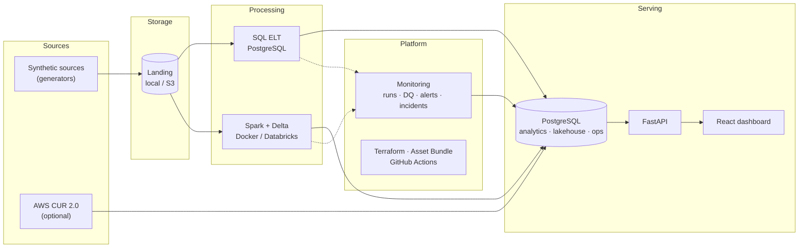

# RideOps Architecture

Implementation status for each component is in [../PROJECT_STATUS.md](../PROJECT_STATUS.md).
For the path of a single record, see [data-flow.md](data-flow.md).

## 1. Design goals

1. **Runs locally for free.** Every core feature runs on a laptop with Python, Node and Docker.
2. **Cloud is optional and honest.** AWS, Databricks and real billing data are opt-in. Code that has not
   run in the cloud is labelled "cloud verification pending".
3. **One source of truth per concern.** Business rules live in tested functions and SQL files. Pipeline
   metadata lives in `ops`. Cost rows carry their `source`.
4. **Testable by design.** Transformations are pure functions (DataFrame in, DataFrame out). SQL is executed in CI.

## 2. System context

## 3. Components

| Component | Code | Responsibility |
|---|---|---|
| Generators | `pipelines/src/rideops/generators/` | 10 reproducible synthetic datasets with exact-count defects and a manifest |
| Storage | `pipelines/src/rideops/storage/` | Local / S3 backends, idempotent checksum-based sync |
| SQL pipeline | `pipelines/src/rideops/ingestion/`, `pipelines/src/rideops/db/`, `pipelines/sql/` | Incremental COPY load, watermark + MERGE ELT, gold, 18 DQ checks, 45 analytics queries |
| Lakehouse | `pipelines/src/rideops/spark/` | Bronze (file streams), silver (foreachBatch MERGE), gold (CDF), streaming windows, DQ, export |
| Databricks | `databricks/` | Asset Bundle, Lakeflow Jobs, DLT, Auto Loader notebooks, Unity Catalog, system-table SQL |
| Monitoring | `pipelines/src/rideops/monitoring/`, `monitoring/` | Run tracking, alert rules, incidents, runbooks, simulated incident |
| Costs | `pipelines/src/rideops/costs/`, `ops.cloud_costs` | Simulated costs, CUR 2.0 loader, anomalies, budget |
| API | `backend/src/rideops_api/` | REST endpoints, pooling, uniform errors, real retry runner |
| Dashboard | `frontend/` | 8 pages, typed client, validated chart palette, responsive |
| Infrastructure | `infra/terraform/`, `docker-compose.yml`, `backend/`, `render.yaml` | AWS resources, local stack, container images, hosting config |
| CI | `.github/workflows/` | Lint, unit, PostgreSQL integration, Spark, frontend, Terraform |

## 4. Key decisions (ADRs)

**ADR-001: Separate Git repository.** The Desktop folder was itself a repository, so RideOps has its own,
keeping personal files out of the project's history.

**ADR-002: Two processing paths, reconciled.** The SQL warehouse path shows SQL engineering (MERGE, window
functions, constraints). The Spark path shows the lakehouse. Both implement the same rules, and
`ops.reconcile_lakehouse_daily()` proves they agree: 0 of 540 date×city cells differ, with identical
totals (99,187 bookings, ₹13,095,490.51).

**ADR-003: PostgreSQL as the serving and metadata store.** The API never starts Spark. Gold is small and
indexed in Postgres, and operational metadata is transactional, row-level data.

**ADR-004: Spark in Docker on Windows.** Confirmed in Phase 3. Native Spark on Windows needs Hadoop
binaries. The `pipelines/Dockerfile` image (Python 3.11, Java 17, PySpark 4.2.0, delta-spark 4.4.1) matches CI.

**ADR-005: The retry endpoint runs real work or refuses.** Only whitelisted local pipelines can run, and
only when `RETRY_RUNNER_ENABLED=true`. Otherwise the API returns 409 or 400 with the reason. It never
fakes a success.

**ADR-006: Cost data is labelled per row.** `source` ∈ {simulated, aws_cur, databricks_system_tables}.
The UI shows "SIMULATED".

**ADR-007: Repair field-level problems, quarantine untrusted rows.** A malformed email is set to NULL and
flagged; the customer is kept. A negative fare or an orphan key moves the row to quarantine. Throwing away
a whole entity for one bad attribute loses good data.

**ADR-008: Incremental everywhere.** Ingestion log and watermarks (SQL), checkpoints (Spark), Change Data
Feed (gold). Re-runs with no new data do no work, which is tested.

**ADR-009: Filters in the URL, colour by entity.** Dashboard filters live in query parameters, so views are
shareable. Chart colours follow the entity (city), never its rank, and the palette is validated for
colour-vision deficiency in both themes.

**ADR-010: Free hosting stack.** Cloudflare Pages (static), Render (Docker API), Neon (Postgres, no
30-day expiry). The limits were checked on 2026-11-19 and are listed in `deployment.md`.

## 5. Environments

| Environment | Storage | Compute | Database | Status |
|---|---|---|---|---|
| `local` | `./data` | Spark in Docker | Postgres in Docker | Running and verified |
| `local` app stack | – | API + nginx containers | Postgres in Docker | Verified (12/12 checks) |
| `dev` (cloud) | S3 via Terraform | Databricks bundle `-t dev` | Neon / RDS | Prepared, not applied |
| `prod` | S3 | Databricks Jobs as a service principal | Managed Postgres | Documented |

## 6. Security

See [security.md](security.md): no secrets in code, least-privilege IAM scoped by prefix, Unity Catalog
roles with masks and row filters, bound SQL parameters, non-root containers, TLS-only buckets.
