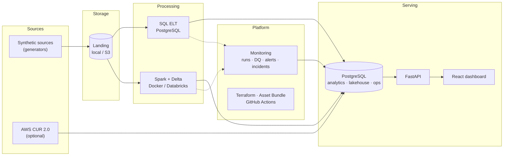
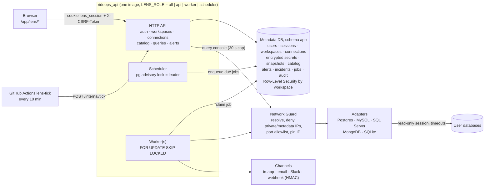

# RideOps Architecture

Implementation status for each component is in [../PROJECT_STATUS.md](../PROJECT_STATUS.md).
For the path of a single record, see [data-flow.md](data-flow.md).

The system has two parts in one codebase:

* **The RideOps data platform** (sections 2–5): pipelines, warehouse, lakehouse, monitoring and the
  analytics dashboard for the fictional ride-booking company.
* **RideOps Lens** (section 7): an opt-in, multi-tenant layer that lets users connect *their own*
  databases and monitor, explore and query them. It runs inside the same FastAPI service and React app,
  keeps its own metadata in a separate `app` schema, and uses the RideOps warehouse only as a read-only
  demo connection. Full design: [ReContruction/lens-system-design.md](ReContruction/lens-system-design.md).

## 1. Design goals

1. **Runs locally for free.** Every core feature runs on a laptop with Python, Node and Docker.
2. **Cloud is optional and honest.** AWS, Databricks and real billing data are opt-in. Code that has not
   run in the cloud is labelled "cloud verification pending".
3. **One source of truth per concern.** Business rules live in tested functions and SQL files. Pipeline
   metadata lives in `ops`. Cost rows carry their `source`.
4. **Testable by design.** Transformations are pure functions (DataFrame in, DataFrame out). SQL is executed in CI.

## 2. System context

## 3. Components

| Component | Code | Responsibility |
|---|---|---|
| Generators | `pipelines/src/rideops/generators/` | 10 reproducible synthetic datasets with exact-count defects and a manifest |
| Storage | `pipelines/src/rideops/storage/` | Local / S3 backends, idempotent checksum-based sync |
| SQL pipeline | `pipelines/src/rideops/ingestion/`, `pipelines/src/rideops/db/`, `pipelines/sql/` | Incremental COPY load, watermark + MERGE ELT, gold, 18 DQ checks, 45 analytics queries |
| Lakehouse | `pipelines/src/rideops/spark/` | Bronze (file streams), silver (foreachBatch MERGE), gold (CDF), streaming windows, DQ, export |
| Databricks | `databricks/` | Asset Bundle, Lakeflow Jobs, DLT, Auto Loader notebooks, Unity Catalog, system-table SQL |
| Monitoring | `pipelines/src/rideops/monitoring/`, `monitoring/` | Run tracking, alert rules, incidents, runbooks, simulated incident |
| Costs | `pipelines/src/rideops/costs/`, `ops.cloud_costs` | Simulated costs, CUR 2.0 loader, anomalies, budget |
| API | `backend/src/rideops_api/` | REST endpoints, pooling, uniform errors, real retry runner |
| Dashboard | `frontend/` | 8 pages, typed client, validated chart palette, responsive |
| Lens | `backend/src/rideops_api/{auth,workspaces,jobs,lens,notifications}/`, `frontend/src/lens/` | Accounts, workspaces, connections to external databases, monitoring, analytics, alerts (section 7) |
| Infrastructure | `infra/terraform/`, `docker-compose.yml`, `backend/`, `render.yaml` | AWS resources, local stack, container images, hosting config |
| CI | `.github/workflows/` | Lint, unit, PostgreSQL integration, Spark, frontend, Terraform |

## 4. Key decisions (ADRs)

**ADR-001: Separate Git repository.** The Desktop folder was itself a repository, so RideOps has its own,
keeping personal files out of the project's history.

**ADR-002: Two processing paths, reconciled.** The SQL warehouse path shows SQL engineering (MERGE, window
functions, constraints). The Spark path shows the lakehouse. Both implement the same rules, and
`ops.reconcile_lakehouse_daily()` proves they agree: 0 of 540 date×city cells differ, with identical
totals (99,187 bookings, ₹13,095,490.51).

**ADR-003: PostgreSQL as the serving and metadata store.** The API never starts Spark. Gold is small and
indexed in Postgres, and operational metadata is transactional, row-level data.

**ADR-004: Spark in Docker on Windows.** Confirmed in Phase 3. Native Spark on Windows needs Hadoop
binaries. The `pipelines/Dockerfile` image (Python 3.11, Java 17, PySpark 4.2.0, delta-spark 4.4.1) matches CI.

**ADR-005: The retry endpoint runs real work or refuses.** Only whitelisted local pipelines can run, and
only when `RETRY_RUNNER_ENABLED=true`. Otherwise the API returns 409 or 400 with the reason. It never
fakes a success.

**ADR-006: Cost data is labelled per row.** `source` ∈ {simulated, aws_cur, databricks_system_tables}.
The UI shows "SIMULATED".

**ADR-007: Repair field-level problems, quarantine untrusted rows.** A malformed email is set to NULL and
flagged; the customer is kept. A negative fare or an orphan key moves the row to quarantine. Throwing away
a whole entity for one bad attribute loses good data.

**ADR-008: Incremental everywhere.** Ingestion log and watermarks (SQL), checkpoints (Spark), Change Data
Feed (gold). Re-runs with no new data do no work, which is tested.

**ADR-009: Filters in the URL, colour by entity.** Dashboard filters live in query parameters, so views are
shareable. Chart colours follow the entity (city), never its rank, and the palette is validated for
colour-vision deficiency in both themes.

**ADR-010: Free hosting stack.** Cloudflare Pages (static), Render (Docker API), Neon (Postgres, no
30-day expiry). The limits were checked on 2026-11-19 and are listed in `deployment.md`.

## 5. Environments

| Environment | Storage | Compute | Database | Status |
|---|---|---|---|---|
| `local` | `./data` | Spark in Docker | Postgres in Docker | Running and verified |
| `local` app stack | – | API + nginx containers | Postgres in Docker | Verified (12/12 checks; 18/18 with Lens) |
| Hosted app + Lens | – | Render (API, `LENS_ROLE=all`), Cloudflare Pages | Neon (warehouse + `app` schema) | Prepared, not deployed |
| `dev` (cloud) | S3 via Terraform | Databricks bundle `-t dev` | Neon / RDS | Prepared, not applied |
| `prod` | S3 | Databricks Jobs as a service principal | Managed Postgres | Documented |

## 6. Security

See [security.md](security.md): no secrets in code, least-privilege IAM scoped by prefix, Unity Catalog
roles with masks and row filters, bound SQL parameters, non-root containers, TLS-only buckets. Lens adds
authentication, CSRF, RBAC, Row-Level Security, encrypted connection secrets and SSRF protection.

## 7. RideOps Lens

### 7.1 Context

### 7.2 Modules

| Module | Code | Responsibility |
|---|---|---|
| Migrations | `backend/src/rideops_api/migrations/` (Alembic, 5 revisions) | `app` schema: identity, connections + RLS, analytics, alerts, uploads |
| Auth | `auth/` | Sign-up, email verification, login (Argon2id), server-side hashed sessions, CSRF double submit, password reset, login rate limits |
| Workspaces | `workspaces/`, `audit.py` | Workspaces, members, invitations, roles owner/admin/editor/viewer, workspace settings (egress allowlist, ports, insecure TLS opt-in), audit log |
| Jobs | `jobs/` | Postgres job queue with idempotency keys, retries with backoff, heartbeats and a reaper; scheduler for recurring work (health checks, schema sync, stats, roll-ups, retention, dashboard refresh) |
| Connections | `lens/connections/` | URL parsing, staged connection test, create/update/pause/delete/restore, quotas, demo connection seeding, SQLite uploads |
| Security | `lens/security/` | AES-256-GCM envelope encryption with a versioned key ring (`rotate-keys`), Network Guard (SSRF) |
| Adapters | `lens/adapters/` | One contract per engine: test, status snapshot, catalog, stats, profile, read-only query |
| Status | `lens/status/` | Health check job, 0–100 score and state model, uptime, hourly/daily roll-ups, retention |
| Catalog + profiling | `lens/catalog/`, `lens/profiling/` | Schema sync and change detection, freshness, PII detection, sampled profiles and auto-charts |
| Queries | `lens/queries/` | sqlglot AST guard (only reads), Mongo JSON guard, limits, masking, saved queries, CSV export, dashboards |
| Insights | `lens/insights/` | 12 rules (missing indexes on FKs, duplicate indexes, stale tables, over-privileged role, weak TLS, …) |
| Alerts | `lens/alerts/` | Rules, default rule pack, evaluation after each check, de-duplication, auto-resolve, maintenance windows, incidents, channels |
| Notifications | `notifications/email.py` | Console (dev), SMTP or Resend; failures are logged and never fail the request |
| Hardening | `hardening.py`, `routers/lens_system.py` | Log redaction, security headers, rate limits, request metrics, `/healthz`, `/readyz`, `/metrics`, `/internal/tick` |
| UI | `frontend/src/lens/` | Auth pages, fleet overview, add-connection wizard, connection, schema, table, insights, query, dashboards, alerts, incidents, channels, notifications |

### 7.3 Key decisions

**ADR-011: Lens lives in the same service, behind a flag.** `LENS_ENABLED=false` leaves the original app
untouched. One image runs as API, worker or scheduler (`LENS_ROLE`), or all three in one process, which
is what a single free Render instance needs.

**ADR-012: Postgres is the queue.** Jobs use `FOR UPDATE SKIP LOCKED`; the scheduler elects a leader with
`pg_try_advisory_xact_lock`. No Redis or broker to host, and job state is transactional with the data it changes.

**ADR-013: Server-side sessions, not JWTs.** Sessions are stored hashed and can be revoked (logout,
password reset signs out everywhere). Cookies are `HttpOnly`, `SameSite=Lax`, `Secure` in production; the
Cloudflare Pages Function proxies `/api` so the dashboard and API share one origin.

**ADR-014: Defence in depth for tenancy.** Every query is scoped by workspace in code, and Postgres
Row-Level Security (`app.workspace_id` set per transaction) blocks cross-workspace reads if a query forgets.
Another workspace's resources return 404, not 403.

**ADR-015: Secrets are encrypted, never returned.** Connection passwords are envelope-encrypted with a data
key per secret, bound to workspace and connection (AAD). The API shows a redacted `display_url` only.

**ADR-016: The network is hostile.** A connection URL is untrusted input. The Network Guard resolves the
host once, rejects private, loopback, link-local and metadata addresses (unless the workspace allowlists a
host or `ALLOW_PRIVATE_NETWORKS=true`) and pins the IP, so DNS rebinding can't redirect the connection.

**ADR-017: Read-only, twice.** Queries are parsed and only reads are allowed; the target session is also
opened read-only with statement timeouts, so a guard bug still cannot write.

**ADR-018: Operator-configured demo.** The demo connection URL (`RIDEOPS_DEMO_URL`) comes from the operator,
uses a dedicated read-only role and can never see the `app` schema or role-password catalogs. It is exempt
from the workspace's TLS opt-in so a local Docker Postgres without TLS works.

### 7.4 How a health check flows

1. The scheduler enqueues `health_check` for each connection whose interval is due (idempotency key per slot).
2. A worker claims it, loads the connection, decrypts the secret and asks the Network Guard for a pinned IP.
3. The engine adapter opens a short read-only session and returns a status snapshot (latency, sessions,
   locks, size, replication, cache hit, …).
4. Scoring turns the snapshot into a 0–100 score and a state; the snapshot is stored and roll-ups are
   updated hourly/daily.
5. Alert rules for the connection are evaluated; new alerts notify the workspace's channels, critical ones open an
   incident, and two clean checks resolve them.

### 7.5 Process roles

| `LENS_ROLE` | Runs | Use |
|---|---|---|
| `all` (default) | API + worker + scheduler threads | local development, a single free instance |
| `api` | HTTP only | scale the API separately |
| `worker` | `python -m rideops_api worker` | more check throughput |
| `scheduler` | `python -m rideops_api scheduler` | one per deployment (extra ones stay idle thanks to the lock) |
