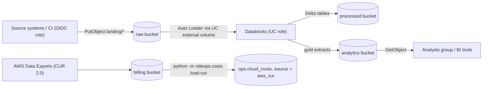

# AWS Setup (optional)

> **Status:** Terraform passes `fmt` and `validate` (AWS provider 6.73, Terraform 1.17.2, run in Docker).
> It has **not been applied** to a real account. The S3 code is tested against `moto`, an AWS mock.
> Nothing in this project creates AWS resources unless you run `terraform apply` yourself.

## What gets created

| Resource | Purpose | Cost at RideOps' data volume |
|---|---|---|
| 3 S3 buckets: `raw`, `processed`, `analytics` | Landing zone, lakehouse storage, BI extracts | Cents per month (a few hundred MB) |
| Bucket baseline | Block public access, SSE-S3 encryption, TLS-only policy, `BucketOwnerEnforced` | Free |
| Versioning + lifecycle on `raw` | Recover deleted/overwritten files; move to IA after 30 days and Glacier IR after 90; abort stale multipart uploads | Reduces cost |
| IAM policies `landing-writer`, `pipeline`, `analytics-read` | Least privilege, scoped by bucket and prefix | Free |
| IAM group `analysts` | Access via group membership, never per-user policies | Free |
| AWS Budget (monthly, tag-filtered) | Email at 80% forecast and 100% actual | Free (first 2 budgets) |
| *Optional* Unity Catalog IAM role | Databricks reads/writes the buckets (ExternalId + self-assume trust) | Free |
| *Optional* GitHub OIDC provider + CI role | CI gets 1-hour credentials; no access keys stored in GitHub | Free |
| *Optional* CUR 2.0 data export + billing bucket | Real daily billing data for `ops.cloud_costs` | Export is free; S3 storage is cents |

## Required permissions for the deploying identity

The identity that runs `terraform apply` needs permission to create the resources above. Granting
`AdministratorAccess` would work, but least privilege is better: attach
[`infra/terraform/deployer-policy.json`](../infra/terraform/deployer-policy.json) to the deploying IAM user
or role. It only allows managing S3 buckets, IAM policies, groups and roles, and budgets whose names start
with `rideops-` (plus the optional GitHub OIDC provider).

AWS console → IAM → Users → *your user* → Add permissions → Create inline policy → JSON → paste the file.

> First real apply (2026-11-19, account `…5280`, ap-south-2): the plan was correct (25 to add), but the
> deploying user lacked `s3:CreateBucket`, `iam:CreateGroup` and `budgets:ModifyBudget`, so nothing was
> created. It also surfaced a real bug that `validate` cannot catch: S3 tag values may not contain `(),`.
> Both are fixed: the tag text has been corrected, and the deployer policy is above.

## Steps

```bash
# 0. Credentials: use SSO / a named profile, never long-lived keys in files you commit.
aws sso login --profile rideops-dev          # or: aws configure --profile rideops-dev
export AWS_PROFILE=rideops-dev

# 1. Review the plan (read-only: shows what WOULD be created)
cd infra/terraform
cp environments/dev.tfvars.example environments/dev.tfvars   # git-ignored
terraform init
terraform plan -var-file=environments/dev.tfvars -out=dev.plan

# 2. Apply only after reading the plan
terraform apply dev.plan

# 3. Point the app at the bucket and upload landing files
export RIDEOPS_S3_RAW_BUCKET=$(terraform output -raw raw_bucket)
python -m rideops.storage sync --dry-run
python -m rideops.storage sync
python -m rideops.storage ls landing/bookings
```

Without Docker, use the same Terraform version the project was validated with (1.17.x).
To check the configuration without installing Terraform:

```bash
docker run --rm -v "$PWD/infra/terraform:/tf" -w /tf hashicorp/terraform:1.17.2 init -backend=false
docker run --rm -v "$PWD/infra/terraform:/tf" -w /tf hashicorp/terraform:1.17.2 validate
```

## Avoiding unexpected charges

1. **Read `terraform plan` before every apply.** It lists every resource that will be created.
2. Keep `monthly_budget_usd` low in dev, and set `budget_alert_emails`.
3. Everything optional is **off** by default (`enable_*` variables).
4. Do not enable NAT gateways, KMS customer keys, or always-on compute for this project. None are needed.
5. Tear down dev completely with `terraform destroy -var-file=environments/dev.tfvars`. Dev buckets have
   `force_destroy = true`, so they are deleted together with their objects.
6. Region: `ap-south-2` (Hyderabad) is the default because it is close to the user. Any region works.

## How the pieces connect


