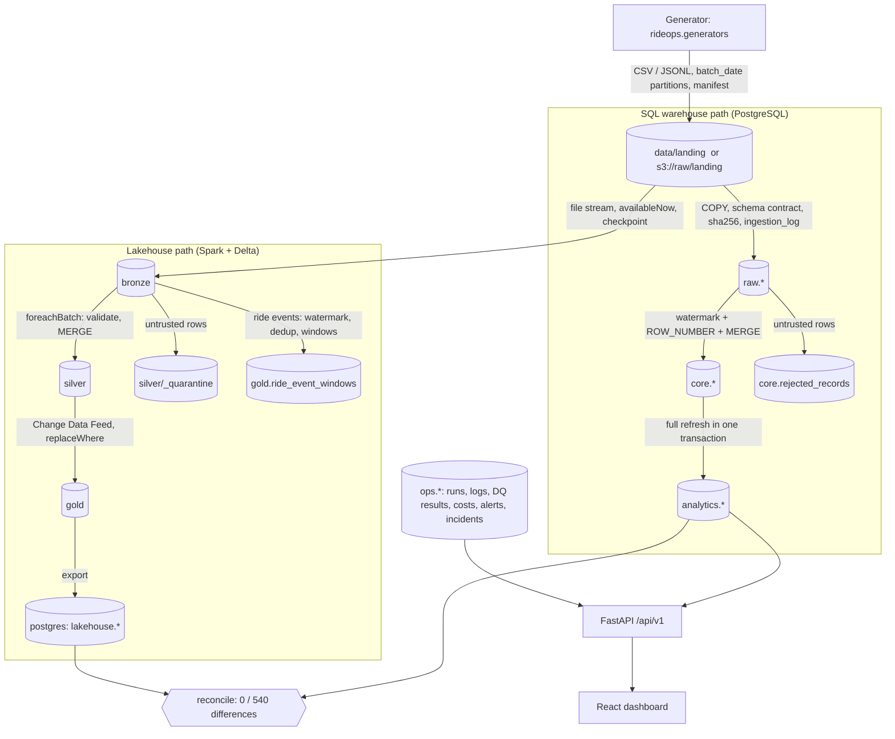

# Data Flow

How one booking travels from a source file to a number on the dashboard, in both processing paths.

## Layer contracts

| Layer | Table examples | Contains | Guarantees |
|---|---|---|---|
| Landing | `landing/bookings/batch_date=2026-10-31/bookings_20261031_0001.csv` | Files exactly as delivered | Immutable; written atomically (temp file, then rename) |
| Raw / Bronze | `raw.bookings`, `bronze/bookings` | Every row, as text, plus `_source_file`, `_batch_id`, `_ingested_at` | Append-only; each file loaded exactly once (ingestion log / checkpoint) |
| Core / Silver | `core.bookings`, `silver/bookings` | Typed, validated, one row per key (latest `updated_at`), `dq_flags` | PK unique; FK/CHECK constraints; untrusted rows quarantined with a reason |
| Analytics / Gold | `analytics.daily_city_summary`, `gold/daily_city_summary` | Business aggregates | Totals reconcile with core/silver (tested) |
| Ops | `ops.pipeline_runs`, `ops.data_quality_results`, `ops.cloud_costs` | Platform metadata | Every real run recorded, even if it fails |

## Following one defect through the system

1. The generator corrupts booking `BKG-0051311` to fare `-103.89`. The manifest counts it under `invalid`.
2. Landing → raw: loaded as the text `"-103.89"`. Raw never rejects values, so nothing is lost.
3. Raw → core: the `invalid fare_amount` rule fires, and the row goes to `core.rejected_records` with the
   original record as JSON.
4. Bronze → silver (Spark): the same rule sends the row to `silver/_quarantine`.
5. The `bookings_reject_reasons` check (WARN, within 2%) and the dashboard's Data Quality page show it.
6. Its payment rows reference a booking that is not in core, so they are quarantined too (`unknown booking_id`).
   The `payments_orphan_booking` check measures this.

## Timing and incrementality

| Step | Incremental by | Re-run cost when nothing changed |
|---|---|---|
| Load to raw | `ops.ingestion_log` (file path) | Lists files only |
| Raw → core | `ops.transform_watermarks` (`_loaded_at`) | Empty staging tables |
| Bronze | Streaming checkpoint (file list) | 0 rows (tested) |
| Silver | Delta streaming checkpoint (table version) | 0 rows (tested) |
| Gold daily tables | Change Data Feed since last version | Skipped (tested); a changed file rebuilds only its dates (tested) |
| Streaming windows | Checkpoint + state store | Only new events |

## Volumes (full scale, measured 2026-11-18/19)

| Dataset | Rows | After cleaning |
|---|---|---|
| Bookings | 101,000 (1,000 duplicates) | 99,187 kept + 813 quarantined |
| Payments | 86,905 | 84,924 kept + 1,121 quarantined |
| Ride events | 372,918 in 92 daily files | 153,598 window rows (15-min × city × type) |
| App events | 355,970 | 321 funnel rows (day × platform) |
| Pipeline runs (simulated history) | 938 | + real local runs |
| Cloud cost line items (simulated) | 2,240 | 2,207 kept |
